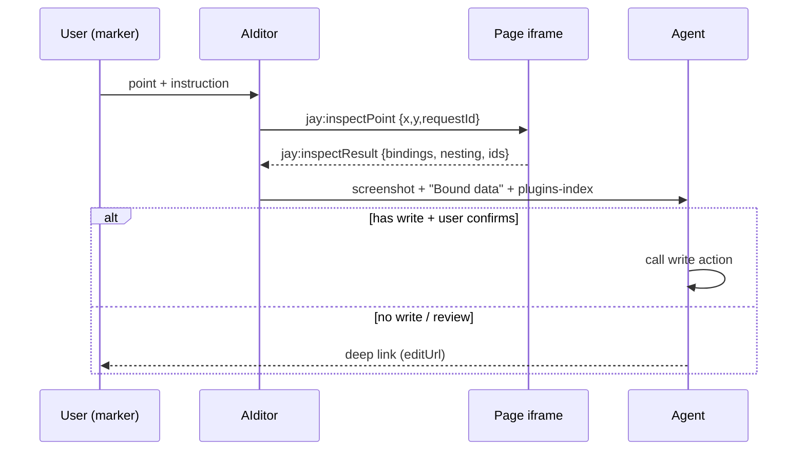

# Design Log #219 — Source Editing (edit contract-bound data at its source)

Status: **[Design]**

## Decisions for the Implementer (TL;DR)

1. **Feature = Source Editing.** When a user points at text/image bound via a contract, the agent can (a) write the new value at the source via a plugin action, or (b) hand the user a deep link to the source system's editor. Static (unbound) content keeps today's flow: the agent edits jay-html.
2. **Contracts declare editability** in a first-class `editing:` block (contract root, tag-level override). Not `ContractTag.meta` — it is `Record<string,string>`, untyped, and unread. ✅ (`contract.ts:25`)
3. **`editing:` flows into `plugins-index.yaml`** (agent-kit generation, DL#85/#125). That is the agent's only discovery channel; no new agent-side mechanism.
4. **Binding inspector = dev-only embed-mode postMessage API**, same pattern as freeze: parent sends `jay:inspectPoint`, page replies `jay:inspectResult`. Returns the bindings under the point, the contract nesting, and ViewState ids (`trackBy` values) — not just a coordinate. ✅ pattern (`generate-client-script.ts:225-240`)
5. **Dev-mode markers are required.** `jay-coordinate` is emitted only where interactivity/Kindergarten needs it, not on every bound element. ✅ (`jay-html-compiler-server.ts:74`) So dev mode must also emit a binding marker (`jay-bind`) on every element with a data binding.
6. **v1 write path = existing server actions** (`.jay-action`) invoked from the agent's Bash via the dev-server action endpoint, with a user-visible confirm (old → new, record). MCP exposure is plugin space (DL#215), deferred.
7. **Prevention first:** validate that `editing.write` names a declared plugin action and that `editing` field/tag names exist in the contract.
8. **Slow phase is a non-issue:** dev mode renders from jay-html before slow resolution (confirmed by author).
9. **AIditor side is a companion DL in the aiditor repo** (marker → inspect → "Bound data" prompt block → confirm UI). This DL covers only the jay repo.

---

## Background

AIditor (`/Users/yoav/work/jay/aiditor`) gives the agent a marker screenshot + the agent-kit; the agent edits jay-html well. A marker carries only a normalized viewport position (`aiditor-notes.ts`); the agent infers bindings from jay-html + screenshot. ⚠️ (sampled, `page.ts` not read in full)

## Problem

For `{productPage.productName}` the agent can find the tag, but not: which **record** it is, what the **source system's write path** is, or where the **editor URL** is. Editing the jay-html would hard-code content the contract owns.

## Prior Art / Adjacent Mechanisms

| Mechanism | Verdict |
| --- | --- |
| `jay-coordinate` (DL#103/#106/#126) | Identifies DOM position; conditional emission, no tag/record mapping → **constrains**, insufficient alone |
| `runtime-automation` `getPageState()` | ViewState + refs only; no data-bound text/images → **extend**, not replace |
| Freeze postMessage (DL#128) | **Reuse pattern** for the inspector |
| Plugin `actions[]` / `.jay-action` | **Reuse as write path**; no tag↔action link today |
| `ContractTag.meta` | Unstructured strings → insufficient for a nested block |
| `plugins-index.yaml` / agent-kit (DL#85/#125) | **Reuse as discovery** |
| DL#215 (MCP/REST = plugin space) | Constrains: no core MCP in v1 |

**Null hypothesis checked:** match the pointed element's text against ViewState values (no compiler change). Rejected: duplicates (`price` = `salePrice`), images, `forEach` items are ambiguous. Binding markers are cheap and exact.

## Questions and Answers

1. **Name?** Source Editing. (Reverse lookup = the resolver only; CMS implies Jay owns storage.) — *Answered.*
2. **Dashboard URL home?** Declared with the contract, emitted into `plugins-index.yaml`. — *Answered.*
3. **Site-level `editUrl` placeholders (`{siteId}`)** — from project config or plugin service? — *Open.*
4. **Image writes:** `kind: image` passes a media URL; upload via the plugin's own command (e.g. `wix-media upload-public`). Confirm per plugin. — *Open.*

## Design

```yaml
# product-page.jay-contract
name: product-page
editing:
  entity: product
  id: "{productId}"            # expression over ViewState/params identifying the record
  write: updateProduct         # plugin action: { id, field, value }
  editUrl: "https://www.wix.com/dashboard/{siteId}/store/products/{id}"
tags:
  - tag: productName
    editing: { field: name, kind: text }
  - tag: mediaGallery
    editing: { field: media, kind: image }
```



**Inspect result** (per binding under the point, innermost first):
`{ expr, kind: text|attr:<name>|if|forEach, contract, key, tagPath, instancePath: [{contract,key,trackBy}], value }`. Multi-field elements (`{price} {currency}`) return all bindings; the agent decides.

**Marker:** dev-only `jay-bind="<expr>;…"` on every element with a data binding (text, attributes); ancestors' `forEach` items supply `trackBy` ids. Resolver walks up from `elementFromPoint`.

**Agent decision rule** (agent-kit guide): static text → edit jay-html; bound + `editing.write` → write action after confirm; bound without `write` → `editUrl`; bound without either → say read-only and name the source.

## Implementation Plan

1. `editing` in contract types + parser + docs (`compiler-jay-html/lib/contract/`), `contract-file-format.md`.
2. Validation: `write` ∈ plugin actions; tag/field names exist.
3. `plugins-index.yaml` emits `editing` (stack-cli agent-kit).
4. Dev-mode `jay-bind` emission (server + hydrate + element targets).
5. Inspector in client script (`generate-client-script.ts`, embed mode only).
6. Agent-kit guide `source-editing.md` (designer + plugin roles).
7. Prototype: `updateProduct` + `editing` for `wix-stores` (wix repo, own DL) and a live onsko-shop example.
8. Companion DL in aiditor.

## Scope pre-mortem (not handled)

Production-mode editing (dev only); rich-text field kinds beyond a `kind` tag (defer); per-call auth/permissions on write actions (DL#215 hooks); Wix write actions themselves (wix repo DL); composed/computed bindings beyond returning all contributing bindings (defer).

## Verification

- Compiler fixtures: dev output with `jay-bind`, `toEqual` + `prettifyHtml` across element/server/hydrate targets.
- Parser + validate tests for `editing` (fixtures in `test/fixtures/`).
- Dev-server test: `jay:inspectPoint` on text, image, `forEach` item, nested headless instance.
- Live example: onsko-shop — change a product name via write action; get the deep link when `write` is absent.

## Trade-offs

First-class `editing:` adds contract surface but gets validation and typing; `meta` would be free but unchecked. Dev markers add dev-only DOM noise in exchange for exact resolution. Bash-invoked actions are the smallest v1 but need the confirm step to stay safe.

## Claims

✅ verified: `meta` type; freeze postMessage; conditional `jay-coordinate`.
⚠️ assumed (verify before implementing): `forEach` `trackBy` recoverable from ancestors in dev DOM; hydrate target can carry `jay-bind`; dev-server action endpoint is callable from the worker's Bash.
