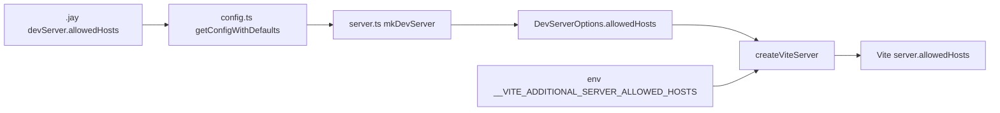

# DL#220 — Dev-server allowed hosts (remote/cloud preview)

## Decisions for the Implementer (TL;DR)

- **Problem:** The Jay dev server runs Vite in middleware mode. Vite's dev-server host check (the
  "Blocked request. This host is not allowed." 403, added in the Vite 5.4.12 security patch) rejects any
  request whose `Host` header is not `localhost`. Cloud preview proxies (Base44 sandbox, Codespaces,
  Gitpod, etc.) forward an external `Host`, so the dev server 403s. Today the only escape hatch is a
  hand-written `src/pages/vite.config.ts` that the nested Vite happens to read because our `root` is
  `src/pages` — an undocumented gap, not a feature.
- **Fix (two prongs, both merged into Vite `server.allowedHosts`):**
  1. **`.jay` config** — new `devServer.allowedHosts?: string[] | true`. A list of allowed hosts (Vite
     host-suffix syntax, e.g. `.mysandbox.dev`), or `true` to disable the check entirely.
  2. **Env passthrough** — `createViteServer` reads `process.env.__VITE_ADDITIONAL_SERVER_ALLOWED_HOSTS`
     (comma-separated) and merges it in. This is **Vite's own convention** (honored natively only in
     Vite 6); our nested Vite 5.4 ignores it, so we read it ourselves. Net effect: a platform that
     already sets that env var (Base44 does) works with **zero config files and zero `.jay` edits**.
- **Merge semantics:** final `allowedHosts` = `.jay` list ∪ env list. If **either** resolves to `true`,
  the check is disabled (`allowedHosts: true`). If both are empty/unset → leave `server.allowedHosts`
  **undefined** (Vite default = `localhost` only). No behavior change for existing projects.
- **Threading (all seams already exist):** `.jay` → `config.ts` (`JayConfig.devServer.allowedHosts` +
  `getConfigWithDefaults`) → `server.ts` (pass into `mkDevServer`) → `DevServerOptions.allowedHosts`
  (`dev-server-options.ts`) → `createViteServer({ allowedHosts })` (`dev-server.ts:1445`) → Vite
  `server: { allowedHosts }` (`vite-factory.ts:49`).
- **Do NOT** hardcode any vendor env-var name (no `BASE44_*`) in framework code. Only the generic Vite
  convention var is read.
- **Remove the workaround:** once shipped, the `src/pages/vite.config.ts` host hack is unnecessary.
  Document the config in the devops agent-kit guide.
- **Scope:** dev server only. Production serving (`jay-stack serve`) is a separate Express/Node server
  with no Vite host check — out of scope.

## Background

`mkDevServer` (`packages/jay-stack/dev-server/lib/dev-server.ts`) builds a single Vite server in
middleware mode via the shared factory `createViteServer`
(`packages/jay-stack/dev-server/lib/vite-factory.ts:36`). The dev server's `root` is the pages folder
(`src/pages` by default; `vite-factory.ts:75`), and Express wraps Vite's middleware
(`stack-cli/lib/server.ts:66`). Port comes from `.jay` `devServer.portRange`; the Express server binds
all interfaces, so remote reachability is purely a Vite **host-check** concern, not a bind concern.

## Problem

Vite's dev server validates the `Host` header against `server.allowedHosts` (default: `localhost` +
loopback). A cloud preview proxy forwards the browser's external host (e.g.
`abc123.preview.mysandbox.dev`), which fails the check → `403 Blocked request. This host is not
allowed.` Jay exposes **no** way to configure this. The field report (Base44) worked around it by adding
`src/pages/vite.config.ts` with `server.allowedHosts`, relying on the fact that our Vite `root` is
`src/pages` and we never set `configFile: false`, so the nested Vite merges that file. This is fragile
(breaks if `root`/`pagesBase` changes), undocumented, and per-project boilerplate.

## Prior Art / Adjacent Mechanisms

- **`createViteServer` `server` block** (`vite-factory.ts:47-53`) — sets `middlewareMode`, `hmr`,
  `watch`. Does **not** set `allowedHosts`. This is the one place Vite host config belongs. ✅ verified
  (read).
- **`.jay` `devServer.*`** (`stack-cli/lib/config.ts:6-13`, defaults `:44-50`,
  `getConfigWithDefaults:80-90`) — existing config surface for `portRange`, `pagesBase`, etc. Natural
  home for `allowedHosts`. ✅ verified (read).
- **`DevServerOptions`** (`dev-server/lib/dev-server-options.ts:5-34`) — the typed boundary between
  stack-cli and the dev-server package; already threads `pagesRootFolder`, `httpServer`, `logLevel`.
  `allowedHosts` rides the same path. ✅ verified (read).
- **Vite `__VITE_ADDITIONAL_SERVER_ALLOWED_HOSTS`** — Vite 6 reads this env var to append allowed hosts;
  Vite 5.4 (our nested `^5.0.11`) does not. The field report confirms Base44 sets it but nested Vite
  ignores it. ⚠️ assumed (Vite-6-only behavior, per the field note); we read it ourselves regardless, so
  our correctness does not depend on Vite's version honoring it.
- **Vite `server.allowedHosts: true`** — disables the host check entirely; supported since the 5.4.12
  patch. Our nested Vite is `^5.0.11` → resolves to 5.4.21 per the field note, and the working
  `vite.config.ts` workaround proves `server.allowedHosts` is honored in middleware mode. ⚠️ assumed for
  the programmatic path (same option, different injection point) — the fixture/live check in the plan
  confirms it.

**Null hypothesis (why not just docs?):** documentation alone cannot remove the `vite.config.ts` file —
there is no config seam today that reaches Vite's `server.allowedHosts`. A small framework feature is
required. (Validation can't help either: a 403 at request time is not a build-time condition.)

## Questions and Answers

**Q1: Why not keep the `vite.config.ts` file and just document it?**
A: It depends on an implementation detail (Vite `root == src/pages`, no `configFile: false`). If we ever
pass `configFile: false` or move `root`, every project's workaround silently breaks. A first-class config
is stable and discoverable.

**Q2: `string[] | true` — why allow `true`?**
A: Cloud sandboxes often can't predict the exact host; `allowedHosts: true` disables the check (dev
only). It mirrors Vite's own API, so there's nothing new to learn. The security caveat is dev-only and
documented.

**Q3: Should we read a Jay-specific env var too (e.g. `JAY_DEV_ALLOWED_HOSTS`)?**
A: No — one env var is enough, and reusing Vite's own `__VITE_ADDITIONAL_SERVER_ALLOWED_HOSTS` means
platforms already configured for Vite 6 "just work." Adding a second Jay-specific name is surface we'd
have to document and maintain for no gain. (Revisit only if a user needs it.)

**Q4: What about `createViteForCli` (the other factory, `vite-factory.ts:121`)?**
A: Out of scope. It's used by `setup`/`agent-kit` for SSR module loading, never serves browser traffic
over a proxy, so the host check is irrelevant there. Leave it unchanged.

**Q5: Merge precedence when `.jay` lists hosts and env says `true` (or vice-versa)?**
A: `true` wins (most permissive) → disable the check. Rationale: both are explicit opt-ins to loosen the
check; the broader intent should not be silently narrowed.

## Design

### Config type (`stack-cli/lib/config.ts`)

```ts
export interface JayConfig {
    devServer?: {
        portRange?: [number, number];
        pagesBase?: string;
        componentsBase?: string;
        publicFolder?: string;
        configBase?: string;
        /**
         * Hosts the dev server's Vite host-check accepts, beyond localhost. Use Vite's host-suffix
         * syntax (`.example.dev` matches any subdomain). Set `true` to disable the check entirely
         * (dev only — e.g. cloud preview sandboxes). Merged with the
         * `__VITE_ADDITIONAL_SERVER_ALLOWED_HOSTS` env var. (DL#220)
         */
        allowedHosts?: string[] | true;
    };
    // ...unchanged
}
```

`getConfigWithDefaults` passes `allowedHosts` through unchanged (no default — absent means "undefined",
i.e. Vite's localhost-only default). `DEFAULT_CONFIG` does **not** set it.

### Env + config resolution (new helper)

A small pure function resolves the final value, used by the dev server:

```ts
// returns string[] | true | undefined
function resolveAllowedHosts(
    fromConfig: string[] | true | undefined,
    env: string | undefined, // process.env.__VITE_ADDITIONAL_SERVER_ALLOWED_HOSTS
): string[] | true | undefined {
    if (fromConfig === true) return true;
    const envHosts = (env ?? '')
        .split(',')
        .map((h) => h.trim())
        .filter(Boolean);
    if (envHosts.includes('true')) return true; // allow env to disable too
    const merged = [...(fromConfig ?? []), ...envHosts];
    return merged.length ? Array.from(new Set(merged)) : undefined;
}
```

### Threading

- `DevServerOptions.allowedHosts?: string[] | true` (`dev-server-options.ts`).
- `CreateViteServerOptions.allowedHosts?: string[] | true` (`vite-factory.ts`).
- `createViteServer` sets `server.allowedHosts` only when the resolved value is defined; otherwise omits
  the key so Vite keeps its default.
- The env read (`__VITE_ADDITIONAL_SERVER_ALLOWED_HOSTS`) happens in `createViteServer` via
  `resolveAllowedHosts(options.allowedHosts, process.env.__VITE_ADDITIONAL_SERVER_ALLOWED_HOSTS)`, so
  **both** the dev server and any other caller get the env merge for free.
- `server.ts` reads `resolvedConfig.devServer.allowedHosts` and passes it into `mkDevServer`.



## Implementation Plan

1. **config.ts** — add `allowedHosts` to `JayConfig.devServer`; pass through in `getConfigWithDefaults`.
   No default.
2. **vite-factory.ts** — add `allowedHosts` to `CreateViteServerOptions`; add `resolveAllowedHosts`;
   set `server.allowedHosts` conditionally in `createViteServer`.
3. **dev-server-options.ts** + **dev-server.ts** — add `allowedHosts` to `DevServerOptions`; forward
   into the `createViteServer({...})` call (`dev-server.ts:1445`).
4. **server.ts** — pass `resolvedConfig.devServer.allowedHosts` into `mkDevServer`.
5. **Test / fixture** — unit-test `resolveAllowedHosts` (config-only, env-only, both, `true` in either,
   dedup, empty→undefined). Cross-target note: a request with a foreign `Host` header is the real check;
   add a dev-server integration test (or documented live check) that a configured host is accepted and an
   unconfigured one is rejected — host-check behavior is invisible to types/validation (DL#195 boundary
   rule).
6. **Docs** — devops `INSTRUCTIONS.md`: new "Running in cloud/remote environments" section (config + env
   + `true`), and remove the `vite.config.ts` workaround guidance everywhere.

### Scope pre-mortem (what this does NOT handle)

- **Production serving host restrictions** — `jay-stack serve` is plain Express, no Vite check; if a
  future need arises it's a separate DL. _Decision: defer._
- **HMR websocket over a proxy** — some sandboxes also need `server.hmr.clientPort`/`host` tweaks for
  live reload through the proxy. Not required for page serving (the 403 is the blocker). _Decision: defer;
  note in docs that HMR may need extra proxy config._
- **Per-host TLS / origin checks** — not in scope.

## Examples

✅ Allow a sandbox subdomain via `.jay`:

```yaml
# .jay
devServer:
    portRange: [3000, 3000]
    allowedHosts:
        - .mysandbox.dev
```

✅ Disable the check for an ephemeral preview (dev only):

```yaml
# .jay
devServer:
    allowedHosts: true
```

✅ Zero-config on a platform that sets the Vite env var (e.g. Base44) — no `.jay` change, no file:

```bash
__VITE_ADDITIONAL_SERVER_ALLOWED_HOSTS=.mysandbox.dev jay-stack dev
```

❌ Old workaround (remove):

```ts
// src/pages/vite.config.ts  — no longer needed
export default { server: { allowedHosts: ['localhost', '.mysandbox.dev'] } };
```

## Trade-offs

- **`allowedHosts: true` is permissive** — acceptable because it's dev-only and opt-in; documented with
  the dev-only caveat. Mirrors Vite's own API, so no new mental model.
- **Reading a `__`-prefixed env var** is slightly unusual, but it is Vite's established name; choosing a
  Jay-specific alias would fragment the convention and break drop-in platform support.
- **No default** keeps existing projects byte-for-byte unchanged (Vite's localhost-only default stays).

## Verification Criteria

- With `devServer.allowedHosts: ['.foo.dev']`, a request with `Host: x.foo.dev` is served (not 403); a
  request with `Host: evil.com` still 403s.
- With `allowedHosts: true`, any `Host` is served.
- With only `__VITE_ADDITIONAL_SERVER_ALLOWED_HOSTS=.foo.dev` set (no `.jay` change), `Host: x.foo.dev`
  is served.
- With neither set, behavior is identical to today (localhost only).
- The Base44 `src/pages/vite.config.ts` workaround can be deleted and remote preview still works.

## Implementation Results

Implemented as designed. Changes:

- **`stack-cli/lib/config.ts`** — added `devServer.allowedHosts?: string[] | true` to `JayConfig`;
  passed through in `getConfigWithDefaults` (no default).
- **`dev-server/lib/vite-factory.ts`** — added `allowedHosts` to `CreateViteServerOptions`; added the
  exported pure helper `resolveAllowedHosts(fromConfig, env)`; `createViteServer` now reads
  `process.env.__VITE_ADDITIONAL_SERVER_ALLOWED_HOSTS`, resolves, and sets `server.allowedHosts` only
  when defined (key omitted otherwise, preserving Vite's localhost-only default).
- **`dev-server/lib/dev-server-options.ts`** — added `allowedHosts` to `DevServerOptions`.
- **`dev-server/lib/dev-server.ts`** — `defaults()` forwards `allowedHosts`; passed into the
  `createViteServer({...})` call.
- **`stack-cli/lib/server.ts`** — passes `resolvedConfig.devServer.allowedHosts` into `mkDevServer`.
- **Tests** — `dev-server/test/vite-factory.test.ts` covers `resolveAllowedHosts`: neither set →
  undefined, config-only, env-only (trim/split), merge+dedup, `true` via config, `true` via env literal.
  6/6 pass.
- **Docs** — devops `INSTRUCTIONS.md` gained a "Running in cloud / remote environments" section (host
  check + config/env, no-flags binding, credentials-as-files, health/shutdown).

Type-checks clean after rebuilding `@jay-framework/dev-server` (stack-cli consumes its built `.d.ts`).

**Deviation:** none from the design. The merge-precedence rule (either source `true` → disable) and the
"omit the key when unset" behavior are implemented exactly as specified.

**Not yet done (follow-ups, as scoped):** a full dev-server integration test that drives a foreign `Host`
header through the running server (the unit test covers the resolution logic; the live host-check
behavior is verified against Vite's documented `server.allowedHosts` semantics and the field report's
working workaround). HMR-over-proxy and production-serve host restrictions remain deferred per the scope
pre-mortem.
