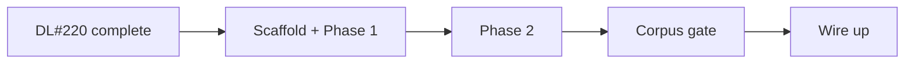

# Design Log #221 — Code-Review Validator Plugin (v1: CSS-First Rules)

**Status:** Design. Depends on DL#220: step 1 (finding types) before Phase 1, steps 1–3 and 5 (`ctx.script` live) before Phase 2, step 6 (`ruleCounts`) before the corpus gate.

## Decisions for the Implementer (TL;DR)

- **Package:** `@jay-framework/code-review-validator` (`packages/plugins/code-review-validator`). Validator-only plugin, handlers from the `./tools` entry (DL#179). **Opt-in** in `create-jay` until the corpus gate passes.
- **Families, not one bucket.** v1 ships one family, `css-first`. Each family owns a suppression namespace (`css-first:`) and a `ruleId` prefix (`css-first/allow-timer-animation`). Future families (hydration cost, contract hygiene) add namespaces, not plugins.
- **Admission gate — every rule must pass all four:** (1) matches a code **shape**, not an identifier vocabulary; (2) names the exact replacement, derived from the match; (3) the "legitimately JavaScript" case is a **checkable** condition; (4) **zero** findings on correct code in the corpus. A candidate failing 1 or 3 becomes agent-kit documentation, not a rule.
- **Deterministic only.** No heuristic class in v1. **Unknown means silent:** if a rule cannot resolve something (a signal it can't trace, a computed class), it emits nothing.
- **15 rules in two phases.** Phase 1: 9 template/CSS rules. Phase 2: 6 script rules on `ctx.script`. The corpus gate is the acceptance test for both this log and DL#220, so it runs last.
- **Ownership rule:** only state the template's **own** contract declares is ever flagged. A variant from a headless plugin is that plugin's API — the page author cannot remove it. ✅ This alone clears all 8 corpus hits of the earlier interactive-variant rule (see Background).
- **Boolean variants only** for `allow-presentational-variant`. Enum variants set by clicks are the tabs pattern, which has no native element to name (gate 2). ✅ The repo's one enum example (`smoke-test/src/pages/headfull/page.jay-contract:19–21`, cycled by a button) is therefore silent.
- **`bound-inline-event-handler` resolves bindings, it doesn't grep for `{`.** Braces in plain JavaScript (`onclick="if (x) { y() }"`) are not ViewState; only a `{…}` part that resolves to a contract tag in scope is the security error.
- **Two algorithms are specified, not described:** `allow-hover-only-disclosure` (selector-twin matching) and `signal-trace.ts` (a case matrix where every unlisted shape is silent).
- **Anchors:** every rule traces to correctness, performance, accessibility, or security. Taste rules (naming, length, structure) are out of scope for `validate`.

## Background

Jay pages should use HTML and CSS for presentation and keep JavaScript for data and application logic. Modern CSS covers most of what used to need scripts: `transition`/`@keyframes`, `position: sticky`, `scroll-behavior`, `prefers-color-scheme` + `light-dark()`, `<details>`, `<dialog>`, the Popover API, `:has()`, `loading="lazy"`.

An earlier exploration of this plugin taught two things that shape this design:

- A rule flagging `if`/`class`/`style` bound to any `fast+interactive` variant fired **8 times** on `examples/jay-stack/fake-shop/src/pages/page.jay-html` — every hit a variant owned by a headless plugin (`mt.currentMood` from `mood-tracker`, `inStock` from `stock-status`). ✅ verified: the page contract (`fake-shop/src/pages/page.jay-contract`) declares no `fast+interactive` tag at all; the headless imports are at `page.jay-html:4–17`.
- Rules matching class-name or tag-name vocabularies (`open`, `scrolled`, `theme`) could not state when JavaScript is legitimate. They are the pattern behind this repo's false-positive repair logs (DL#170, #184, #185).

## Problem

No validator answers _"was this UI feature reimplemented in JavaScript when CSS or native HTML does it?"_ The relevant signals are split: some are visible in the template and CSS (library attributes, `role="dialog"` on a `<div>`, hover-only CSS), most live in the component script (scroll handlers, timer animations, theme storage), which no plugin can see until DL#220.

## Prior Art / Adjacent Mechanisms

| Mechanism                                                                                                                                                           | Solves?                                                                                                                             |
| ------------------------------------------------------------------------------------------------------------------------------------------------------------------- | ----------------------------------------------------------------------------------------------------------------------------------- |
| DL#145 plugin validators                                                                                                                                            | ✅ Host                                                                                                                             |
| DL#220 `ctx.script`, finding fields, host suppression                                                                                                               | ✅ Phase 2 foundation; Phase 1 uses only the finding fields                                                                         |
| Core `checkDirectDocumentAccess` (`stack-cli/lib/validate.ts:619`)                                                                                                  | Constrains — owns "you bypassed refs". This plugin owns "this should not be JavaScript at all"; messages must not repeat "use refs" |
| `a11y-validator`                                                                                                                                                    | Constrains — owns labels and WCAG checks; do not duplicate                                                                          |
| `design-system-validator` `design-tokens`                                                                                                                           | Constrains — owns motion presets and `prefers-reduced-motion` (`design-system-validator/lib/validators/design-tokens.ts:198–245`)   |
| `seo-validator`                                                                                                                                                     | Constrains — framework-emitted JSON-LD in `<head>` must never be flagged                                                            |
| `compiler-shared` `walkElements` / `resolveBinding`                                                                                                                 | ✅ Binding resolution through `forEach` and headless scopes                                                                         |
| `compiler-jay-html` `getEffectivePhase` (`lib/contract/contract-phase-validator.ts:20`)                                                                             | ✅ Phase of a tag including parent inheritance                                                                                      |
| `createSignal` → `[get, set]` (`runtime/component/lib/hooks.ts:50`); `Signals<T>` → `[Getter, Setter]` per key (`full-stack-component/lib/jay-stack-builder.ts:31`) | ✅ The two setter sources the variant rule traces                                                                                   |
| UI Kit agent-kit (`toggle-switch.md`, `click-popover.md`, `sticky-header-scroll.md`)                                                                                | ✅ Patterns every message cites                                                                                                     |

## Questions and Answers

**Q1:** Why one plugin with families instead of a plugin per concern?

**A1:** One install, one place for shared machinery (binding resolution, script walking, test fixtures), and one opt-in decision for users. Families keep suppression precise: `css-first: { allow-timer-animation: true }` cannot accidentally silence a future hydration rule.

**Q2:** Is deterministic detection of "this could be CSS" actually possible?

**A2:** For **API substitution**, yes: a specific call shape has a complete CSS equivalent derivable from the match — `scrollIntoView({ behavior: 'smooth' })` → `scroll-behavior: smooth`. For **intent inference**, no: `classList.toggle('open')` cannot be classified without knowing what `open` means. The gate encodes exactly that line, and the rejected-rules table shows where it bit.

**Q3:** How does the variant rule become deterministic?

**A3:** Three checkable conditions instead of a guess. **Ownership** — the variant is declared in the template's own contract (`ctx.contract`), not a headless import. **Boolean** — `dataType: boolean`; a two-state disclosure has a native equivalent, a multi-state enum does not. **Pure toggle** — in `ctx.script`, every call to its setter sits in a ref event handler whose body does nothing but set it (`set(!get())` or a literal). If the setter is called after an `await`, next to an action call, alongside other signal writes, or cannot be traced at all → silent (full rules in the signal-trace matrix). Then the state exists only to show and hide, and `<details>` or `popover` owns it natively.

**Q4:** Should security findings be suppressible?

**A4:** A bound inline handler (`onclick="track('{title}')"`) interpolates ViewState into executable code — that is an **error** with no suppression key (DL#176 allows unsuppressible errors). `javascript:` URLs stay warnings: common legacy `javascript:void(0)` is bad practice but not an injection path by itself.

**Q5:** What counts as the corpus?

**A5:** All pages of `examples/jay-stack/fake-shop` and `examples/jay-stack/design-system-demo`, plus the plugin's own negative fixtures. Every corpus hit is either fixed in the example (a true positive — good) or makes the rule fail the gate (a false positive — fix the predicate or drop the rule). Counts come from `ruleCounts` in `jay-stack validate --json` (DL#220).

**Q6:** Which `on*` values are the bound-handler security error?

**A6:** Only values containing a binding that resolves to ViewState. The rule runs `parseTemplateParts(value)` (`compiler-jay-html/lib/expressions/expression-compiler.ts:553`) — the same parser the compiler uses on attribute values — and, for each `binding` part, extracts identifier paths and calls `resolveBinding` in the element's `walkElements` scope. At least one resolved tag → **error**. No resolvable tag, or a parse failure (plain JavaScript braces like `if (x) { y() }`) → the value is treated as static and only `allow-inline-event-handlers` (a warning) fires.

**Q7:** Why restrict the variant rule to booleans?

**A7:** Gate 2. A boolean bound to `if`/`class`/`aria-expanded` and flipped by a click is a disclosure, and disclosure has exact native replacements (`<details>`, `popover`). An enum flipped by clicks is tab or step selection, and the rejected-rules table already records that tabs have no native element. Admitting enums would mean naming a replacement that doesn't exist.

## Design — Rule Set

All rules are warnings unless marked. Suppress with `css-first: { <key>: true }` per page, or `// css-first: allow` on the script line.

### Phase 1 — template and CSS

| Rule (`css-first/…`)                                     | Shape                                                                                                                                                                                   | Names                                                                              | Anchor        |
| -------------------------------------------------------- | --------------------------------------------------------------------------------------------------------------------------------------------------------------------------------------- | ---------------------------------------------------------------------------------- | ------------- |
| `allow-executable-script`                                | Body `<script>` with an executable type (none, `module`, `text/javascript`, …), inline or `src`. Allowlist: `application/ld+json`, `importmap`, `speculationrules`, `application/jay-*` | Move behavior to CSS or the component script                                       | Correctness   |
| `allow-inline-event-handlers`                            | Static `on*` attribute                                                                                                                                                                  | CSS for presentation; ref handlers for logic                                       | Correctness   |
| `bound-inline-event-handler` — **error, unsuppressible** | `on*` value with a binding part that resolves to a contract tag in scope (Q6)                                                                                                           | Ref handler in the script                                                          | Security      |
| `allow-javascript-url`                                   | `href`/`src`/`action`/`formaction` starting with `javascript:` (trimmed, case-insensitive)                                                                                              | `<button type="button">`, `popovertarget`, `<details>`                             | Security      |
| `allow-custom-dialog`                                    | `role="dialog"`/`"alertdialog"` or `aria-modal="true"` on anything but `<dialog>`                                                                                                       | `<dialog>` + `commandfor`/`command="show-modal"`                                   | Accessibility |
| `allow-div-switch`                                       | `role="switch"` on `<div>` or `<button>`                                                                                                                                                | `<input type="checkbox" role="switch">` in a `<label>` (UI Kit `toggle-switch.md`) | Accessibility |
| `allow-js-lazy-load`                                     | `` / `data-srcset`                                                                                                                                                        | `loading="lazy"`                                                                   | Performance   |
| `allow-hover-only-disclosure`                            | A `:hover` on a non-final compound reveals another element, and no `:focus-within`/`:focus-visible` twin selector exists (algorithm below)                                              | Add the `:focus-within` twin                                                       | Accessibility |
| `allow-scroll-reveal-library` _(markup half)_            | `<script src>` or library attribute from the Appendix list                                                                                                                              | `@keyframes` + `animation-timeline: view()`                                        | Performance   |

### Algorithm — `allow-hover-only-disclosure`

Uses `postcss` + `postcss-selector-parser`, the pair `design-system-validator` already depends on (✅ `design-system-validator/package.json:45–46`, used in `lib/css-cascade.ts:2,28`).

1. **Parse** `ctx.css` with postcss. A parse failure → no findings. Minified CSS needs no special handling — both parsers are whitespace-agnostic.
2. **Reveal rules.** Walk every rule, including those nested in `@media`/`@supports`/`@layer`. A rule reveals when it declares `display` ≠ `none`, `visibility` ∉ {`hidden`, `collapse`}, or `opacity` with a numeric value > 0.
3. **Candidates.** For each selector of a reveal rule, split it into compounds at combinators. It is a candidate when a compound **other than the last** contains a `:hover` pseudo. `.btn:hover { opacity: 1 }` (hover on the target itself) is not a disclosure and is skipped.
4. **Self-paired.** Skip when that compound also contains `:focus-within`/`:focus-visible`, or holds `:hover` inside `:is()`/`:where()` alongside one of them (`.nav li:is(:hover, :focus-within) > ul`).
5. **Twin key.** Remove the `:hover` node, serialize with selector-parser, collapse whitespace. Build the same key for every selector in the stylesheet by removing its `:focus-within`/`:focus-visible` node. A matching key anywhere is a twin.
6. **At-rule context is ignored** when matching: a twin inside a different `@media` still counts. That can only make the rule quieter, never noisier.
7. **One finding per candidate selector**, the selector quoted in the message. CSS findings carry no `location` — `ctx.css` may be concatenated from several sources, so a line number would point nowhere real.

| Stylesheet                                                  | Result                                    |
| ----------------------------------------------------------- | ----------------------------------------- |
| `.nav li:hover > ul { display: block }` only                | ❌ finding                                |
| …plus `.nav li:focus-within > ul { display: block }`        | ✅ twin                                   |
| `.nav li:is(:hover, :focus-within) > ul { display: block }` | ✅ self-paired                            |
| `.btn:hover { opacity: .8 }`                                | ✅ not a disclosure (hover on the target) |
| `.card:hover .meta { color: red }`                          | ✅ not a reveal declaration               |
| Hover rule in `@media (hover: hover)`, twin outside it      | ✅ twin (context ignored)                 |

### Phase 2 — component script (`ctx.script`, DL#220)

Every predicate is **effect-exhaustive**: the matched callback must do nothing beyond the presentational write. An `await`, an action call, or a write to another signal makes it silent.

| Rule (`css-first/…`)                          | Shape                                                                                                                                                                                                 | Names                                                                                                  | Anchor      |
| --------------------------------------------- | ----------------------------------------------------------------------------------------------------------------------------------------------------------------------------------------------------- | ------------------------------------------------------------------------------------------------------ | ----------- |
| `allow-scroll-reveal-library` _(import half)_ | Import specifier from the Appendix list                                                                                                                                                               | As above                                                                                               | Performance |
| `allow-scripted-smooth-scroll`                | `scrollIntoView` / `scrollTo` / `scrollBy` with an object argument containing `behavior: 'smooth'`                                                                                                    | `scroll-behavior: smooth` with a reduced-motion guard                                                  | Performance |
| `allow-js-theme-switch`                       | Write of `data-theme`, `class`, or `style.colorScheme` on `document.documentElement`/`document.body` whose value comes from a `localStorage` read or a `matchMedia('(prefers-color-scheme…)')` result | `color-scheme`, `prefers-color-scheme`, `light-dark()`; script only persists an explicit user override | Performance |
| `allow-timer-animation`                       | `setInterval` / `requestAnimationFrame` whose callback only writes numeric `style.*` properties                                                                                                       | `transition`, `@keyframes`                                                                             | Performance |
| `allow-presentational-scroll-handler`         | `addEventListener('scroll'\|'resize')` or `onscroll =` whose handler only reads scroll position / `getBoundingClientRect()` and only writes `classList` or `style`                                    | `position: sticky`, `animation-timeline: scroll()`, `@container` (UI Kit `sticky-header-scroll.md`)    | Performance |
| `allow-presentational-variant`                | Own-contract **boolean** variant at effective phase `fast+interactive`, bound in `if`/`class`/`style`/`aria-expanded`, whose setter is only called from pure-toggle ref handlers (Q3, matrix)         | `<details>`, `popover` + `popovertarget`, `:has()`; drop the tag and its handler                       | Performance |

### Trace — `allow-presentational-variant`

Contract `isMenuOpen: { type: variant, dataType: boolean, phase: fast+interactive }`; template `<nav if="isMenuOpen">`; script:

```typescript
function constructor(props, refs: PageElementRefs, fastViewState: Signals<PageFastViewState>) {
  const [isMenuOpen, setIsMenuOpen] = fastViewState.isMenuOpen;
  refs.menuButton.onclick(() => setIsMenuOpen(!isMenuOpen()));
  return { render: () => ({ isMenuOpen: isMenuOpen() }) };
}
```

1. `walkElements` visits `<nav>`; the `if` path `isMenuOpen` resolves in **page scope** — the template's own contract, not a headless key → candidate.
2. `getEffectivePhase` → `fast+interactive`; type includes `variant`; `dataType` is `boolean` → still a candidate.
3. In `ctx.script.sourceFile`: the `render` return object maps `isMenuOpen` → `isMenuOpen()`; the getter comes from destructuring `fastViewState.isMenuOpen` (`Signals<T>`, `jay-stack-builder.ts:31`), giving setter `setIsMenuOpen`. The same walk handles a `createSignal` tuple (`hooks.ts:50`).
4. Every `setIsMenuOpen(…)` call: one, inside `refs.menuButton.onclick(…)`, body is a single setter call with `!getter()` → pure toggle.
5. All conditions hold → one warning on the template's `if`, `location` pointing at the script line of the handler.

Any step that cannot resolve ends the walk with **no finding**.

### Signal-trace matrix (`signal-trace.ts`)

The walk has four stages. Each lists what is traced; **every shape not listed is silent**, so the matrix is the complete specification and each row is a test fixture.

**Stage 1 — find the constructor**

| Shape                                                                                          | Result |
| ---------------------------------------------------------------------------------------------- | ------ |
| `makeJayStackComponent<…>()…withInteractive(fn)` — `fn` inline or a same-file function         | traced |
| `makeJayComponent(render, fn)` — second argument (✅ `runtime/component/lib/component.ts:127`) | traced |
| Constructor imported from another module, built by a factory, or wrapped                       | silent |

**Stage 2 — map the contract tag to a getter** (via the constructor's returned `render`)

| Shape                                                                                                    | Result |
| -------------------------------------------------------------------------------------------------------- | ------ |
| `render: () => ({ tag: getter() })` — called getter (✅ `smoke-test/src/pages/headfull/page.ts:35`)      | traced |
| `render: () => ({ tag: getter })` — uncalled getter (✅ `mood-tracker-plugin/lib/mood-tracker.ts:91–95`) | traced |
| Shorthand `{ tag }` where `tag` is a getter identifier                                                   | traced |
| Block body with exactly one `return { … }`                                                               | traced |
| Any other value expression (`!g()`, `g() && x`, a memo, a function call)                                 | silent |
| Object spread anywhere in the returned object, or several `return`s                                      | silent |

**Stage 3 — map the getter to its setter**

| Shape                                                                                           | Result |
| ----------------------------------------------------------------------------------------------- | ------ |
| `const [g, s] = fastViewState.tag` (`Signals<T>`, ✅ `jay-stack-builder.ts:31`)                 | traced |
| `const [g, s] = createSignal(…)` (✅ `hooks.ts:50`)                                             | traced |
| Renamed destructuring (`const [open, setOpen] = …`) — matched by position, not name             | traced |
| Tuple kept whole (`const sig = …; sig[1](…)`), `createPatchableSignal`, or a reassigned binding | silent |

**Stage 4 — classify every setter use** (all uses must pass)

| Shape                                                                                               | Result    |
| --------------------------------------------------------------------------------------------------- | --------- |
| Call directly inside a callback passed to `refs.<name>.on<event>(cb)` or `on<event>$(cb)`           | candidate |
| …whose body is only setter calls with `true`, `false`, `!g()` (same tuple's getter), or `(v) => !v` | pure      |
| Multiple handlers, each pure (open button + close button)                                           | pure      |
| Collection ref inside `forEach` (`refs.items.onclick(…)`) using no handler parameter                | pure      |
| Handler reads its parameters (`viewState`, `event`) or contains any other statement                 | silent    |
| Setter inside `exec$`, `createEffect`, a timer, a promise chain, or the constructor body itself     | silent    |
| Setter referenced without being called (passed to a helper, stored, returned)                       | silent    |

A variant bound in several elements yields **one** finding, anchored on its first binding in document order.

### Rejected rules

| Candidate                                                               | Fails                                                                              | Goes to                                          |
| ----------------------------------------------------------------------- | ---------------------------------------------------------------------------------- | ------------------------------------------------ |
| Any `fast+interactive` variant bound in `if`/`class`/`style`            | Gate 4 — 8/8 corpus hits were plugin-owned variants                                | Replaced by `allow-presentational-variant`       |
| `aria-expanded` bound to a client variant                               | Same as above                                                                      | Merged into `allow-presentational-variant`       |
| `role` tab/tablist/tooltip/listbox/combobox/menu on non-native elements | Gate 2 — there is no native tabs or listbox element to name                        | `css-first-patterns.md`, UI Kit guides           |
| Importing `popover-menu` / `word-split` / `letter-split` headless       | Gate 3 — legitimate whenever the content is dynamic; fires on the UI Kit demo page | `css-first-patterns.md`                          |
| `classList.toggle('open'\|'active'\|'expanded')`                        | Gates 1 and 3 — identifier vocabulary                                              | `css-first-patterns.md`                          |
| `<header>` class binding mentioning `scrolled`/`sticky`                 | Gate 1                                                                             | Covered by `allow-presentational-scroll-handler` |
| Contract tag named `theme`/`darkMode`                                   | Gate 1                                                                             | Covered by `allow-js-theme-switch`               |
| In-page anchors without `scroll-behavior` in CSS                        | Gate 2 — absence of a preference is advice, not a finding                          | `css-first-patterns.md`                          |
| `element.animate(…)`                                                    | Gate 3 — often the right tool for sequenced motion                                 | `css-first-patterns.md`                          |
| Importing GSAP, anime.js, or Lottie                                     | Gate 2 — general-purpose engines; the replacement depends on how they are used     | `css-first-patterns.md`                          |

### Package

```
packages/plugins/code-review-validator/
  plugin.yaml                     # validators: - name: css-first, handler: validateCssFirst
  lib/index.ts                    # serve entry — exports nothing compiler-related
  lib/tools.ts                    # ./tools entry — validateCssFirst
  lib/css-first/template-rules.ts # Phase 1 markup rules
  lib/css-first/css-rules.ts      # Phase 1 postcss rules
  lib/css-first/script-rules.ts   # Phase 2
  lib/css-first/signal-trace.ts   # render-key → getter → setter walk
  lib/css-first/scroll-reveal-libraries.ts # the Appendix list — the only copy
  lib/shared/binding-paths.ts     # identifier paths from jay-html expressions
  agent-kit/designer/css-first-patterns.md
  test/css-first/fixtures/<rule>/ # positive, negative, suppressed per rule
  test/css-first/fixtures/signal-trace/<row>/ # one fixture per matrix row
```

`plugin.yaml`, in the shape of `seo-validator/plugin.yaml`:

```yaml
name: code-review-validator

validators:
  - name: css-first
    handler: validateCssFirst
    description: Flags UI features implemented in JavaScript that HTML or CSS provide natively
```

`validateCssFirst` is exported from `lib/tools.ts` only; `package.json` exposes `./tools` and lists `agent-kit` in `files`.

## Implementation Plan



1. **Scaffold + Phase 1 rules + tests** — starts once DL#220 step 1 (finding types) has landed, so every finding carries `ruleId` and `suppressKey` from day one. Fixture per rule: one positive, one negative, one suppressed; the hover rule gets one fixture per row of its table.
2. **Agent-kit guide** `css-first-patterns.md`, including the rejected-rule patterns as prose guidance.
3. **Phase 2 rules + tests** once `ctx.script` is live in `runPluginValidators` (DL#220 steps 1–3, 5). `signal-trace.ts` gets one fixture per matrix row before any rule uses it.
4. **Corpus gate** — needs DL#220 step 6. `ruleCounts` from `jay-stack validate --json` on both examples; each hit fixed in the example or the rule fixed/dropped. Record per-rule counts in Implementation Results. This is the acceptance test for DL#220 and this log together.
5. **Wire up.** `create-jay` entry (`checked: false`), `fake-shop` devDependency, a pointer from `agent-kit-template/designer/jay-html-styling.md`, rules in the DL#147 catalog, `index.md`.

## Examples

❌ Script owns a sticky header

```typescript
window.addEventListener('scroll', () => {
  headerEl.classList.toggle('scrolled', window.scrollY > 45);
});
```

✅ CSS owns it

```css
.site-header {
  position: sticky;
  top: 0;
  animation: header-stick linear both;
  animation-timeline: scroll();
  animation-range: 0 45px;
}
```

✅ Not flagged — the handler loads data, so it is application logic

```typescript
window.addEventListener('scroll', async () => {
  if (nearBottom()) setItems(await loadMoreProducts({ cursor }));
});
```

## Scope Pre-Mortem

| Not handled                                                | Decision                                                               |
| ---------------------------------------------------------- | ---------------------------------------------------------------------- |
| Logic in helper modules imported by the script             | Defer (DL#220 is sibling-only)                                         |
| `<head>` scripts                                           | Defer — the validate body is body-only                                 |
| Variants of headless components the project itself authors | Defer — would need the headless component's own script; a later family |
| Other families (hydration cost, contract hygiene)          | Own DLs, same plugin                                                   |

## Verification Criteria

1. A fixture page implementing sticky header, smooth scroll, theme switching, a timer animation, and a menu toggle entirely in script produces exactly one finding per matching rule; the same features implemented in CSS/native HTML produce **zero**.
2. Every Phase 2 rule has a negative fixture (awaits an action, writes another signal, or is untraceable) that produces **zero**.
3. `fake-shop/src/pages/page.jay-html` produces **zero** `allow-presentational-variant` findings (all its variants are plugin-owned), and `smoke-test/src/pages/headfull` produces zero (its variant is an enum).
4. Every row of the signal-trace matrix and of the hover table has a fixture asserting its listed result.
5. `onclick="if (open) { close() }"` with no matching contract tags yields the `allow-inline-event-handlers` warning, **not** the security error.
6. Corpus gate: zero findings on correct code across both examples; per-rule counts from `ruleCounts` recorded.
7. A bound `on*` attribute that resolves to a contract tag is an error that page overrides cannot silence.
8. The serve-bundle leak scan passes — `lib/index.ts` reaches no compiler import (DL#179).

## Trade-offs

- **Narrow by design.** A menu toggled through a renamed class or a helper module goes unflagged. A rule that is right every time it speaks is worth more than wide coverage that gets muted; the uncovered patterns live in the agent-kit guide.
- **Effect-exhaustive checks favor silence.** A scroll handler that toggles a class and also logs analytics is not flagged. The corpus run shows whether that strictness is too tight.
- **The scroll-reveal library list needs upkeep.** Cheap, explicit, and honest compared to inferring "this is an animation library". It is deliberately short: only libraries whose single job CSS now does.
- **Script rules widen the audience to developers.** Findings point at the script line, so ownership is clear.

## Appendix — Scroll-reveal library list

Lives in `lib/css-first/scroll-reveal-libraries.ts` and is imported by both halves of `allow-scroll-reveal-library`, so markup and imports can never drift apart. Adding a library is a one-line change plus one fixture.

Admission criterion for the list: the library's **sole purpose** is animating elements as they enter the viewport, so `@keyframes` + `animation-timeline: view()` is an exact replacement (gate 2). General-purpose engines fail that test and are in the rejected-rules table.

| Library      | Import specifiers | `<script src>` match (case-insensitive, path segment) | Markup attributes        |
| ------------ | ----------------- | ----------------------------------------------------- | ------------------------ |
| AOS          | `aos`             | `aos`                                                 | `data-aos`, `data-aos-*` |
| WOW.js       | `wow.js`, `wowjs` | `wow`                                                 | `data-wow-*`             |
| ScrollReveal | `scrollreveal`    | `scrollreveal`                                        | `data-sr`, `data-sr-*`   |

`animation-timeline: view()` is not yet supported in every browser; the message pairs it with `@supports (animation-timeline: view())` and a no-animation fallback, which is the graceful degradation those libraries also need when JavaScript fails.
