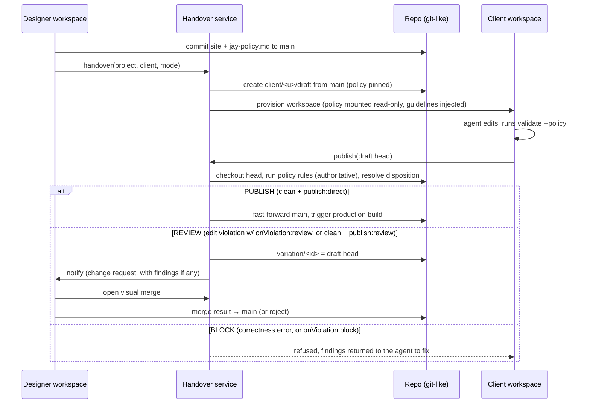

# Design Log #222 — Handover and Dev Flow (designer → client, managed / unmanaged)

Status: **[Design]** — questions open, no implementation started.

## Decisions for the Implementer (TL;DR)

1. **Two modes, one mechanism.** _Unmanaged_ = client owns the repo, no policy. _Managed_ = same flow plus a **policy** that gates **publish** (not editing). Unmanaged is managed with an empty policy.
2. **The repo is the source of truth, including the policy.** Policy is a single repo-root `jay-policy.md` — YAML frontmatter (rules) + markdown body (guidelines), mirroring the design-system's `DESIGN.md` — versioned with the site. The designer edits it; the client workspace mounts it read-only.
3. **Policy = guidelines (prevention, soft) + rules (enforcement, hard).** Guidelines are agent-kit markdown injected into the client agent. Rules run through `jay-stack validate` (DL#145 plugin mechanism). Each finding carries its own severity (`error` / `warn`) from the validation report — the policy adds **no** severity level of its own.
4. **Enforcement is server-side at the publish gate.** The agent runs validate in its loop, but the Handover service re-runs it on the exact commit being published. The agent can never be the enforcement point.
5. **Two rule types; the file is `role → selector → rules`.** _Correctness_ rules are global (every role, every file/page): a list of validator plugins that must pass. _Edit_ rules say **what can be edited where**, organized by **route-based CSS-like selectors** — `*` (project), `/campaigns/**` (folder), `/about` (page), `/products/[slug]` (dynamic page), `/about #hero #cta` (section / inner section via `jay-policy-section`). **Every rule may be set at any selector and cascades downward; most-specific wins.** Edit rules: `code` / `css` / `dependencies` (file-class), `content` / `design` (+ `designSystemOnly` modifier), `createPages` / `createSections` / `overrideRoute` (tri-state `any | from-template | no`; templates live under `src/components/pages|sections/`), and `addContract`. `edit: no` locks every rule at a selector and below. Set a rule at `*` for a project default, override it per folder/page/section.
6. **The gate resolves a disposition: PUBLISH / REVIEW / BLOCK** — a _workflow_ decision, separate from a finding's `error`/`warn` severity (this is **not** a new severity level). A clean change → **PUBLISH** (fast-forward `main`), or **REVIEW** if the scope sets `publish: review`. An edit-permission violation → **REVIEW**, or **BLOCK** if the scope sets `onViolation: block`. A correctness error → always **BLOCK** (agent must fix; waive only by editing the versioned policy). `warn` never blocks. Strictest disposition wins across the changeset. Defaults: `publish: direct`, `onViolation: review`. **REVIEW = a variation branch + a change request** (base, head, findings) the designer approves/merges — the same object whether it came from a violation or a forced review.
7. **Visual merge = 3-way merge of jay-html trees, rendered side by side.** Base / client / designer-current are rendered in iframes; the designer picks per-hunk; the result is written to the designer's branch. Reuses the DL#219 inspector (pixel ↔ jay-html node).
8. **Infra reuse:** Wix dev machines = workspaces (one per user per branch); Wix git-like file storage = repo. New: one thin **Handover service** (control plane). No new runtime/compiler surface.

## Background

Jay's contract separates design from logic. AIditor lets a human drive an agent that edits jay-html/contracts in a dev-server. Today there is one user and one working copy. The product flow in the diagram needs two principals (designer, client) and a controlled transfer between them.

## Problem

1. How does a designer hand a site to a client, and what exactly is handed over?
2. How does the designer constrain the client's agent, given the agent can edit any file?
3. When the client wants something the policy forbids, how does it reach the designer, and how does the designer merge it visually?

## Prior Art / Adjacent Mechanisms

| Mechanism                                                            | Verdict                                                                                                                                                                                 |
| -------------------------------------------------------------------- | --------------------------------------------------------------------------------------------------------------------------------------------------------------------------------------- |
| Pluggable jay-html validation (DL#145)                               | **Reuse** as the rule engine. ✅ read: per-file, parsed DOM, findings carry agent-friendly `suggestion`, `--json` output, per-finding `error`/`warn` severity. **Gap:** no diff awareness (no base/head) — needs a diff-aware rule kind (§4). The `error`/`warn` severity is reused as-is; the policy adds none. |
| `design-system-validator`, `a11y-validator`, `seo-validator` plugins | **Reuse** as the global `correctness` plugins a designer switches on.                                                                                                                   |
| Content classification (DL#200 `REGION-OVERRIDE-NON-CONTENT`, DL#202 content marker) | **Reuse** the `content`-vs-`design` line. ✅ read, **fully implemented**: `CONTENT_TAGS` allowlist (`stack-cli/lib/validate.ts:1256`), `isNonContentOverride` (`:1335`), `checkRegionOverrideNonContent(…, contentTags = CONTENT_TAGS)` (`:1428`), over the `addedElementTags` facet (`compiler-inline-composition/lib/facet.ts`). ⚠️ `CONTENT_TAGS` is **module-local** — promote it to a shared export so this rule imports the same constant (no fork). This DL only adds `aria-*` to the content attributes. |
| Agent-kit guides (DL#85, #125)                                       | **Reuse** as the channel for guidelines. Policy guidelines are an overlay folder in the agent-kit.                                                                                      |
| Source editing / inspector (DL#219)                                  | **Reuse** for visual merge: ✅ read: pixel/rect → jay-html source fragment + structural stack via embed postMessage. (DL#219 is still [Design]; merge depends on A1.)                   |
| `devOnly` actions                                                    | **Reuse** to keep policy-authoring and merge actions out of production. ✅ per DL#219 §Dev-only.                                                                                        |
| Wix dev-machine infra, git-like storage                              | **Reuse**, per the brief. ⚠️ assumed: supports branches, per-branch checkouts, ACL per path or per ref, and a server-side pre-publish hook. Must be confirmed (Q1).                     |
| Freeze / embed postMessage (DL#128)                                  | **Reuse** pattern for the side-by-side iframes. ⚠️ not re-read.                                                                                                                         |

**Null hypothesis for the merge UI:** use plain git text merge and conflict markers. Rejected for the designer persona: jay-html conflicts are unreadable, and non-conflicting textual merges can still be visually wrong. We keep git for storage and history, and add a visual layer on top, not a new VCS.

**Policy as permissions, rejected:** blocking file writes in the workspace (read-only paths) breaks the agent mid-task and only works if every path is classifiable. Gating **publish** lets the client explore freely and still be safe. Path scopes remain available as a _rule_ (see below), not as a filesystem lock.

## Design

### 1. Entities

```
Project        { id, repo, ownerId, mode: 'unmanaged' | 'managed' }
Branch         main (published) · designer/* · client/<user>/draft · variation/<id>
Policy         jay-policy.md in repo (frontmatter rules + markdown guidelines), pinned by commit  (see §3)
Role           named persona a client is handed over as; selects a rule set in jay-policy.md (e.g. client, content-editor)
Workspace      dev machine bound to (user, branch, role): dev-server + AIditor + agent
ChangeRequest  { id, variation branch, base, head, findings[], status: open|approved|rejected|merged }
```

### 2. Flow



**Handover** (idempotent action in the Handover service): (a) record owner/mode **and the client's role**; (b) create the client's draft branch from `main`; (c) pin the policy commit; (d) provision workspace. In unmanaged mode the repo ownership transfers outright and step (c) is skipped. The role selects which rule set in `jay-policy.md` applies (§3).

**After handover, `main` has a single writer in managed mode: the Handover service** (on a passing publish or an approved merge). The designer continues on `designer/*` and publishes to `main` through the same gate (no policy applied to the designer).

**Client branch updates:** when the designer changes `main`, the client draft is rebased/merged on next session start; conflicts are handled by the same visual merge, shown to the client's agent first (it resolves, then re-publishes).

### 3. Policy

One file at the repo root — **`jay-policy.md`** — mirroring the design-system's `DESIGN.md` (`design-system-validator/lib/parse-design-md.ts`): **YAML frontmatter** carries the machine-readable rules (`correctness` + `roles → selectors → rules`), the **markdown body** carries the guidelines prose injected into the agent. One artifact to author, version, pin, and hand over — no separate `policy.yaml` + `guidelines/` folder.

```
jay-policy.md
  ---                # frontmatter: correctness (global) + roles → selectors → edit rules
  <yaml>
  ---
  <markdown>         # guidelines (prevention) — injected into the client agent's agent-kit
```

**Policy = guidelines (prevention) + rules (enforcement).** A rule, when violated, emits a finding in the `jay-stack validate` report; **each finding already carries its own severity** (`error` / `warn`, DL#145). An `error` prevents a _direct_ publish; `warn` is surfaced and never blocks. There is **no policy-level severity** — severity is a property of the violation, not of the policy entry. What then _happens_ to an `error` — fix it, or send it to the designer — is the **disposition**, a separate workflow axis defined below (not a severity). The designer chooses _which_ rules apply _where_; a designer who wants a soft constraint uses a `warn`-level validator or a guideline.

#### Two rule types

1. **Correctness** — global invariants the site must always satisfy, **every role, every file/page, not scopeable**. Just the validator plugins that must pass (the old "plugins to validate"). Violations are `error`.
2. **Edit** — **what can be edited where**, organized `role → selector → rules`. These are the client-facing permissions.

#### Selectors (route-based, CSS-like)

A selector names a **location**; the most-specific matching selector wins (a cascade). File-class rules at a route scope bind to the files backing those routes (e.g. the page folder); at `*` they bind project-wide.

| Selector               | Matches                                                                   |
| ---------------------- | ------------------------------------------------------------------------- |
| `*`                    | the whole project                                                         |
| `/campaigns/**`        | a folder — every page under `/campaigns` (recursive); `/*` = one level     |
| `/about`               | one page, by route (no `page.jay-html` suffix)                             |
| `/products/[slug]`     | a dynamic page (route with params)                                         |
| `/about #hero`         | a **section** — an element marked `jay-policy-section="hero"` on that page  |
| `/about #hero #cta`    | an inner section (descendant combinator)                                   |

Specificity: `*` < `/x/**` < `/x/*` < `/route` ≈ `/route/[p]` < `/route #sec` < `/route #sec #inner`. A bare `#hero` (no route) matches that section on any page.

#### Edit rules

**Every rule may be set at any selector and cascades downward — most-specific wins.** Setting `createSections: from-template` (or `addContract`, `overrideRoute`, `content`, `publish`, …) at `*` is the project default; a folder, page, or section selector overrides it for its subtree. The "Scope note" column records only where a rule is _meaningful_ or _fires_ — not where it may be declared (it may be declared anywhere above that).

| Rule                              | Values                       | Means / scope note                                                                      |
| --------------------------------- | ---------------------------- | -------------------------------------------------------------------------------------- |
| `code` / `css` / `dependencies`   | `yes` \| `no`                | file-class: `.ts`·`.js` / `.css`+`style=` / `package.json`·lockfile. Set at `*` or folder — a page/section scope has no such files to govern |
| `createPages`                     | `any` \| `from-template` \| `no` | create new pages; `from-template` = from `src/components/pages/`. Set at `*`/folder (the area new pages land in) |
| `createSections`                  | `any` \| `from-template` \| `no` | add a section; `from-template` = from `src/components/sections/`. Cascades `*` → folder → page → section |
| `addContract`                     | `yes` \| `no`                | add a contract (wire a plugin / headless component) to a page. Cascades `*` → folder → page |
| `overrideRoute`                   | `any` \| `from-template` \| `no` | create a higher-priority **concrete override** of a dynamic route. Settable at `*`/folder as the default; **fires only where a `[param]` route exists** |
| `content`                         | `yes` \| `no`                | edit **content facets** (see below) — no structural change. Cascades to any level           |
| `design`                          | `yes` \| `no`                | any non-content change: `class`/`style`, layout, net-new non-content tags. Cascades to any level |
| `designSystemOnly`                | `yes` \| `no`                | modifier on `design`: non-content elements must be design-system elements; content free     |
| `edit`                            | `no`                         | shorthand — lock every rule at this selector (and below)                                     |
| `publish`                         | `direct` \| `review`         | **disposition** of a _clean_ change: publish directly (default), or force a change request   |
| `onViolation`                     | `review` \| `block`          | **disposition** of an _edit-permission_ violation: change request (default), or hard-stop    |

A value at `*` or a folder is the **default** inherited downward and overridden by any more specific selector (`correctness` is the one exception — it is global and not scopeable).

**What counts as `content` (reused, not reinvented).** The content-vs-design line is exactly DL#200's `REGION-OVERRIDE-NON-CONTENT` classification — a change is `content` iff it touches only content facets: text / bound values, the `src` / `alt` / `aria-*` attributes, and net-new DOM built **only** from the DL#200 **content-tag allowlist** (`span`, `strong`, `em`, `a`, `img`, `ul`/`li`, `table`, `p`, `h1`–`h6`, …). Everything else — `class` / `style`, layout wrappers, and net-new non-allowlisted tags (`div`, `section`, custom components) — is `design`. The policy rule consumes the same `addedElementTags` facet the region-override diff produces (`compiler-inline-composition/lib/facet.ts`) and the same **`CONTENT_TAGS` allowlist** DL#200 already ships (`stack-cli/lib/validate.ts:1256`; classification in `isNonContentOverride` `:1335`, `checkRegionOverrideNonContent` `:1428`). `CONTENT_TAGS` is currently module-local — promote it to a shared export so both features use one constant (no fork). This DL only adds `aria-*` to the content attributes — no parallel map.

#### Disposition — PUBLISH / REVIEW / BLOCK

Rules decide **whether a change is a violation**; the **disposition** decides **what the publish flow does** with the attempt. It is a _workflow_ decision, distinct from a finding's `error`/`warn` severity — not a second severity level. Two per-selector settings (both cascade, both defaulted) steer it:

- `publish: direct | review` (default `direct`) — for a **clean** change: publish directly, or force a change request even though nothing is wrong.
- `onViolation: review | block` (default `review`) — for an **edit-permission** violation: raise a change request the designer can approve/merge, or hard-stop so the agent must fix.

Correctness is not steerable here: a **correctness error always BLOCKs** (it is a declared invariant; the only waiver is editing the versioned, designer-owned policy). `warn` findings never block.

The gate resolves one disposition per publish; across a changeset the **strictest wins** (BLOCK > REVIEW > PUBLISH):

| Situation                                                    | Disposition |
| ----------------------------------------------------------- | ----------- |
| any correctness error                                       | **BLOCK**   |
| edit-permission violation, in an `onViolation: block` scope | **BLOCK**   |
| edit-permission violation, `onViolation: review` (default)  | **REVIEW**  |
| clean (warnings only), in a `publish: review` scope         | **REVIEW**  |
| clean (warnings only), `publish: direct` (default)          | **PUBLISH** |

**REVIEW** reuses the §2 machinery unchanged: cut a `variation/<id>` branch + change request (base, head, findings if any), notify the designer, resolve via visual merge. Nothing new is built for it — the only additions are the two settings and the disposition resolver. This covers both target cases: a policy violation becomes a PR the designer can approve (not a dead-end), and a fully-valid change can be forced through designer approval (`publish: review`).

```markdown
<!-- jay-policy.md -->
---
version: 1

# Correctness — global, every role, every file/page. Violations are errors.
correctness: [design-system-validator, a11y-validator, seo-validator]

# New pages/sections/overrides come from templates under the components folder:
#   src/components/pages/   src/components/sections/
# 'from-template' = any template in that area (nothing is listed here).

roles:
  client:
    '*': # whole project — these are the defaults every page/section inherits
      code: no
      css: no
      dependencies: no
      createPages: from-template
      createSections: no # project default; a folder/page/section can grant it
      addContract: no # project default; a page can grant it
      overrideRoute: no # project default; a dynamic page can grant it
      content: yes
      design: no
      publish: direct # clean changes auto-publish (disposition default)
      onViolation: review # violations become a change request, not a dead-end

    '/campaigns/**': # a folder — design freedom within the design system
      design: yes
      designSystemOnly: yes
      createSections: from-template # overrides the * default (no); cascades to pages/sections under /campaigns

    '/about': # a page, by route
      content: yes

    '/about #hero': # a section on that page
      edit: no # lock every rule here

    '/about #hero #cta': # an inner section
      content: yes

    '/products/[slug]': # a dynamic page — both override the * defaults
      overrideRoute: from-template
      addContract: yes

    '/': # home page — designer signs off on every change, even a clean one
      publish: review

    '/checkout/**': # locked hard — not editable, not even via a PR
      edit: no
      onViolation: block
---

# Working on this site

You're editing content on the marketing site. Keep the hero layout as-is and use
only design-system elements and tokens — no raw CSS.

## Home page

Every change here is reviewed before it goes live, so expect a short approval step.

## Checkout

Off-limits — don't touch `/checkout`. Ask the designer if something needs to change.
```

- **Guidelines → agent** (prevention): the `jay-policy.md` **markdown body** is injected into the workspace's agent-kit (an overlay like the DL#85/#125 guides) and referenced from the agent entry instructions. Written in the designer's words ("never change the hero layout; use only tokens from the design system"); markdown headings per role/section are a convention, not parsed.
- **Rules → validate** (detection): `jay-stack validate --policy --role <role>` reads the `jay-policy.md` **frontmatter**, resolves each change to its most-specific selector, runs the matched edit rules plus the global `correctness` plugins, and emits DL#145 findings (each with its own `error`/`warn` severity and `suggestion`) **plus the resolved disposition** (PUBLISH / REVIEW / BLOCK, per the table above). The agent runs this in its loop to see what a publish would do; the Handover service runs the identical command at publish and acts on the disposition (fast-forward `main`, open a change request, or refuse).
- **Tamper resistance:** the Handover service reads `jay-policy.md` **from the pinned commit on `main`**, never from the client's branch — so a client edit to it has no effect on the gate. (With `code: no` at `*`, that edit is itself a locked-path change and surfaces as an `error`.)

### 4. What must be built in the framework (smallest set)

1. **Policy loader + selector engine.** Read `jay-policy.md` — split frontmatter/body with the same approach as `DESIGN.md` (`parse-design-md.ts`: `^---\n…\n---` + `js-yaml`; factor out the shared frontmatter helper rather than re-implement), the body is the guidelines overlay. Parse `role → selector → rules`; compile selectors (route globs + `#section` anchors); given a change, resolve the **most-specific** matching selector (cascade) and the effective rule set for a role. `correctness` is global and role-independent.
2. **Diff-aware rule engine + the built-in rules.** DL#145 is per-file with no base. Add a rule kind that receives the `RevisionPair` (`{ baseDir, headDir, changes }`, see Build shape (3)) and parses jay-html from each tree, implementing the edit rules: file-class locks (`code` / `css` / `dependencies`); `content` vs `design` — **reuse DL#200's content classification** (content = text / bound values / `src` / `alt` / `aria-*` / net-new content-tag-only DOM; everything else = design), consuming the existing `addedElementTags` facet from `compiler-inline-composition` rather than a new element map. the content-tag allowlist already ships as DL#200's `CONTENT_TAGS` (`stack-cli/lib/validate.ts:1256`, consumed via `checkRegionOverrideNonContent`); promote that module-local constant to a **shared export** reused by both the region-override validator and this rule — do not fork a second list; `designSystemOnly` (reuses `design-system-validator` with a content-element exemption); the tri-state create rules (`createPages` / `createSections` / `overrideRoute`) against the `src/components/pages|sections/` template areas; and `addContract`. Correctness plugins (`validate`) stay per-file.
3. **Route ↔ file + section mapping.** Resolve a route selector to its page file(s) and a changed file back to its route; map changed jay-html nodes to the enclosing `jay-policy-section="…"` element for section selectors; detect a dynamic-route override (a concrete route that shadows a `[param]` route) for `overrideRoute`.
4. **Disposition resolver.** From the findings + the matched selectors' `publish` / `onViolation` settings, compute one disposition per change and the **strictest** across the changeset (BLOCK > REVIEW > PUBLISH), per the §3 table: correctness error → BLOCK; edit violation → `onViolation`; clean → `publish`. Pure function of findings + resolved rules — no new infra; REVIEW drives the existing variation / change-request path.
5. **`jay-stack validate --policy [--role <role>] [--base <sha>] --json`.** Per CLAUDE.md "validation first": the core enforcement mechanism; everything else is plumbing. Findings reuse the DL#145 `error`/`warn` severity unchanged; the command emits the resolved **disposition** so agent and gate act on the same answer.

#### Build shape

**(1) Not a plugin.** The DL#145 validator-plugin contract is **per-jay-html-file** and read-only: `JayHtmlValidatorFn(JayHtmlValidationContext)` receives one file's parsed `body` / `css` / `head` / `contract` / `headlessImports` and returns findings (`compiler-shared/lib/plugin-validators.ts`). It has no diff (`base`/`head`/`changedFiles`), no cross-file/project view, never sees `.ts`/`.css`/`package.json`, and knows nothing of role / selector / disposition. The policy engine is the inverse: diff-aware, cross-file, multi-file-type, role- and selector-driven. It is also the **authoritative gate** — it _orchestrates_ validators, so it cannot be one. The one part that _is_ a plugin is **`correctness`**: those are ordinary DL#145 validators (design-system / a11y / seo) the engine invokes via `scanPlugins` exactly as `validate.ts` does today (`stack-cli/lib/validate.ts:1753`). So: edit-rules + disposition + diff = new engine; correctness = reuse plugins.

**(2) A module in `stack-cli`, invoked via the CLI — no separate package.** Both consumers shell out to `jay-stack validate --policy`: the Handover service (Wix-side, §2/§5) and the client agent's dev-loop. **Assume CLI, not in-process** — nothing imports the engine, so build it as a self-contained module under `stack-cli/lib/policy/` behind the `--policy` flag. Its deps are already stack-cli's (`compiler-inline-composition` for diff/`addedElementTags`/`CONTENT_TAGS`, `stack-route-scanner` for route↔file, `stack-server-runtime` for `scanPlugins`, the shared `DESIGN.md` frontmatter helper). Keep it cohesive so it _could_ be lifted to `@jay-framework/stack-policy` later, but don't add that boundary now — no caller needs an importable library.

**(3) Diffs over two real trees (git worktree), not blob reads.** The edit rules must _traverse_ each revision — parsing a jay-html resolves its linked contracts / imports / templates from **sibling files**, `scanRoutes` walks the pages dir, `scanPlugins` walks packages, and files can be **moved/renamed** between revisions. Reading isolated blobs (`git show <ref>:<path>`) can't support that without a virtual-FS shim over every read. Instead materialize the base as a **real filesystem tree**: HEAD = the draft working tree (where the CLI runs); BASE = a detached **git worktree** at the base ref (`git worktree add --detach <tmp> <base>`; `git worktree remove` after). Run the _same_ parser/scanner machinery on each tree — no FS interception. Renames come from `git diff --name-status -M <base>..<head>` (old→new path), so a moved page reads as a rename, not delete+add. Wrap this behind a small `RevisionPair { baseDir, headDir, changes }` seam so the Handover service can hand the engine **two checkouts straight from the Wix git-like storage** (it already spins clean checkouts, §5) instead of git worktrees — the git-worktree impl is just the default for the local CLI. Base selection: the service uses `main`@pinned; local `--base` defaults to `git merge-base` against `main`. ⚠️ Caveat: a fresh base worktree has no `node_modules`; base parses that need a plugin's shipped template/contract reuse HEAD's `node_modules` (deps rarely differ across a draft, and a dependency change is itself a `dependencies` finding) — confirm when wiring plugin resolution across revisions.

Not in the framework: no policy-level severity, no new template syntax (the `jay-policy-section` marker is a plain attribute read by the rule engine, not compiled), no runtime change.

### 5. Handover service (control plane, outside the framework)

Small stateful service (Wix-side):

| API                                                | Does                                                                                                        |
| -------------------------------------------------- | ----------------------------------------------------------------------------------------------------------- |
| `handover(project, client, mode)`                  | §2 steps (a)–(d)                                                                                            |
| `publish(project, branch, commit)`                 | spin a clean checkout, run `validate --policy --role <role> --json`, then act on the disposition: PUBLISH → fast-forward `main` + production build; REVIEW → `createChangeRequest`; BLOCK → refuse with findings |
| `createChangeRequest(project, branch)`             | cut `variation/<id>`, attach findings, notify designer                                                      |
| `resolveChangeRequest(id, mergedCommit \| reject)` | land or close                                                                                               |
| `workspace(project, branch, user)`                 | get or provision a dev machine from the Wix infra                                                           |

Authority lives here, not in the workspace: the workspace is a convenience and is assumed hostile for policy purposes.

### 6. Visual merge (designer)

Opened on a change request in the designer's workspace, which checks out three trees: **base**, **theirs** (variation), **ours** (designer's current `main`).

1. **Diff unit = jay-html node, per page.** Parse the three versions (node-html-parser, as in DL#145), match nodes by `ref`/`jay-coordinate`/tree position + similarity, and produce **hunks**: {added, removed, moved, attribute/text changed}. ⚠️ assumed: node identity is stable enough; fallback is tree-position + content hash. See Q4.
2. **Layout:** three iframes (base optional, theirs, ours) from three dev-server instances (or one dev-server with three worktrees), plus a **merged preview** pane driven by the current selection.
3. **Hunk selection:** each hunk has accept-theirs / keep-ours. Clicking a region in either preview calls the DL#219 inspector → jay-html fragment → highlights the owning hunk. Hunks that touch the same node on both sides = conflict, shown in both previews with the agent's offer to propose a resolution.
4. **Apply:** the chosen hunks are applied to the jay-html AST and written, so the merged tree is plain jay-html on `designer/merge-<id>`; run `validate` (no policy for designer), commit, `resolveChangeRequest`.
5. **Non-jay-html changes** (contracts, `.ts`, assets) in the variation: listed as file-level diffs with standard text diff, accept/reject per file. Visual merge covers pages first.

## Implementation Plan

| Phase | Scope                                                                                            | Outcome                                         |
| ----- | ------------------------------------------------------------------------------------------------ | ----------------------------------------------- |
| P0    | Confirm infra constraints (Q1, Q2) with the Wix dev-machine and storage owners                   | Go / no-go on branches, hooks, ACLs             |
| P1    | `jay-policy.md` (frontmatter `correctness` + `roles → selectors → rules`; markdown guidelines body), loader + selector engine, diff-aware edit rules (`code`/`css`/`dependencies`/`content`/`design`/`designSystemOnly`/`createPages`/`createSections`/`addContract`), disposition resolver (`publish`/`onViolation` → PUBLISH/REVIEW/BLOCK), `validate --policy [--role] [--base] --json`, guidelines overlay in agent-kit | Policy works locally, agent can see what a publish would do |
| P2    | Handover service: `handover`, `workspace`, `publish` with gate; unmanaged + managed happy path   | The 2-step flow in the diagram works end to end |
| P3    | Change requests + variation branches; designer inbox                                             | Client can request changes                      |
| P4    | Visual merge (hunks, side-by-side, apply)                                                        | Designer can merge visually                     |
| P5    | `#section` selectors (`jay-policy-section` mapping) + `overrideRoute` (dynamic-route shadowing), client-branch updates from `main`, merge-conflict flow for client | Policy covers sections + dynamic overrides; long-lived clients |

## Scope Pre-mortem (not handled, with decision)

| Gap                                                                                       | Decision                                                                                 |
| ----------------------------------------------------------------------------------------- | ---------------------------------------------------------------------------------------- |
| Policy over **data** the client edits via plugins (CMS items, products) — not in the repo | Defer; own DL. Repo policy only governs repo content.                                    |
| Multiple clients/editors on one draft                                                     | Defer: one draft per user, merged via the same machinery.                                |
| Policy evolution when it conflicts with already-published client work                     | Defer: policy applies to the next publish; no retroactive failure.                       |
| Visual merge of **logic** changes (`page.ts`)                                             | Out of scope; file-level diff only.                                                      |
| Agent circumventing rules by crafted edits that pass validate but violate intent          | Residual risk; mitigate with guidelines + `publish: review` on sensitive scopes so even a passing change gets designer eyes. |
| Approvals / billing / roles beyond designer & client                                      | Defer.                                                                                   |
| Cross-target rendering of three trees (element/hydrate/SSR)                               | Merge previews use the dev-server only; production-build parity checked at publish gate. |
| Content-tag allowlist (`CONTENT_TAGS`) is DL#200 module-local, not exported                | Dependency, not deferred: promote `CONTENT_TAGS` (`stack-cli/lib/validate.ts:1256`) to a shared export so this rule reuses DL#200's constant. No forked list. |

## Questions and Answers

**Q1.** Does the Wix git-like storage support: branches, three-way merge base lookup, per-ref write ACLs, a server-side pre-publish hook, and **checking out two revisions as real trees** (the `RevisionPair` the policy engine needs — §4 Build shape (3))? _Needs answer (P0)._ If no per-ref ACL, the Handover service holds the only credential for `main` (works without it). If it can't produce two trees, the service clones/exports base + head to temp dirs and feeds those to `validate --policy`.

**Q2.** Dev machine: can one machine mount three branch checkouts (merge view), or do we need three machines? _Needs answer._ Affects merge latency/cost.

**Q3.** Is "publish" = "fast-forward `main` + production build", or does the client's site deploy from their own branch? _Assumed the former._ Confirm with the product owner.

**Q4.** Node identity across edits: does the agent rewrite whole fragments (identity lost) or patch? If lost, hunks degrade to coarse regions. _Spike in P4: run 10 realistic client edits and measure hunk quality._

**Q5.** Who can approve: any designer on the project, or only the original owner? _Default: project designers._

**Q6.** In managed mode, may the client _see_ the policy and rules? _Default yes — findings need to be explainable; guidelines are already shown to the agent._

**Q7.** When a publish is refused, should the client _preview_ their change live (draft URL) while a change request is open? _Default yes, via draft-branch preview; not published._

## Trade-offs

- **Gate at publish, not at write:** friendlier for the agent and client; the cost is that some wasted edits happen before a refusal. Mitigated by guidelines.
- **Policy in the repo:** simple, versioned, portable; the cost is that the Handover service must read it from the pinned commit to be tamper-proof.
- **Jay-html tree merge vs. text merge:** more work, but the only approach the designer can use visually; falls back to text for non-page files.
- **Thin service, no new VCS:** reuses Wix infra; the cost is dependence on Q1 answers.

## Verification Criteria

1. Handover creates a working client workspace; the client agent edits and publishes in unmanaged mode with zero policy.
2. Managed: the service enforces the disposition even if the agent skips `validate` — a BLOCK change is refused and a REVIEW change goes to a change request (never fast-forwarded to `main`) regardless of the client-side run (fixture: workspace with the local check disabled).
3. Managed: edits to `jay-policy.md` in the client branch don't change enforcement.
4. A REVIEW disposition yields a variation + change request; the designer sees base/theirs/ours side by side, can select hunks, and the merged result validates and builds.
5. Each edit rule enforces: `code`/`css`/`dependencies: no` block the matching file change; `content: yes` + `design: no` passes a content edit but blocks a structural one; `designSystemOnly` blocks a non-DS element but passes a content element; `createPages`/`createSections`/`overrideRoute` pass only `from-template` creations; `addContract: no` blocks wiring a new contract; the global `correctness` plugins run on every change. The selector cascade resolves: a `/route #section` rule fires only inside its `jay-policy-section`, and a more specific selector overrides a `*`/folder default.
6. Disposition resolves correctly: a correctness error → BLOCK; an edit violation → REVIEW by default but BLOCK under `onViolation: block`; a clean change → PUBLISH by default but REVIEW under `publish: review`; across a mixed changeset the strictest disposition wins. A `publish: review` scope forces a change request even with zero findings.
7. Fixture-based tests (`toEqual`, no `toContain`) for: `jay-policy.md` frontmatter+body parsing, scope resolution (page/folder/section), diff-aware rules per option, disposition resolution per the §3 table, hunk computation on jay-html fixtures.
8. A live example (designer + client + variation) running before P4 closes.
