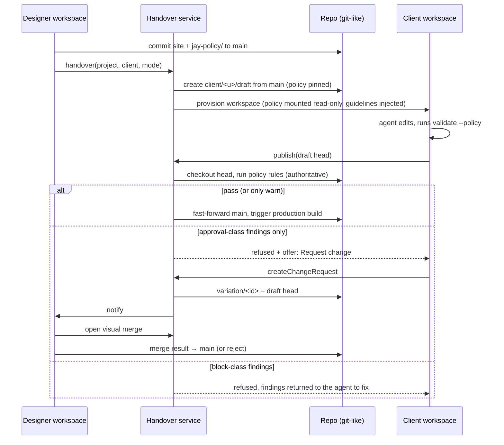

# Design Log #222 — Handover and Dev Flow (designer → client, managed / unmanaged)

Status: **[Design]** — questions open, no implementation started.

## Decisions for the Implementer (TL;DR)

1. **Two modes, one mechanism.** _Unmanaged_ = client owns the repo, no policy. _Managed_ = same flow plus a **policy** that gates **publish** (not editing). Unmanaged is managed with an empty policy.
2. **The repo is the source of truth, including the policy.** Policy lives in the repo (`jay-policy/`), versioned with the site. The designer edits it; the client workspace mounts it read-only.
3. **Policy = guidelines (prevention, soft) + rules (enforcement, hard).** Guidelines are agent-kit markdown injected into the client agent. Rules are `jay-stack validate` rules (DL#145 plugin mechanism) with a severity.
4. **Enforcement is server-side at the publish gate.** The agent runs validate in its loop, but the Handover service re-runs it on the exact commit being published. The agent can never be the enforcement point.
5. **Rule severities: `block` | `approval` | `warn`.** `block` = cannot publish, cannot request approval (agent must fix). `approval` = cannot publish directly, can be sent to the designer as a **variation**. `warn` = publish allowed, surfaced.
6. **Variation = a branch + a change request.** Created from the client's draft when publish is refused. Carries base commit, head commit, and the findings that triggered it.
7. **Visual merge = 3-way merge of jay-html trees, rendered side by side.** Base / client / designer-current are rendered in iframes; the designer picks per-hunk; the result is written to the designer's branch. Reuses the DL#219 inspector (pixel ↔ jay-html node).
8. **Infra reuse:** Wix dev machines = workspaces (one per user per branch); Wix git-like file storage = repo. New: one thin **Handover service** (control plane). No new runtime/compiler surface.

## Background

Jay's contract separates design from logic. AIditor lets a human drive an agent that edits jay-html/contracts in a dev-server. Today there is one user and one working copy. The product flow in the diagram needs two principals (designer, client) and a controlled transfer between them.

## Problem

1. How does a designer hand a site to a client, and what exactly is handed over?
2. How does the designer constrain the client's agent, given the agent can edit any file?
3. When the client wants something the policy forbids, how does it reach the designer, and how does the designer merge it visually?

## Prior Art / Adjacent Mechanisms

| Mechanism                                                            | Verdict                                                                                                                                                                                 |
| -------------------------------------------------------------------- | --------------------------------------------------------------------------------------------------------------------------------------------------------------------------------------- |
| Pluggable jay-html validation (DL#145)                               | **Reuse** as the rule engine. ✅ read: per-file, parsed DOM, findings carry agent-friendly `suggestion`, `--json` output. **Gap:** no diff awareness and no severity beyond error/warn. |
| `design-system-validator`, `a11y-validator`, `seo-validator` plugins | **Reuse** as ready-made rules a designer can switch on in policy.                                                                                                                       |
| Agent-kit guides (DL#85, #125)                                       | **Reuse** as the channel for guidelines. Policy guidelines are an overlay folder in the agent-kit.                                                                                      |
| Source editing / inspector (DL#219)                                  | **Reuse** for visual merge: ✅ read: pixel/rect → jay-html source fragment + structural stack via embed postMessage. (DL#219 is still [Design]; merge depends on A1.)                   |
| `devOnly` actions                                                    | **Reuse** to keep policy-authoring and merge actions out of production. ✅ per DL#219 §Dev-only.                                                                                        |
| Wix dev-machine infra, git-like storage                              | **Reuse**, per the brief. ⚠️ assumed: supports branches, per-branch checkouts, ACL per path or per ref, and a server-side pre-publish hook. Must be confirmed (Q1).                     |
| Freeze / embed postMessage (DL#128)                                  | **Reuse** pattern for the side-by-side iframes. ⚠️ not re-read.                                                                                                                         |

**Null hypothesis for the merge UI:** use plain git text merge and conflict markers. Rejected for the designer persona: jay-html conflicts are unreadable, and non-conflicting textual merges can still be visually wrong. We keep git for storage and history, and add a visual layer on top, not a new VCS.

**Policy as permissions, rejected:** blocking file writes in the workspace (read-only paths) breaks the agent mid-task and only works if every path is classifiable. Gating **publish** lets the client explore freely and still be safe. Path scopes remain available as a _rule_ (see below), not as a filesystem lock.

## Design

### 1. Entities

```
Project        { id, repo, ownerId, mode: 'unmanaged' | 'managed' }
Branch         main (published) · designer/* · client/<user>/draft · variation/<id>
Policy         jay-policy/ in repo, pinned by commit  (see §3)
Workspace      dev machine bound to (user, branch): dev-server + AIditor + agent
ChangeRequest  { id, variation branch, base, head, findings[], status: open|approved|rejected|merged }
```

### 2. Flow



**Handover** (idempotent action in the Handover service): (a) record owner/mode; (b) create the client's draft branch from `main`; (c) pin the policy commit; (d) provision workspace. In unmanaged mode the repo ownership transfers outright and steps (c) is skipped.

**After handover, `main` has a single writer in managed mode: the Handover service** (on a passing publish or an approved merge). The designer continues on `designer/*` and publishes to `main` through the same gate (no policy applied to the designer).

**Client branch updates:** when the designer changes `main`, the client draft is rebased/merged on next session start; conflicts are handled by the same visual merge, shown to the client's agent first (it resolves, then re-publishes).

### 3. Policy

```
jay-policy/
  policy.yaml        # rules, severities, scopes, who may approve
  guidelines/*.md    # injected into the client agent's agent-kit
```

```yaml
# policy.yaml
version: 1
rules:
  - id: design-system # validator plugin rule (DL#145)
    plugin: design-system-validator
    severity: block
  - id: a11y
    plugin: a11y-validator
    severity: block
  - id: layout-locked # diff-aware built-in (new, see §4)
    scope: { paths: ['src/pages/**/page.jay-html'], change: structure }
    severity: approval
  - id: contracts-locked
    scope: { paths: ['**/*.jay-contract', '**/*.ts'] }
    severity: approval
  - id: seo
    plugin: seo-validator
    severity: warn
```

- **Guidelines → agent** (prevention): `jay-policy/guidelines/*.md` are copied into the workspace's `agent-kit/policy/` and referenced from the agent entry instructions. Written in the designer's words ("never change the hero layout; use only tokens from the design system").
- **Rules → validate** (detection): `jay-stack validate --policy` loads `policy.yaml`, runs the named validators, and emits findings with `severity` and `suggestion`. The agent runs this in its loop; the Handover service runs the identical command at publish.
- **Tamper resistance:** the Handover service reads policy **from the pinned commit on `main`**, never from the client's branch. A client edit to `jay-policy/` has no effect, and itself triggers an `approval` finding.

### 4. What must be built in the framework (smallest set)

1. **Severity on findings** (`block | approval | warn`), mapped from `policy.yaml`. Extends the DL#145 finding type; validators stay unchanged.
2. **Diff-aware scope rules.** DL#145 is per-file with no base. Add a built-in rule kind that receives `{ base, head, changedFiles }` and checks path scopes and "structural vs. text-only change" for jay-html (text/bound-value changes pass, element add/remove/reorder = structure). Validators plugins remain per-file.
3. **`jay-stack validate --policy [--base <sha>] --json`.** Per CLAUDE.md "validation first": this is the core enforcement mechanism; everything else is plumbing.

Not in the framework: no new template syntax, no runtime change.

### 5. Handover service (control plane, outside the framework)

Small stateful service (Wix-side):

| API                                                | Does                                                                                                        |
| -------------------------------------------------- | ----------------------------------------------------------------------------------------------------------- |
| `handover(project, client, mode)`                  | §2 steps (a)–(d)                                                                                            |
| `publish(project, branch, commit)`                 | spin a clean checkout, run `validate --policy --json`, gate, fast-forward `main`, kick the production build |
| `createChangeRequest(project, branch)`             | cut `variation/<id>`, attach findings, notify designer                                                      |
| `resolveChangeRequest(id, mergedCommit \| reject)` | land or close                                                                                               |
| `workspace(project, branch, user)`                 | get or provision a dev machine from the Wix infra                                                           |

Authority lives here, not in the workspace: the workspace is a convenience and is assumed hostile for policy purposes.

### 6. Visual merge (designer)

Opened on a change request in the designer's workspace, which checks out three trees: **base**, **theirs** (variation), **ours** (designer's current `main`).

1. **Diff unit = jay-html node, per page.** Parse the three versions (node-html-parser, as in DL#145), match nodes by `ref`/`jay-coordinate`/tree position + similarity, and produce **hunks**: {added, removed, moved, attribute/text changed}. ⚠️ assumed: node identity is stable enough; fallback is tree-position + content hash. See Q4.
2. **Layout:** three iframes (base optional, theirs, ours) from three dev-server instances (or one dev-server with three worktrees), plus a **merged preview** pane driven by the current selection.
3. **Hunk selection:** each hunk has accept-theirs / keep-ours. Clicking a region in either preview calls the DL#219 inspector → jay-html fragment → highlights the owning hunk. Hunks that touch the same node on both sides = conflict, shown in both previews with the agent's offer to propose a resolution.
4. **Apply:** the chosen hunks are applied to the jay-html AST and written, so the merged tree is plain jay-html on `designer/merge-<id>`; run `validate` (no policy for designer), commit, `resolveChangeRequest`.
5. **Non-jay-html changes** (contracts, `.ts`, assets) in the variation: listed as file-level diffs with standard text diff, accept/reject per file. Visual merge covers pages first.

## Implementation Plan

| Phase | Scope                                                                                            | Outcome                                         |
| ----- | ------------------------------------------------------------------------------------------------ | ----------------------------------------------- |
| P0    | Confirm infra constraints (Q1, Q2) with the Wix dev-machine and storage owners                   | Go / no-go on branches, hooks, ACLs             |
| P1    | `policy.yaml`, severity on findings, `validate --policy --json`, guidelines overlay in agent-kit | Policy works locally, agent can see/obey it     |
| P2    | Handover service: `handover`, `workspace`, `publish` with gate; unmanaged + managed happy path   | The 2-step flow in the diagram works end to end |
| P3    | Change requests + variation branches; designer inbox                                             | Client can request changes                      |
| P4    | Visual merge (hunks, side-by-side, apply)                                                        | Designer can merge visually                     |
| P5    | Diff-aware scope rules, client-branch updates from `main`, merge-conflict flow for client        | Policy covers structure; long-lived clients     |

## Scope Pre-mortem (not handled, with decision)

| Gap                                                                                       | Decision                                                                                 |
| ----------------------------------------------------------------------------------------- | ---------------------------------------------------------------------------------------- |
| Policy over **data** the client edits via plugins (CMS items, products) — not in the repo | Defer; own DL. Repo policy only governs repo content.                                    |
| Multiple clients/editors on one draft                                                     | Defer: one draft per user, merged via the same machinery.                                |
| Policy evolution when it conflicts with already-published client work                     | Defer: policy applies to the next publish; no retroactive failure.                       |
| Visual merge of **logic** changes (`page.ts`)                                             | Out of scope; file-level diff only.                                                      |
| Agent circumventing rules by crafted edits that pass validate but violate intent          | Accepted residual risk; guidelines + designer approval for `approval`-class scopes.      |
| Approvals / billing / roles beyond designer & client                                      | Defer.                                                                                   |
| Cross-target rendering of three trees (element/hydrate/SSR)                               | Merge previews use the dev-server only; production-build parity checked at publish gate. |

## Questions and Answers

**Q1.** Does the Wix git-like storage support: branches, three-way merge base lookup, per-ref write ACLs, and a server-side pre-publish hook? _Needs answer (P0)._ If no per-ref ACL, the Handover service holds the only credential for `main` (works without it).

**Q2.** Dev machine: can one machine mount three branch checkouts (merge view), or do we need three machines? _Needs answer._ Affects merge latency/cost.

**Q3.** Is "publish" = "fast-forward `main` + production build", or does the client's site deploy from their own branch? _Assumed the former._ Confirm with the product owner.

**Q4.** Node identity across edits: does the agent rewrite whole fragments (identity lost) or patch? If lost, hunks degrade to coarse regions. _Spike in P4: run 10 realistic client edits and measure hunk quality._

**Q5.** Who can approve: any designer on the project, or only the original owner? _Default: project designers._

**Q6.** In managed mode, may the client _see_ the policy and rules? _Default yes — findings need to be explainable; guidelines are already shown to the agent._

**Q7.** Should `approval` findings let the client _preview_ their change live (draft URL) while waiting? _Default yes, via draft-branch preview; not published._

## Trade-offs

- **Gate at publish, not at write:** friendlier for the agent and client; the cost is that some wasted edits happen before a refusal. Mitigated by guidelines.
- **Policy in the repo:** simple, versioned, portable; the cost is that the Handover service must read it from the pinned commit to be tamper-proof.
- **Jay-html tree merge vs. text merge:** more work, but the only approach the designer can use visually; falls back to text for non-page files.
- **Thin service, no new VCS:** reuses Wix infra; the cost is dependence on Q1 answers.

## Verification Criteria

1. Handover creates a working client workspace; the client agent edits and publishes in unmanaged mode with zero policy.
2. Managed: a change violating a `block` rule is refused by the service even if the agent skips `validate` (fixture: workspace with the local check disabled).
3. Managed: edits to `jay-policy/` in the client branch don't change enforcement.
4. An `approval` finding yields a variation; the designer sees base/theirs/ours side by side, can select hunks, and the merged result validates and builds.
5. Fixture-based tests (`toEqual`, no `toContain`) for: `policy.yaml` parsing, severity mapping, diff-aware scope rules, hunk computation on jay-html fixtures.
6. A live example (designer + client + variation) running before P4 closes.
