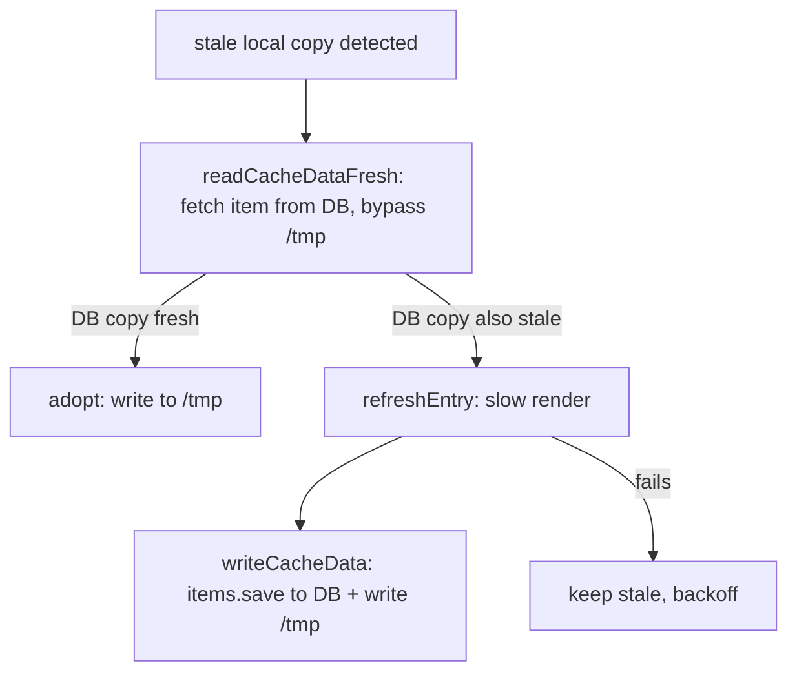

# Design Log #226 — Stale-While-Revalidate Slow Render in Production

**Date:** October 20, 2026 (rev. 2 — supersedes the Oct 19 draft: TTL now comes from slow render, stale responses are uncacheable, per-instance disk + shared-DB stores)
**Status:** Draft
**Related:** #134 (production build), #134b (main server), #134c (slow render server), #139 (wix deployment separation), #110 (slow render cache), #141 (fast phase request context), #221 (loadParams cache key); wix repo: `packages/wix-deploy` (`WixDataArtifactStore`)

## Decisions for the Implementer (TL;DR)

1. **The slow render result carries `ttl` and `grace`, per instance, both in seconds** (like `withCaching({ maxAge })` on actions and HTTP `max-age`). No route-level policy, no new declaration surface. No `ttl` → never stale → identical to today.
2. **Freshness is stored with the data:** `cache.json` gets `{ renderedAt, ttl, grace }` (epoch **ms** / **seconds** / **seconds**). `ageMs = now - renderedAt`; state comparisons use `ageMs` against `ttl * 1000` / `grace * 1000`. **Combining parts:** a page may have several components with a slow phase (the page component plus headless instances). The instance's `ttl` is the **minimum of the positive `ttl` values** across all parts, and its `grace` is the **minimum of the positive `grace` values** across all parts — computed independently. `0`, `null` and `undefined` are ignored (a part returning `0`/`null` states no freshness contract; it never forces "always stale"). No positive `ttl` in any part → no `ttl` → never stale. No positive `grace` in any part → `grace` defaults to `max(43200, ttl)` (12 h, in seconds). A combined `ttl` below **10 s is raised to 10 s** (fixed floor, no config). If the combined `grace` < combined `ttl` (different parts supplied them), `classify()` clamps `grace` up to `ttl` (no `stale` window; the entry goes straight from `fresh` to `expired`).
3. **Three freshness states, by age** (`ttl ≤ grace`; `grace` is an **absolute age**, not an addition to `ttl`):

   | State       | Age                 | Behavior                                                                                                                                                                                                                                            |
   | ----------- | ------------------- | --------------------------------------------------------------------------------------------------------------------------------------------------------------------------------------------------------------------------------------------------- |
   | **fresh**   | `age < ttl`         | Serve stored data. Cache headers clamped to remaining TTL.                                                                                                                                                                                          |
   | **stale**   | `ttl ≤ age < grace` | Serve stored data **immediately**, refresh in the background. Response is `no-store`. (busy sites, stable latency)                                                                                                                                  |
   | **expired** | `age ≥ grace`       | Start the refresh and **wait up to `JAY_STALE_WAIT_MS`** (default 2000). Finished → serve fresh with normal headers; not finished → serve stored data with `no-store`. Keeps low-traffic sites and crawlers from always seeing the previous render. |

4. **Any response served from old data is uncacheable** (`Cache-Control: no-store`, overriding any cacheable header from fast render) — never let a CDN/browser pin it. **Fresh → cap cacheability to the remaining TTL:** fast-render `max-age`/`s-maxage` is clamped to `floor(ttl - ageMs / 1000)` seconds (never below 0); stricter directives (`private`, `no-store`, `no-cache`) are kept.
   4a. **Every response built from an entry with a `ttl` carries `jay-freshness: <state>, <age>ms`** (e.g. `jay-freshness: stale, 20000ms`) — the state of the data **actually served** and its age in ms. See "Freshness header".
5. **The refresh writes through the `ArtifactStore`, not the filesystem.** New optional store method `writeCacheData(route, params, entry)` (an upsert; the store keeps its instance index consistent, see #227). The refresher is store-agnostic.
6. **Regular deployment (`FilesystemArtifactStore`): each instance refreshes its own disk independently.** No coordination.
7. **Wix deploy (`WixDataArtifactStore`): the shared Wix Data collection is the source of truth.** Refresh = re-check shared copy → only if also stale, render → save to DB + local `/tmp` cache.
8. **Overwrite `cache.json` in place** (same `cachePath`; atomic tmp+rename on disk, single-item `save` in the DB). No manifest rewrite, no `rebuildSuffix`, no cleanup manifest. Safe because server element + client bundle are route-level and `cache.json` is self-contained. ⚠️ verify (see Verification).
9. **Webhooks stay the precise path** (DL#134c). TTL/SWR is the fallback when no renderer role exists.

## Background

Production main server (DL#134b) reads `{slowViewState, carryForward}` from the artifact store per request and never runs the slow phase; it is now a fetch handler (`production-server/lib/serve/fetch-page-handler.ts`, DL#139). Slow data only changes via full build, or webhook/`rebuild` on the renderer role (DL#134c).

Two store implementations exist:

- **`FilesystemArtifactStore`** — reads `cache.json` from disk on every request (`artifact-store.ts:48`, no in-memory cache); manifest reloaded by `build-metadata.json` mtime.
- **`WixDataArtifactStore`** (`wix/packages/wix-deploy/lib/artifact-store.ts`) — BaaS, no usable disk. Eager files (`route-manifest.json`, `build-metadata.json`) are loaded at cold start and the manifest is cached for the process lifetime (`manifestCache`). Lazy files (`page-parts.json`, `*.cache.json`) are fetched from the `jay-backend-files` collection on first use and then cached **forever** in `/tmp` (`ensureFile` step 2). It already has write methods (`writeFile`, `writeFiles`, used by `upload-backend`) and its API key already has Data read/write.

## Problem

Without a renderer role, nothing refreshes slow data short of a redeploy. For Wix BaaS the problem is worse: the `/tmp` cache never expires, so even if something updated the shared DB, running instances would never see it.

## Prior Art / Adjacent Mechanisms

| Mechanism                                                                                                | Solves / constrains                                                                                                                                                                                                                                                                         |
| -------------------------------------------------------------------------------------------------------- | ------------------------------------------------------------------------------------------------------------------------------------------------------------------------------------------------------------------------------------------------------------------------------------------- |
| `rebuildInstance()` (`production-server/lib/invalidation/rebuild-instance.ts`)                           | ✅ Runs `DevSlowlyChangingPhase.runSlowlyForPage` + `slowRenderInstances`, writes `cache.json` — no compile/Vite. Refresh primitive. ⚠️ Hard-wired to `FilesystemArtifactStore` + `fs.writeFile`; must be refactored to take an `ArtifactStore` and return `CacheEntry` instead of writing. |
| `rebuild()` (`invalidation/rebuild.ts`)                                                                  | ✅ Reference for manifest swap — not needed here (in-place overwrite). ⚠️ Re-runs `initializeServices` per call and regenerates sitemap/llms.txt; the in-process refresher must not.                                                                                                        |
| `renderFastChangingData` `responseHeaders` (`fast-changing-runner.ts:226`) → `fetch-page-handler.ts:264` | ✅ Fast-render headers are `Object.assign`-merged and spread onto the `Response` verbatim. Freshness header adjustment is a post-step on this object.                                                                                                                                       |
| `makeWebhook` + `rebuild`                                                                                | Complementary; requires renderer role.                                                                                                                                                                                                                                                      |
| `WixDataArtifactStore.writeFile(s)`                                                                      | ✅ Write path exists; `_id = sha256("v{version}/{path}")` makes `save` an idempotent upsert of one item — atomic per `cache.json`.                                                                                                                                                          |
| Wix eager `manifestCache` + dist-dir precedence in `ensureFile`                                          | Constrains: the Wix manifest is effectively immutable per process → refresh **must not** depend on manifest changes. DL#227 resolves this by taking instances out of the manifest (per-instance DB items are the index).                                                                    |
| DL#221 / #110 `loadParams` cache                                                                         | Constrains render-on-miss (deferred).                                                                                                                                                                                                                                                       |

**Slow-render TTL:** ⚠️ I could not find an existing `ttl` field in the slow phase output types (`full-stack-component/lib/render-results.ts`, `render-pipeline.ts` only carry `headTags`/`responseHeaders`) in either repo. This DL assumes `ttl` and `grace` (both **seconds**) on the slow `PhaseOutput` options, next to `headTags`/`responseHeaders`, persisted into `carryForward`/`cache.json` at build and refresh. If it already exists under another name, point me at it and I'll align.

## Design

### Freshness metadata

```typescript
interface CacheEntry {
  slowViewState: object;
  carryForward: object;
  renderedAt?: number; // epoch ms, set by whoever writes the entry
  ttl?: number; // seconds; min of positive ttls across all slow parts (0/null ignored); undefined = never stale
  grace?: number; // seconds (absolute age, >= ttl); min of positive graces across all parts (0/null ignored); default max(43200, ttl) = 12 h
}
```

`cache.json` = `{ slowViewState, carryForward, renderedAt, ttl, grace }`. Written by the build (`instance-pipeline.ts`) and by the refresher. Old files without `ttl` are never stale.

### Request path

```mermaid
sequenceDiagram
    participant C as Client/CDN
    participant M as Main server
    participant S as ArtifactStore
    participant R as Refresher
    C->>M: GET /products/blue-widget
    M->>S: readCacheData(cachePath)
    S-->>M: {slowViewState, carryForward, renderedAt, ttl, grace}
    M->>M: classify(entry, now) → fresh | stale | expired
    M->>M: fast render → fastHeaders
    alt stale (ttl ≤ age < grace)
        M->>R: start(route, params, cachePath)  (single-flight; slots full → busy, nothing queued; not awaited)
        M-->>C: SSR from stored data + Cache-Control: no-store
    else expired (age ≥ grace)
        M->>R: start(...); await done up to JAY_STALE_WAIT_MS only if started/joined (busy/skipped → serve old data now)
        alt refresh finished in budget
            M-->>C: SSR from fresh data + normal (clamped) headers
        else budget exceeded
            M-->>C: SSR from stored data + Cache-Control: no-store
        end
    else fresh
        M-->>C: SSR + fastHeaders clamped to remaining TTL
    end
    R->>S: refresh + writeCacheData (see per-store flow)
```

### Cache headers (`applyFreshness`)

Pure function applied in `fetchPageRequest` to `fastResult.responseHeaders`:

```typescript
function applyFreshness(
  headers: Record<string, string>,
  entry: Pick<CacheEntry, 'renderedAt' | 'ttl' | 'grace'>,
  freshness: Freshness, // from classify(); 'expired' means "served from old data" here (refresh did not finish in budget)
  now: number,
): Record<string, string>;
```

- No `ttl` → headers unchanged.
- **Served from old data (`stale`, or `expired` whose refresh missed the budget)** → `Cache-Control: no-store`. Replaces any fast-render `Cache-Control`; drops `Expires`. **Validators (`ETag`, `Last-Modified`) are kept** — staleness is not a reason to drop them (a `304` is accurate while we serve the same stored data, and dropping them only costs crawlers conditional requests). The invariant instead: **validators must change whenever served content changes**, so any `ETag` we derive includes the entry's `renderedAt` (e.g. weak `W/"<fastEtag?>-<renderedAt>"`); a completed refresh therefore invalidates old validators. Jay streams SSR, so we do not compute a body-hash `ETag` ourselves in v1 — only fast-render-provided validators are adjusted.
- **Fresh** → parse `Cache-Control`; `max-age` and `s-maxage` become `min(existing, max(0, floor(ttl - ageMs / 1000)))` (both in seconds — no unit conversion beyond `ageMs`); `stale-while-revalidate`/`stale-if-error` are removed (they would extend life past TTL). Stricter directives are untouched. If fast render set no `Cache-Control`, leave it unset (we don't invent cacheability).

This **replaces** the earlier draft's idea of emitting `s-maxage`/`stale-while-revalidate` ourselves.

### Freshness header (`jay-freshness`)

```
jay-freshness: <fresh|stale|expired>, <age>ms
jay-freshness: stale, 20000ms
```

- **`<state>`** is the state of the entry **actually used to build the response**, not of the request-time classification:
  - `fresh` → entry within TTL (including an `expired` entry whose awaited refresh finished in the wait budget — the response is then built from the new entry, and age is that of the new data);
  - `stale` → served from a `stale` entry (refresh running in the background);
  - `expired` → served from an `expired` entry because the awaited refresh missed the budget, the key is in backoff (`skipped`), or the refresher was `busy` (all slots taken).
- **`<age>`** = `now - renderedAt` of the served entry, integer milliseconds, computed when response headers are written (streaming SSR: at head time).
- **Omitted** when the entry has no `ttl` (no freshness contract → nothing to report) and on error/redirect responses.
- Added by `applyFreshness()` alongside the cache-header rewrite (same single choke point in `fetchPageRequest`, so the state in the header and the `Cache-Control` decision cannot diverge).
- **Not the HTTP `Age` header:** `Age` (seconds, RFC 9111) describes time in a shared cache and would be misread/overwritten by intermediaries; `jay-freshness` is origin-only metadata about the slow data. Intermediaries that cache a `fresh` response will replay a stale `jay-freshness` age — informational only, never used for logic. (`stale`/`expired` are `no-store`, so they are never replayed.)
- Purposes: observability/debugging ("why am I seeing old data?"), monitoring (alert on `expired` rate), tests (assert state without timing hacks). It is not an SEO signal (see Scope Pre-mortem).
- Exposure: reveals only data age, not content. Default on; `JAY_FRESHNESS_HEADER=off` disables it.

### Stale serving policy (grace + wait budget)

Plain serve-stale-then-refresh breaks for **low-traffic sites**: with one visit a day and a short TTL every visitor (and Googlebot, which indexes what it gets) sees the previous render, even when the data never changed, and the refresh runs after they leave.

```typescript
type Freshness = 'fresh' | 'stale' | 'expired';

function classify(entry: CacheEntry, now: number): Freshness {
  if (entry.ttl === undefined) return 'fresh';
  const ageSec = (now - entry.renderedAt) / 1000; // renderedAt is epoch ms; ttl/grace are seconds
  if (ageSec < entry.ttl) return 'fresh';
  const grace = Math.max(entry.grace ?? DEFAULT_GRACE_SECONDS, entry.ttl); // DEFAULT_GRACE_SECONDS = 43200 (12 h); absolute age; grace < ttl is clamped to ttl
  return ageSec < grace ? 'stale' : 'expired';
}
```

Naming: **fresh** = within TTL; **stale** = past TTL, still within grace (served immediately, refreshed in the background); **expired** = past grace (refresh awaited, bounded). Elsewhere in this DL "served from old data" means a response built from a `stale` entry, or an `expired` one whose refresh missed the wait budget.

- `stale` → background refresh, respond immediately (`no-store`).
- `expired` → `await Promise.race([refresh, timeout(JAY_STALE_WAIT_MS)])`:
  - refresh won → re-read entry, serve **fresh** with normal headers (and `renderedAt`-based validators);
  - timeout/failure → serve stored data with `no-store`; the refresh keeps running (single-flight) for the next request.
- Busy sites rarely hit `expired` (a request arrives within the grace window); rarely-visited pages and crawlers almost always do, so they get fresh content at the cost of ≤ `JAY_STALE_WAIT_MS` extra latency. No user-agent branching, so no cloaking concern.
- **Never wait for a refresh that isn't running:** if `start` returns `busy` (max concurrency) or `skipped` (backoff), do not wait — serve the old entry immediately with `no-store` (`expired` state in the header). Nothing is queued; the next request retries. Only `started`/`joined` refreshes are awaited, and only up to `JAY_STALE_WAIT_MS`.

### Refresher (store-agnostic)

```typescript
type RefreshStart =
  | { kind: 'started' | 'joined'; done: Promise<CacheEntry | undefined> } // resolves with the new entry, undefined on failure
  | { kind: 'busy' } // all slots taken by other keys → nothing started, nothing queued (fail fast)
  | { kind: 'skipped' }; // key is in failure backoff (nextAttemptAt in the future)

interface Refresher {
  /** Never throws, never waits for a slot. */
  start(route: RouteEntry, params: Record<string, string>, cachePath: string): RefreshStart;
}
```

- **One slow render for N concurrent requests of the same instance** (same route + params → same `cachePath`; e.g. 5 requests for one product): the first request `start`s the refresh, the other four get `joined` and share the **same** promise — one slow render, one slot, one `cache.json` write. In `expired` state all of them await that one promise, each within its own `JAY_STALE_WAIT_MS` budget. Followers never consume a slot and are never `busy`. The in-flight registry is the same one render-on-miss uses (DL#227), keyed by `cachePath`.
- **Single-flight** per `cachePath`: if a refresh for the same key is *running*, `start` returns `joined` with the in-flight promise — joining does not consume a slot. If the key is in failure backoff, `start` returns `skipped`.
- **Fixed slots, no queue, fail fast:** one **shared slow-render pool**, `JAY_SLOW_RENDER_CONCURRENCY` (default **5**; sensible range 5–10), used by background refreshes **and** by render-on-miss (DL#227). When all slots are taken by other keys, `start` returns **`busy` immediately**: nothing is started and **nothing is queued**. The request is served from the old entry (`no-store`, `jay-freshness: stale|expired, <age>ms`) — even in `expired` state — and the next request for that instance tries again (traffic is the trigger). For render-on-miss the same condition returns `503` (see #227). No queue means no backlog of slow renders and no work for data nobody is asking for any more.
- **Only a running refresh is awaited:** `started`/`joined` can be awaited, and only up to `JAY_STALE_WAIT_MS`; `busy`/`skipped` are served from old data immediately.
- `busy` is **not a failure**: no backoff; debug-level logging plus a counter (`busy`) for monitoring.
- **Failure:** keep serving stale (already `no-store`), log, exponential backoff per `cachePath` (`nextAttemptAt`). Non-`PhaseOutput` slow results (Redirect/ClientError/…) count as failure.
- **No manifest write.** Refresh output is a `CacheEntry` written via the store.
- Core step, shared by both stores:

```typescript
async function refreshEntry(route, params, store): Promise<CacheEntry>; // refactored rebuildInstance: slow phase → entry (+ renderedAt, ttl); no I/O
```

### Store interface additions

```typescript
interface ArtifactStore {
  // existing…
  /**
   * Upsert an instance's data at its derived cachePath. The store also keeps its instance index
   * consistent (index membership ⇔ data exists) — callers never touch the manifest (DL#227).
   * Absent → store is read-only → refresh disabled (warn once).
   */
  writeCacheData?(
    route: RouteEntry,
    params: Record<string, string>,
    entry: CacheEntry,
  ): Promise<void>;
  /** Re-read bypassing any local cache (shared stores: another instance may have refreshed). */
  readCacheDataFresh?(relativePath: string): Promise<CacheEntry>;
}
```

DL#227 adds `getInstance` / `listInstances` / `removeInstance` to the same interface and moves the instance list out of `RouteManifest`.

### Regular deployment — `FilesystemArtifactStore` (per-instance disk)

Each server refreshes its own `build/v{n}/backend/…/*.cache.json`. No coordination; replicas may refresh at different moments.

`writeCacheData`: write `*.cache.json.tmp` → `rename` (atomic; `readCacheData` reads the file per request so it sees old or new, never partial). Requires a writable build dir (if not, refresh is disabled with a startup warning; documented in the agent-kit).

### Wix deploy — `WixDataArtifactStore` (shared DB)

Two changes in `wix-deploy`:

1. **Local `/tmp` copy becomes TTL-aware.** `readCacheData` returns the entry from `/tmp` (as today) including `renderedAt`/`ttl`. Stale detection is the same `now > renderedAt + ttl`, evaluated by the handler.
2. **Refresh = shared-first:**



- Another instance may already have refreshed → one DB `get` instead of a slow render. Duplicate renders across instances are possible and harmless (idempotent upsert, last write wins; both are fresh data).
- `writeCacheData(route, params, entry)` → saves the instance item (`JSON.stringify(entry)` plus the index fields `route`/`params`, DL#227) + `writeToCache`. Same `_id`, so it overwrites the build-time item for the current version.
- **No manifest involvement.** Refreshing an existing instance is a single-item write; the instance's DB item is also its index entry (DL#227), so there is no shared blob to coordinate.
- Redeploy (`upload-backend`) writes new `version`-scoped items; `/tmp` is per-version so no cross-version bleed. ⚠️ Confirm `cacheDir` is version-scoped, otherwise old `/tmp` entries could shadow new deploys (pre-existing risk; TTL makes it visible).
- Slow render on BaaS needs the slow-phase code and plugins in `entry.mjs` (`MODULE_REGISTRY`) — plugins are bundled already; ⚠️ verify the slow phase (`DevSlowlyChangingPhase`, `slowRenderInstances`) and service init are reachable in the bundled entry. The rename of `DevSlowlyChangingPhase` becomes more urgent.
- Contention: many BaaS instances × many expired instances could hammer the Wix Data collection. Mitigations: the shared-first check, fixed slow-render slots with fail-fast `busy` (no queue, no jitter — refresh is traffic-triggered, see Q3).

## Scope Pre-mortem (not handled)

| Gap                                                                              | Decision                                                                                                                                                          |
| -------------------------------------------------------------------------------- | ----------------------------------------------------------------------------------------------------------------------------------------------------------------- |
| Refreshing data that never changed (low-traffic sites waste a render per expiry) | **Defer.** Optional plugin "last updated"/version probe to skip the render; until then every refresh writes `renderedAt` even when data is identical (A4). Wait budget keeps it correct, not cheap. |
| SEO signal for "stale, retry later"                                              | No standard header exists. Serve stale as `200`; use `503` + `Retry-After` only when there is nothing to serve (see #227 overload).                               |
| New items (render-on-miss) / deleted items                                       | **Moved to DL#227** (render-on-miss, instance index behind `ArtifactStore` — per-instance DB items on Wix, 10-min negative cache).                                |
| Multi-instance filesystem deployments diverge in freshness                       | **Accepted** (decision 6). Each serves ≤ its own TTL window of stale data and sends `no-store` while stale, so no shared cache pins it.                           |
| Cross-instance lease to avoid duplicate renders on Wix                           | **Defer.** Shared-first read mitigates; add a lease item only if load shows a problem.                                                                            |
| TTL on list/search pages that depend on many items                               | TTL is per instance — fine; fine-grained dependency tracking remains DL#134c future work.                                                                         |
| Source-code staleness (`sourceHash`)                                             | Out of scope — code changes still need build/redeploy.                                                                                                            |
| Read-only filesystem for `FilesystemArtifactStore`                               | Startup log warning; refresh disabled, stale data keeps being served (with `no-store`). Documented in the devops agent-kit.                                                                    |
| `sitemap.xml` / `llms.txt` derived from slow data                                | Not regenerated by SWR refresh (they're build artifacts; webhook `rebuild` still regenerates them).                                                               |

## Agent-Kit (prevention-first; no new validation rules)

Docs cannot create a refresh path, so a framework feature is justified — but the rules below are only followed if developers and plugin authors (human or AI) can find them. No `jay-stack validate` rules are added. A read-only store/build dir is handled at runtime: log one warning at startup and disable refresh (stale data keeps being served, `no-store`).

Updates to `packages/jay-stack/stack-cli/agent-kit-template/`:

**Plugin role** (`plugin/render-results.md`, `plugin/component-data.md`, `plugin/webhooks-guide.md`)

- How slow render returns freshness: `ttl` and `grace`, **seconds**, next to `headTags`/`responseHeaders` (same unit as `withCaching({ maxAge })`).
- `grace` is an **absolute age** (≥ `ttl`), default `max(12 h, ttl)`. `0`, `null`, `undefined` mean "no freshness opinion" (ignored), **not** "always refresh".
- **Combining rule:** a page's freshness is the minimum positive `ttl` and the minimum positive `grace` across **all** slow components on it. One short-`ttl` component makes the whole page refresh often — choose `ttl` deliberately.
- The three states and what the server does: `fresh` / `stale` (served immediately, refreshed in background, `no-store`) / `expired` (refresh awaited briefly, else old data).
- **Slow render must be safe to re-run in the production request path:** idempotent, no side effects, safe if run concurrently or twice, uses only services available at runtime, bounded in time (it can hit external APIs once per `ttl`).
- When to set `ttl` (data that changes without a webhook) vs omit it (data that never changes, or a webhook calls `invalidate`). Webhooks stay the precise path; `ttl` is the fallback.

**Developer role** (`developer/render-results.md`, `developer/page-components.md`, `developer/seo-guide.md`)

- Same `ttl`/`grace` contract for `page.ts` slow render, with the combining rule across the page's components.
- SEO: stale pages are served as `200`; there is no standard "stale, retry later" header; `no-store` is for caches, not a crawler signal. Use `503` + `Retry-After` only when there is nothing to serve.
- Debugging: the `jay-freshness: <fresh|stale|expired>, <age>ms` response header.

**DevOps role** (`devops/serving-modes.md`, `devops/invalidation.md`, `devops/production-build.md`, `devops/fetch-handler.md`)

- When to use webhooks/renderer vs `ttl`/SWR (no renderer role deployed → `ttl`).
- Env vars: `JAY_STALE_WAIT_MS` (2000), `JAY_SLOW_RENDER_CONCURRENCY` (5, shared with render-on-miss), `JAY_FRESHNESS_HEADER` (on).
- Regular deployment: each server instance refreshes **its own disk** (needs a writable build dir; replicas drift within a TTL window). Shared stores (Wix): the shared DB is the source of truth.
- Cache headers on stale responses (`no-store`), clamping of fast-render `max-age` to remaining TTL.

**Wix repo:** `packages/wix-deploy/agent-kit/devops/wix-baas-deployment.md` — rewrite "Updating After Data Changes" (it currently says only the renderer updates pages): shared-first refresh through the data collection, `/tmp` local copies, TTL behavior.

## Implementation Plan

**Jay repo**

1. `full-stack-component`: add `ttl` and `grace` (seconds) to slow `PhaseOutput` options (next to `headTags`/`responseHeaders`); `render-pipeline.toPhaseOutput` passes them through.
2. Slow-phase runner: collect `ttl` and `grace` (`combineFreshness(parts)`: min of positive `ttl`, min of positive `grace`, independently, across the page and all headless-instance slow results; `0`/`null`/`undefined` ignored; no positive `grace` → `max(43200, ttl)`; combined `ttl` floored at 10 s; unit-tested with mixed/missing/zero values) → store in `carryForward` meta; build pipeline + refresher write `{renderedAt, ttl, grace}` into `cache.json`.
3. `production-server/types.ts`: extend `CacheEntry`; `ArtifactStore`: optional `writeCacheData(route, params, entry)`, `readCacheDataFresh` (instance index methods come with DL#227).
4. `FilesystemArtifactStore`: `writeCacheData` (tmp + rename; instance already in manifest → no index change), read returns `renderedAt`/`ttl`.
5. Refactor `rebuildInstance` → `refreshEntry(route, params, store)` returning a `CacheEntry` (no fs); `rebuild()` (webhook path) calls it and writes through the store.
6. `classify()` + `applyFreshness()` (cache headers + `jay-freshness`) + unit tests (fixtures: fresh/stale/expired/none × existing `Cache-Control`/`ETag` variants; boundaries `age == ttl`, `age == grace`, `grace < ttl`).
7. `Refresher` (`start()` → `started | joined | busy | skipped`; single-flight, fixed concurrency slots shared with render-on-miss, **no queue** (fail fast), backoff, awaitable with deadline only when running) in `production-server/lib/serve/`; hook into `fetchPageRequest` (`stale` → fire-and-forget; `expired` → race with `JAY_STALE_WAIT_MS`).
8. Agent-kit updates (plugin, developer, devops roles — see "Agent-Kit"); startup log warning when refresh is disabled (read-only store). No validation rules.
9. Rename `DevSlowlyChangingPhase` to a neutral name (separate small change).

**Wix repo (`wix-deploy`)**

10. `WixDataArtifactStore`: `writeCacheData`, `readCacheDataFresh` (DB `get` bypassing `/tmp`); ensure `/tmp` cache is version-scoped.
11. `build-entry.ts`: construct the `Refresher` with the store; confirm slow phase + services are bundled.
12. Update `wix-baas-deployment.md` "Updating After Data Changes".

## Examples

✅ Blog post, slow render returns `{ ttl: 600, grace: 3600 }`. At t=10 min 1 s the entry is **stale**: a visitor gets the old post with `Cache-Control: no-store`; the refresh writes new `cache.json`; the next request is **fresh** and gets `max-age ≤ remaining TTL`. A visitor (or Googlebot) arriving after 1 h finds it **expired**: the server awaits the refresh (≤ 2 s) and serves fresh content.
✅ Headers: stale hit → `Cache-Control: no-store`, `jay-freshness: stale, 20000ms`. Expired entry, refresh finished in budget → `jay-freshness: fresh, 340ms`. Expired entry, refresh missed the budget → `no-store`, `jay-freshness: expired, 5400000ms`.
✅ Wix: instance A refreshes and saves to DB. Instance B's local copy expires; B's `readCacheDataFresh` sees A's fresh copy, adopts it, no slow render.
✅ Fast render sets `Cache-Control: public, max-age=3600`, TTL remaining 90s → `public, max-age=90`.
❌ Fast render sets `max-age=3600` and the instance is stale → header becomes `no-store` (never `max-age=3600`).
❌ Slow render returns no `ttl` → never refreshed by this mechanism (webhook/rebuild only).

## Units

| Value                                             | Unit             | Why                                                                                                     |
| ------------------------------------------------- | ---------------- | ------------------------------------------------------------------------------------------------------- |
| `ttl`, `grace` (slow render output, `cache.json`) | **seconds**      | Matches HTTP cache directives and `withCaching({ maxAge, staleWhileRevalidate })` on actions (seconds). |
| `renderedAt` (`cache.json`)                       | epoch ms         | Like `Date.now()`; internal.                                                                            |
| `jay-freshness` age                               | ms (suffix `ms`) | Unit is explicit in the value; sub-second resolution for `fresh, 340ms` and tests.                      |
| `JAY_STALE_WAIT_MS`, `JAY_*_MS` env vars          | ms               | Unit is in the variable name.                                                                           |

## Questions

**Q1:** Where exactly does slow render return the TTL today? I found no `ttl` in the slow `PhaseOutput`; naming/placement above is a proposal.

**A1:** `ttl` does not exist today; we add it as proposed (`ttl` and `grace`, seconds, on the slow `PhaseOutput` options).

**Q2:** Should a stale response be `no-store` or `no-cache`? Proposal: `no-store` (the user asked it not be cached at all).

**A2:** `no-store`.

**Q3:** Should the first request after a cold start/deploy treat build-time data as fresh? Build-time `renderedAt` is old, so if `ttl` is short, every instance is immediately stale after deploy → thundering herd. Proposal: ±10% jitter, plus the shared-first read on Wix.

**A3:** No special handling, no jitter.
- After a deploy (which follows a build) all instances are fresh, unless `ttl` is very low.
- After a cold start most instances will probably be `expired` regardless of jitter, and refresh is triggered by traffic — which is fine.
- Event-based updates (webhooks/`invalidate`, DL#134c) are expected to keep the system up to date in parallel; with them, even expired data is actually correct. Keeping TTL/SWR as a fallback alongside events makes the system resilient.

**Q4:** On a refresh that produces an identical `slowViewState`/`carryForward`, skip the write (save DB writes / disk churn) but still bump `renderedAt`? Proposal: always write `renderedAt` (needed so replicas see "fresh"), skip nothing in v1.

**A4:** Agreed: always write `renderedAt`, skip nothing in v1.

**Q6:** (Answered) `grace` is returned by slow render next to `ttl`, in seconds, as an absolute age (`ttl ≤ grace`). Remaining question: default when omitted — proposal `2 × ttl`; wait budget `JAY_STALE_WAIT_MS` 2000 ms.

**A6:** Default `grace` = `max(12 h, ttl)` (43200 s). A fixed multiple of `ttl` (2×, or 1×) has no real justification; a fixed long window is simpler. Consequence to note: with this default a visitor arriving up to 12 h after expiry gets the old data (and triggers a background refresh) — plugins/pages that need fresher guarantees set `grace` explicitly (e.g. `grace = ttl` to always wait for the refresh). Wait budget `JAY_STALE_WAIT_MS` stays 2000 ms.

**Q5:** Should `ttl` have a project-level cap/floor (e.g. min 10 s) to protect external APIs from a plugin returning a tiny positive `ttl` (e.g. 1 s)? (`ttl: 0`/`null` is already ignored when combining parts.) Proposal: yes, floor via `.jay` config, default 5 s, applied to the combined `ttl`.

**A5:** Floor of **10 seconds**, applied to the combined `ttl`; no configuration for now.

## Trade-offs

| Decision                                      | Pro                                                                              | Con                                                                                      |
| --------------------------------------------- | -------------------------------------------------------------------------------- | ---------------------------------------------------------------------------------------- |
| TTL from slow render (per instance)           | Data owner knows its volatility; no config surface                               | Requires slow render to return it; plugins must opt in                                   |
| Stale ⇒ `no-store`                            | No CDN/browser pins stale data; correct by construction                          | Stale window bypasses edge caching → more origin load while stale (short, one refresh)   |
| Grace + bounded wait for expired data         | Low-traffic sites and crawlers get fresh content; busy sites keep stable latency | Rare visitors/crawlers can wait up to `JAY_STALE_WAIT_MS`; needs two knobs (grace, wait) |
| Keep validators on stale, tie to `renderedAt` | Crawlers keep cheap conditional requests; `304` stays accurate                   | No body-hash `ETag` for streamed SSR; only fast-render validators are adjusted           |
| Clamp fresh `max-age` to remaining TTL        | Edge caches never outlive the data's freshness                                   | Header rewriting must parse `Cache-Control` correctly                                    |
| In-place `cache.json` overwrite               | No manifest churn; no shared blob to coordinate on Wix                           | Deviates from DL#134c unique-name scheme; relies on route-level server element           |
| Per-instance disk refresh (regular)           | Zero coordination                                                                | Replicas drift within TTL windows                                                        |
| Shared-DB source of truth (Wix)               | One render serves all instances; survives instance recycling                     | DB read on stale; possible duplicate renders without a lease                             |
| Store-agnostic `Refresher`                    | One implementation, store supplies persistence                                   | Adds optional methods to `ArtifactStore`                                                 |

## Verification Criteria

1. No `ttl` → behavior and headers identical to today; existing tests unchanged.
1a. `combineFreshness`: parts `[{ttl:60}, {ttl:600, grace:3600}]` → `ttl 60, grace 3600`; `[{ttl:0}, {ttl:null}, {ttl:300}]` → `ttl 300, grace 43200` (default `max(12 h, ttl)`); `[{ttl:5}]` → `ttl 10` (floor), `grace 43200`; `[{ttl:0}, {}]` → no `ttl` (never stale); `[{ttl:600}, {grace:100}]` → `ttl 600, grace 100` clamped to 600 by `classify()`.
2. `stale` (`ttl ≤ age < grace`): request returns stored data immediately with `Cache-Control: no-store` (fast-render `public, max-age=…` overridden); next request returns refreshed data.
   2a. `expired` (`age ≥ grace`): request waits for the refresh (≤ `JAY_STALE_WAIT_MS`) and returns **fresh** data with normal headers; if the refresh exceeds the budget, the key is in backoff (`skipped`) or all slots are taken (`busy`), returns stored data with `no-store` — immediately for `busy`/`skipped`, never waiting longer than the budget otherwise.
2d. With all 5 slots taken by other instances, a request for a *different* instance gets `busy`: it is served from old data at once (no added latency), **nothing is queued**, and the next request for it tries again; a request for an instance whose refresh is already running `joined`s it without needing a slot; `busy` does not start backoff.
   2c. `jay-freshness` header: `fresh, <age>ms` / `stale, <age>ms` / `expired, <age>ms` reflects the entry actually served (an `expired` entry refreshed within budget reports `fresh` with the new age); age = `now - renderedAt` in integer ms; absent when no `ttl`, on redirects/errors, and when `JAY_FRESHNESS_HEADER=off`.
   2b. Fast-render `ETag`/`Last-Modified` are preserved on stale responses; any derived validator changes after a refresh (`renderedAt` in the tag), so an old `If-None-Match` never yields `304` for refreshed content.
3. Fresh request: `max-age`/`s-maxage` clamped to remaining TTL; `stale-while-revalidate` stripped; `private`/`no-store` preserved.
4. N concurrent stale/expired requests for the same route + params (e.g. 5 for one product) → exactly one slow render, one slot, one `cache.json` write per server instance; followers `join` without consuming a slot, and in `expired` state all await the same promise (each within its own wait budget). The same registry dedupes against render-on-miss (#227).
5. Failed refresh keeps serving old data (still `no-store`) and obeys backoff.
6. Filesystem: refreshed `cache.json` appears atomically; no manifest/metadata change; concurrent readers never see partial JSON.
7. Wix: stale local copy + fresh DB copy → adopted without slow render; stale DB copy → one render, DB item updated at the same `_id`, `/tmp` updated.
8. Wix: refresh of an existing instance writes exactly one DB item (no manifest/index blob touched); redeploy to a new version never serves previous-version `/tmp` entries.
9. ⚠️→✅ Confirm in code: server element and client bundle are route-level for all instances, so in-place `cache.json` overwrite is safe; confirm slow phase is bundled in `entry.mjs`.
10. Fixture-based tests; no `toContain` on code files.
