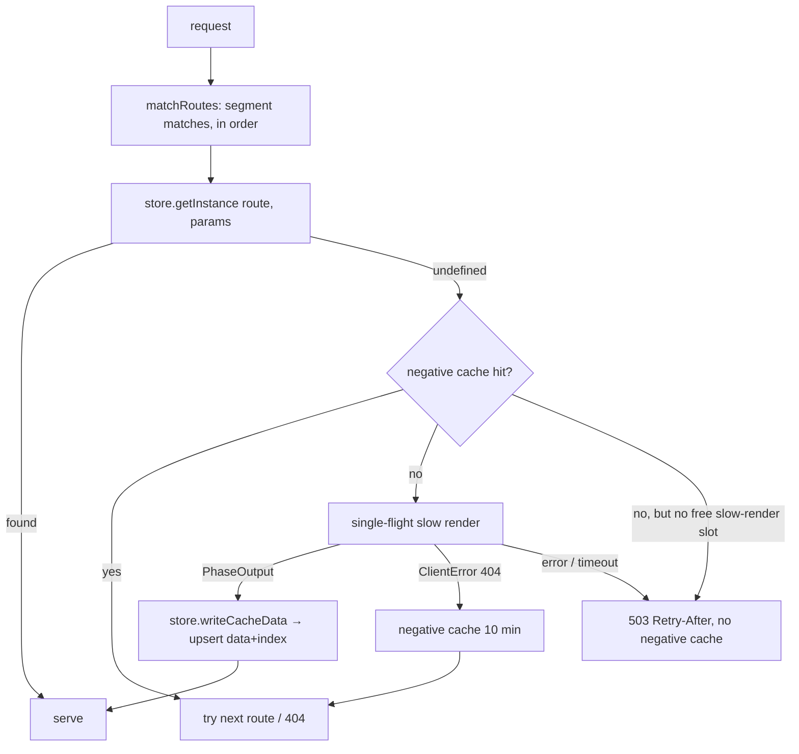

# Design Log #227 — New Items in Production: Render-on-Miss + Instance Index behind `ArtifactStore`

**Date:** October 20, 2026 (rev. 2 — replaces the "mutable manifest in the DB with revision-log CAS" design with per-instance index items)
**Status:** Draft
**Related:** #226 (SWR slow render — `writeCacheData`, freshness), #134b (main server), #134c (slow render server), #139 (wix deployment separation), #221 (loadParams cache key); wix repo: `packages/wix-deploy` (`WixDataArtifactStore`, `build-entry.ts`, `upload-backend.ts`)

## Decisions for the Implementer (TL;DR)

1. **Instances leave `RouteManifest` at runtime.** The manifest keeps route structure only. The instance list is accessed through the store: `getInstance`, `listInstances`, `writeCacheData` (upsert), `removeInstance`.
2. **The instance's data item is its own index entry.** On Wix, each `cache.json` DB item carries `route` and `params` fields (+ `category: 'instance'`). Creating an instance = one idempotent insert at the derived `_id`; deleting = one delete. **No shared mutable blob → no CAS, no revisions, no batching, no manifest TTL, no manifest size limit.**
3. **Instance identity = deterministic `cachePath`** `pre-rendered/<route>/page_<md5(params)>.cache.json` (single shared `hashParams`, no suffix). `getInstance` = lookup at that derived key.
4. **Any request whose route matches but whose instance doesn't exist triggers one slow render** (no `onMiss`, no allow-list). First visitor blocks.
5. **Validation = the slow render itself:** `ClientError 404` means the item doesn't exist (e.g. `Pipeline.clientError(404, 'Product not found')`, `wix-stores-v1/product-page.ts:266`). No `loadParams` call.
6. **Real 404 → negative cache, TTL 10 min**, in memory per instance, LRU-bounded. Errors/timeouts are never cached negatively (→ `503`).
6a. **Miss renders share the slow-render concurrency cap with background refreshes (#226).** No free slot for an unknown param → `503 Retry-After: 2` (we can't tell whether it is a real item; no queueing for a waiting visitor).
7. **Sitemap (`/_wix/pages.json`) uses `listInstances`**, cached in memory with TTL + serve-and-revalidate; forced fresh variant available.
8. **One form of manifest, everywhere: no instances in `route-manifest.json`** (build, filesystem, Wix). The filesystem store uses the same model as Wix: `cache.json` carries `route`/`params` and is its own index entry; `getInstance` = `stat` of the derived path; `listInstances` = directory scan (TTL-cached). Per-instance disk, independent — as decided in #226.
9. **Race handling is idempotency, not locking:** concurrent creators insert the same `_id`; the duplicate-key loser adopts the winner's item.

## Background

Today `RouteManifest.routes[].instances: InstanceEntry[]` is both the runtime allow-list and the instance index (`production-server/lib/types.ts:86`). Its consumers:

| Consumer                                                                                                                       | Needs                   |
| ------------------------------------------------------------------------------------------------------------------------------ | ----------------------- |
| `matchRequest` → `findInstance` (`route-matcher.ts:74`), O(n) scan                                                             | lookup by params        |
| `generate-sitemap.ts:31`, `generate-llms-txt.ts:77`, `streamPagesJson` (wix `build-entry.ts:323`), `check-build-output.ts:187` | enumerate params        |
| `rebuild.ts:79-108`, `build-pipeline.ts:620`                                                                                   | add / replace instances |
| `BuildMetadata.instanceCount`, `rebuild.ts:133`, `renderer-server.ts:151`                                                      | count                   |

`InstanceEntry = { params, cachePath, serverElementPath, clientBundlePath, clientCssPath }` — but the last three are copies of route-level values (`rebuild-instance.ts:137-143` fills them from `route.*`), and `cachePath` derives from `(route, params)`. **Only `params` is information.** The real per-instance data is the `cache.json` item.

Wix store specifics: manifest is eager (bundled in `dist/`, cached per process — immutable); `*.cache.json` are lazy DB items keyed `_id = sha256("v{version}/{path}")`.

## Problem

New items (new product/post) 404 until a build/renderer run, because the instance list is a build-time snapshot. On Wix that snapshot can't be updated across running instances without extra machinery. The instance list is also an unnecessary shared mutable structure: it duplicates what the per-instance items already say.

## Prior Art / Adjacent Mechanisms

| Mechanism                                                                     | Solves / constrains                                                                                                                                                                            |
| ----------------------------------------------------------------------------- | ---------------------------------------------------------------------------------------------------------------------------------------------------------------------------------------------- |
| `rebuild()` creates an instance for unknown params (`rebuild.ts:82-84`)       | ✅ Render-for-new-params already exists on the renderer path; reuse `refreshEntry` (#226).                                                                                                     |
| `writeCacheData` (#226)                                                       | ✅ Becomes the single upsert primitive: data + index membership.                                                                                                                               |
| `WixDataArtifactStore.writeFile(s)`, `makeItemId`, `fetchFromCollection`      | ✅ Items already exist per instance; add `route`/`params` fields and `category: 'instance'`. Today `fetchFromCollection` throws `File not found` → 500; must become a typed `NotFound`.        |
| `hashParams` duplicated (`instance-pipeline.ts:42`, `rebuild-instance.ts:17`) | Constrains: derived key valid only if build, rebuild and miss path share **one** function.                                                                                                     |
| `streamPagesJson(manifest)` (wix `build-entry.ts`)                            | ✅ Switch to `store.listInstances`. Sitemap becomes correct automatically.                                                                                                                     |
| Dropped design (rev. 1): manifest revisions + insert-CAS                      | ✗ Replaced: needed whole-manifest rewrites, retries, pruning, TTL reads, and ran into the unverified item-size limit and insert-duplicate semantics. The per-instance model has none of these. |

**Null hypothesis (why not keep instances in the manifest?):** it works for a build-time snapshot, but any runtime change (new/deleted items, refresh) then needs a shared, mutable, lock-protected list — on Wix across replicas, on disk across processes. Per-instance records need no list to coordinate, and having *one* manifest form (routes only) removes the dual model.

## Design

### Store interface (extends #226)

```typescript
interface InstanceRef {
  params: Record<string, string>;
  cachePath: string;
}

interface ArtifactStore {
  // existing + #226 …
  /** Resolve an instance for (route, params). undefined = no such instance (→ miss path). */
  getInstance(
    route: RouteEntry,
    params: Record<string, string>,
  ): Promise<InstanceEntry | undefined>;
  /** Enumerate instances of a route (sitemap, llms.txt, pages.json). Paged/streamed; may be TTL-cached by the store. */
  listInstances(route: RouteEntry, opts?: { fresh?: boolean }): AsyncIterable<InstanceRef>;
  /** Upsert data AND index membership. (#226) */
  writeCacheData(
    route: RouteEntry,
    params: Record<string, string>,
    entry: CacheEntry,
  ): Promise<void>;
  /** Remove data AND index membership. */
  removeInstance(route: RouteEntry, params: Record<string, string>): Promise<void>;
}
```

`getInstance` returns an `InstanceEntry` synthesized as `{ params, cachePath: derived, serverElementPath: route.serverElementPath, clientBundlePath: route.routeClientBundlePath, clientCssPath: route.routeCssPath }`. `InstanceEntry` shrinks to that derivation — the three route-level copies stop being stored per instance (build output may keep writing them; runtime ignores them).

### `WixDataArtifactStore`

Item schema additions (`BackendFileItem`):

```
category: 'instance'              // cache.json items; (build still writes page-parts etc. as 'lazy')
route:    string                  // route.pattern, e.g. "/products/[slug]"   (queryable)
params:   string                  // JSON of params (stable key order)        (not queried; read back)
```

- `getInstance`: local `/tmp` hit ⇒ exists; else `items.get(derivedId)` ⇒ exists / `undefined`. Hot path is a local file check.
- `listInstances(route)`: `query.eq('category','instance').eq('version',v).eq('route',pattern)` paged; results cached in memory per route with TTL (`LIST_TTL_MS`, default 600 s / 10 min) + serve-and-revalidate; `{fresh:true}` awaits a re-query.
- `writeCacheData(route, params, entry)`: `items.insert` (create) or `items.save` (overwrite) at the derived `_id` with `route`/`params`/content; also `/tmp`. **Create race:** if `insert` fails with duplicate `_id`, read the existing item and treat as success (adopt) — no retry loop, no lock.
- `removeInstance`: `items.remove(derivedId)` + delete `/tmp` copy. The instance vanishes from `listInstances` automatically — **no ordering concern** between data and index.
- `upload-backend`: for each `*.cache.json`, write `category: 'instance'`, `route`, `params` (read from the `cache.json` itself, which now carries them). There are no manifest `instances` to ship; `instanceCount` in `build-metadata.json` stays a build stat.
- Collection schema: add `route` (Text, **indexed/queryable**) and `params` (Text). ⚠️ verify queryable-field setup (see Verification); the store pages according to Wix Data's own limit.

### `FilesystemArtifactStore`

**One form of manifest everywhere:** `RouteEntry.instances` is removed from the `RouteManifest` type and from the on-disk `route-manifest.json` (build and runtime). The filesystem store uses the same model as Wix — the instance's `cache.json` is its own index entry:

- `cache.json` carries `route` and `params` next to `slowViewState`/`carryForward`/freshness (written by the build pipeline and by refresh/miss).
- `getInstance` = `stat` of the derived `cachePath` (exists ⇒ instance), O(1), no in-memory index to maintain.
- `listInstances(route)` = scan `pre-rendered/<route>/*.cache.json`, read `params` from each, cached in memory per route with `LIST_TTL_MS` (same TTL + serve-and-revalidate as Wix; `{fresh:true}` rescans). Only sitemap-like consumers use it (see Q3), so the scan cost is acceptable.
- `writeCacheData` = write `*.cache.json` (tmp + rename): that single atomic write creates *or* updates the instance. `removeInstance` = unlink. **No manifest write, no mutex, no `build-metadata.json` bump** for instance changes — `readManifest` only changes with a new build.
- Each server instance is independent (per-instance disk, as decided in #226).
- Build-time consumers (`generate-sitemap`, `generate-llms-txt`, `check-build-output`) get instance params from the build pipeline results or `store.listInstances` over the build dir — not from a manifest.

### Request flow



- `matchRequest` splits into `matchRoutes(manifest, pathname)` (segment matches, specificity order) + `store.getInstance`. **Fall-through preserved:** a real 404 on route R continues to the next matching route (as today's "no instance → try next"), then 404.
- **One slow render for N concurrent requests of the same unknown instance** (e.g. 5 requests for the same new product): single-flight keyed by the derived `cachePath` (= route + params), using the **same in-flight registry as refreshes (#226)**. The first request takes a pool slot and renders; the other four await the same promise and **do not take a slot**, so they are never `503`'d just because the pool is full. All five get the same outcome: page (success), 404 (real 404, then negative-cached), or `503` (error/timeout). Render **timeout** `JAY_MISS_TIMEOUT_MS` (default 8000) applies to the shared render.
- **Same cap as refreshes (#226):** a miss render needs a slot from the shared slow-render pool (`JAY_SLOW_RENDER_CONCURRENCY`, default 5). We cannot know whether an unknown param is a real new item, so with **all slots busy → `503` with `Retry-After: 2`** (backoff; the client/crawler retries shortly). No queueing anywhere (refreshes and misses both fail fast): the visitor is waiting, and a backlog of bogus URLs would starve real refreshes. A `503` is never negative-cached.
- With no opt-in, negative cache + single-flight + the shared cap + timeout are the abuse guards (esp. catch-all routes).
- The new entry carries `renderedAt`/`ttl`/`grace` (#226), so it refreshes like any other instance.
- **Cross-replica dedup:** before rendering, `getInstance` already checked the DB item; two replicas rendering the same new item at once is harmless (duplicate-key → adopt).

### Negative cache

```typescript
class NegativeCache {
  // key = route.pattern + ':' + paramKey(params); value = expiresAt (epoch ms)
  constructor(ttlMs = 10 * 60_000, max = 10_000); // LRU
  has(key: string, now: number): boolean;
  add(key: string, now: number): void;
}
```

- Only genuine `ClientError 404` from slow render. Errors, timeouts, 5xx are not cached negatively.
- Per instance, in memory. A newly created item can stay 404 on a replica for ≤ 10 min — accepted. A later successful `getInstance` (another replica created it) clears the key.

### Delete path

- #226 refresh gets `ClientError 404` → `removeInstance` → negative-cache.
- A request for a build-time instance whose item is gone: `getInstance` → `undefined` → miss path → render → 404 → negative cache. (No 500: typed `NotFound`, not a thrown error.)

### Sitemap

`/_wix/pages.json` streams via `store.listInstances(route)` for each non-`noIndex` route (static routes without instances emitted as before). Within `LIST_TTL_MS` it serves the cached listing and revalidates in the background; the handler passes `{fresh:true}` when Wix is known to crawl (or always — it is infrequent). New items appear within one TTL (or immediately with `fresh`).

## Scope Pre-mortem (not handled)

| Gap                                                                          | Decision                                                                                                                                                                                                      |
| ---------------------------------------------------------------------------- | ------------------------------------------------------------------------------------------------------------------------------------------------------------------------------------------------------------- |
| **Enumerating very large catalogs** (10k+ items = many paged queries)        | **Accepted (A1):** reading the DB in pages is fine; no compact listing item. |
| **Splitting large sitemaps** (sitemap spec limits per file: 50k URLs / 50 MB → sitemap index + multiple files) | **Out of scope** for this work. |
| Negative-cache staleness (item created within 10 min stays 404)              | **Accepted** (user decision). Optional later: webhook/`invalidate` clears the key.                                                                                                                            |
| Duplicate renders across replicas for the same new item                      | **Accepted.** Idempotent insert + adopt; add a lease only if load shows need.                                                                                                                                 |
| Plugins that don't 404 for missing items → junk instances                    | **Agent-kit rule** (plugin + developer guides, see "Agent-Kit"): slow render for param routes MUST return `clientError(404)` for unknown params. No validation rule.                                               |
| Query-string / non-param variability                                         | **N/A by definition:** slow render receives no query params, so the instance (and its cache) is keyed by route params only; query strings can never create or vary an instance. |
| `llms.txt` / static `sitemap.xml` build artifacts                            | Not regenerated by the miss path; `/_wix/pages.json` is dynamic. Webhook `rebuild` regeneration uses `listInstances`. **Deferred:** a rebuild of `sitemap.xml`/`llms.txt` on a 24 h TTL could be added later. |
| Version overlap during deploys                                               | Items are `version`-scoped; a new version starts with its build-time instances and rebuilds runtime-added ones on demand (self-heals via the miss path).                                                      |
| `RouteEntry.instances` removed from the manifest type and `route-manifest.json` | Done in the same change (no backward-compat shims, per CLAUDE.md): build pipeline stops writing instances, `rebuild.ts` stops mutating/rewriting the manifest for instance changes, `check-build-output`/sitemap/llms generators read via the pipeline results or `listInstances`. |

## Agent-Kit (prevention-first; no new validation rules)

Render-on-miss is only safe if param-route components behave correctly for arbitrary URLs, and nothing can detect that statically — so the agent-kit is the control. No `jay-stack validate` rules are added.

Updates to `packages/jay-stack/stack-cli/agent-kit-template/`:

**Plugin role** (`plugin/render-results.md`, `plugin/component-data.md`, `plugin/actions-guide.md` where slow render calls services)

- **MUST:** slow render of a component used on a param route returns `clientError(404, …)` for params that don't exist (as `wix-stores-v1/product-page.ts:266`, `wix-data/collection-item.ts:117` do). Returning an empty-data `200` makes every unknown URL a persisted, indexable instance.
- Params are **untrusted input**: slow render now runs for arbitrary URL values in production. Never interpolate them into queries/filters unsafely; validate shape; make the not-found path cheap.
- Not-found is the **only** thing that is negative-cached (10 min). Transient failures (network, 5xx, timeout) must surface as errors (`serverError5xx`), never as `clientError(404)`.
- `loadParams` is no longer the gate in production: it lists the instances to **pre-build**; anything else is rendered on demand.

**Developer role** (`developer/page-components.md`, `developer/routing.md`, `developer/error-pages-guide.md`)

- Same 404 rule for `page.ts` slow render on param routes.
- Route semantics: dynamic routes (`[slug]`, `[...path]`, optional segments) render unknown instances on demand; catch-all routes see every URL — expect negative-cache hits and `503 Retry-After` under overload.
- Error pages: a real 404 from slow render falls through to the next matching route, then to the 404 error page (DL#218).
- `loadParams` = prewarm list, not an allow-list.

**DevOps role** (`devops/serving-modes.md`, `devops/production-build.md`, `devops/fetch-handler.md`)

- Env vars: `JAY_SLOW_RENDER_CONCURRENCY` (5, shared with refreshes, #226), `JAY_MISS_TIMEOUT_MS` (8000); negative-cache TTL (10 min) and size; `503 Retry-After` behavior; `LIST_TTL_MS` and sitemap freshness.
- Store implementations: filesystem (per-instance `cache.json` files on local disk) vs shared stores (per-instance DB items). Neither keeps instances in the manifest.

**Wix repo:** `packages/wix-deploy/agent-kit/devops/wix-baas-deployment.md` — document per-instance items, the `route`/`params` collection fields (`route` must be queryable), listing TTL, sitemap freshness, and that new items appear without redeploy.

## Implementation Plan

**Jay repo**

1. One exported `hashParams`/`paramKey`; build, rebuild, miss path use it.
2. `ArtifactStore` interface: `getInstance`, `listInstances`, `removeInstance`; `writeCacheData(route, params, entry)` (with #226). Typed `CacheNotFound` from `readCacheData`.
3. Split `matchRequest` → `matchRoutes` + `store.getInstance`; add `resolveRequest(...)` (miss path, single-flight, caps, timeout, negative cache).
4. `NegativeCache` (LRU + TTL) + tests.
5. `FilesystemArtifactStore`: implement the four methods over per-instance `cache.json` files (`stat` / directory scan with TTL cache / tmp+rename write / unlink); `cache.json` gains `route`/`params`.
6. Remove `RouteEntry.instances` from `RouteManifest` and the build output; update build pipeline (`build-pipeline.ts:620`, `route-manifest.ts:116`), `rebuild.ts` (no manifest rewrite/metadata bump for instance changes; no-params rebuild-all uses `listInstances({fresh:true})`), `renderer-server.ts` status count, sitemap/llms generators and `check-build-output` (pipeline results or `listInstances`); shrink `InstanceEntry` to derived fields.
7. Refresher (#226): on 404 outcome → `removeInstance` + negative cache.
8. Agent-kit updates (plugin, developer, devops roles — see "Agent-Kit"). No validation rules.

**Wix repo (`wix-deploy`)**

9. `BackendFileItem`: `category: 'instance'`, `route`, `params`; implement `getInstance`, `listInstances` (paged query + TTL/SWR cache), `writeCacheData` (insert/save + duplicate-adopt), `removeInstance`; typed `NotFound` in `fetchFromCollection`.
10. `upload-backend`: write instance items with `route`/`params`; stop shipping manifest `instances` to the runtime manifest.
11. `build-entry.ts`: use `resolveRequest`; `pages.json` via `listInstances`.
12. Update collection setup docs (`route` queryable) and `wix-baas-deployment.md`.

## Examples

✅ New product published. First visit to `/products/new-widget`: route matches, `getInstance` → undefined, slow render OK → `writeCacheData` inserts the item (with `route`/`params`) → page served. Another replica: `getInstance` → DB `get` hits the same `_id` → serves with no render. Sitemap lists it within one listing TTL.
✅ `/products/typo`: slow render 404 → negative-cached 10 min on that replica; repeated hits cost nothing.
✅ Two replicas create the same item simultaneously: both render; one `insert` wins; the other gets duplicate-id, reads the winner's item, adopts it. No retry loop.
❌ Slow render times out: respond 503, do not negative-cache, next request retries.
❌ Catch-all route scanned with 10k random URLs: capped by the shared slow-render pool (`JAY_SLOW_RENDER_CONCURRENCY`) → `503 Retry-After: 2` when no slot is free, plus timeout and negative cache — not by a flag.

## Questions

**Q1:** Max page size for `items.query` and expected instance counts per route — does a TTL-cached paged listing stay acceptable for the largest target sites? (Decides whether a compact listing item is ever needed.)

**A1:** Reading the DB in pages is fine for enumeration; no compact listing item. Splitting very large sitemaps into multiple files per the sitemap spec is out of scope for this work. The maximum page size for a query is per plugin / per underlying system — each store implementation pages according to its own backend's limit (Wix Data for `WixDataArtifactStore`; directory scan for the filesystem store), so there is no framework-wide page size to decide.

**Q2:** Is `route` filterable/indexed on `jay-backend-files` without extra setup, and does `items.insert` return a distinguishable duplicate-id error? (Both are needed; ⚠️ unverified.)

**Q3:** `LIST_TTL_MS` default 60 s — acceptable freshness for new items in the sitemap, or force fresh on every `pages.json` request?

**A3:** `LIST_TTL_MS` can be 10 min or more (default 600 s) — the listing is only used for sitemap-like consumers. **Verified** against the code: runtime requests never use the list (`route-matcher.ts:74` `findInstance` → `getInstance`); list consumers are `generate-sitemap.ts`, `generate-llms-txt.ts`, Wix `streamPagesJson`, `check-build-output.ts` (build-time), status/metadata counts (`renderer-server.ts:151`, `rebuild.ts:133,145`), and `rebuild.ts:79-80` (rebuild-all for a contract/route). The only consumer where a stale list matters is the last one: it must call `listInstances({fresh:true})`.

**Q4:** Overload response: `503 + Retry-After` or fall through to 404? Proposal: 503 (never cache a false 404).

**A4:** `503` with backoff (`Retry-After: 2`). When all slow-render slots (shared with refreshes) are busy and the param is unknown — we can't tell whether it is a real new item — the right answer is `503`, not 404 and not queueing (no queue in this design, for refreshes either — #226). The cap is the same pool as refreshes (#226).

**Q5:** Share the 10-min negative cache via a DB tombstone item so replicas don't each pay one slow render per bogus URL? Proposal: per-instance memory in v1.

**Q6:** Should the filesystem store also drop `instances` from the on-disk runtime manifest and derive from a directory scan, or keep the manifest as its index? Proposal: keep (it's the build output other tools read).

**A6:** No — one form of manifest everywhere. `instances` is removed from the manifest type and from `route-manifest.json`; the filesystem store uses per-instance `cache.json` files (with `route`/`params`) exactly like Wix uses per-instance items. Other tools read instance params through the pipeline results or `listInstances`.

## Trade-offs

| Decision                                       | Pro                                                                                | Con                                                                                       |
| ---------------------------------------------- | ---------------------------------------------------------------------------------- | ----------------------------------------------------------------------------------------- |
| No `onMiss` opt-in                             | New content "just works"                                                           | Any matching URL can trigger an API call → needs caps, negative cache, 503 path           |
| Slow-render 404 as validator                   | No `loadParams` cost; authoritative                                                | Relies on plugins returning 404 for unknown params                                        |
| Instances out of manifest, behind the store    | No shared mutable blob; no CAS/size limit; O(1) lookup; one write to create/delete | Enumeration = DB queries (TTL-cached); schema change (`route`, `params`); interface grows |
| Per-instance item = index entry                | Index can't disagree with data; deletes/creates are single-item                    | Listing depends on a queryable `route` field                                              |
| Idempotent insert + adopt (no lock)            | Simple; no retry loops                                                             | Possible duplicate renders (accepted)                                                     |
| In-memory negative cache (10 min)              | Cheap; protects the API                                                            | Per-replica; created-then-requested item stays 404 up to 10 min                           |
| One manifest form (no instances), filesystem also per-instance files | One model for all stores; no manifest rewrites or mutex for instance changes; `getInstance` is a `stat` | `listInstances` on disk = directory scan + JSON parse (TTL-cached, sitemap-only use); build output format changes |

## Verification Criteria

1a. 5 concurrent requests for the same unknown route + params → exactly one slow render and one slot; all five receive the same outcome (page / 404 / 503); a full pool does not 503 the four followers.
1. Unknown params on a param route → one slow render; success → page served, instance item persisted with `route`/`params`; 404/5xx/timeout behave as specified.
2. Real 404 is negative-cached 10 min (second request doesn't call slow render); 5xx/timeout are not.
3. Fall-through: a 404 on route R still lets a later matching route (e.g. catch-all) serve.
4. Concurrent creation of the same instance by two stores → one item; loser adopts it (injected duplicate-id).
5. `getInstance`: local hit makes no DB call; miss → one `get`; absent → `undefined`.
6. `listInstances` returns build-time and runtime-created instances; within `LIST_TTL_MS` no DB query; `{fresh:true}` always queries; `/_wix/pages.json` includes an item created by another replica.
7. Delete: refresh 404 → item removed, disappears from `listInstances`, then 404.
8. Build-time instance whose item is gone → miss path (typed `NotFound`), not 500.
9. Filesystem store: same behaviour through the interface; instance create/update/delete is a single atomic `cache.json` write/unlink; `route-manifest.json` contains no instances and is not rewritten by instance changes.
10. Single `hashParams` used by build, rebuild and miss path (test asserts identical `cachePath`).
11. ⚠️→✅ Confirm: `items.insert` duplicate-id error and queryable `route` on `jay-backend-files`.
12. Fixture-based tests; no `toContain` on code files.

---

## Implementation Results

Built together with DL#226 on branch `feat/slow-render-swr-and-render-on-miss`.

**What was built**

- Manifest holds routes only: `RouteEntry.instances` removed everywhere (build, rebuild, sitemap, llms.txt, renderer status, `check-build-output`, fetch-handler, Wix `build-entry`).
- `shared/instance-key.ts`: `deriveCachePath` (`pre-rendered/<routeDir>/page[_md5(sorted params)[0..8]].cache.json`), `instanceKey`, `synthesizeInstance`; used by build, rebuild, refresh and miss.
- `ArtifactStore`: `getInstance`, `listInstances({fresh})`, optional `writeCacheData` / `removeInstance` / `readCacheDataFresh`; `CacheNotFoundError`. `FilesystemArtifactStore`: stat / directory scan (TTL `SwrCache`, 10 min) / tmp+rename / unlink. `cache.json` carries `route` + `params`.
- `matchRoutes` + `resolveRequest`: render-on-miss through `InstanceRenderer.renderMissing` (single-flight, shared slots, no queue); real 404 (`ClientError 404`) → in-memory LRU negative cache (10 min) and fall-through to the next matching route; anything else → `503` + `Retry-After: 2`, never cached.
- `renderInstance` extracted (shared by rebuild, refresh and miss) with page-parts cache in `serve/page-parts.ts`.
- Wix `WixDataArtifactStore`: `category: 'instance'` items with `route` / `params`; `getInstance` (single `get`, only a real not-found → undefined), `listInstances` (paged query + `SwrCache`), `writeCacheData` (`insert`; duplicate id → adopt winner), `removeInstance`; `upload-backend` sends each `*.cache.json` as an instance item; `build-entry` uses `resolveRequest` + `InstanceRenderer` and lists instances for `/_wix/pages.json`; `setup` creates the `route` / `params` fields; deployment guide updated.

**Deviations**

- Wix `writeCacheData` on duplicate id adopts the existing item only if its `renderedAt` ≥ the new entry's, otherwise overwrites with `save` — plain "adopt" would make a *refresh* of an existing item impossible, since refresh and create share the same write.
- `matchRequest` is replaced by `matchRoutes` (yields all matching routes + params) and `resolveRequest`; no compatibility shim (per project rules).
- Sitemap / llms.txt generators take the store (`listInstances`) instead of reading `manifest.routes[].instances`.
- `renderer-server` `/_jay/status` reports `instanceCount` from `build-metadata.json` (a build statistic).

**Not verified / open**

- ⚠️ Wix assumptions still to confirm against a live collection: duplicate-id error code (`WDE0074`), not-found code (`WDE0073`), and that `route` is filterable without extra index setup.
- ⚠️ `yarn confirm` (vitest, full type-check, prettier) has not been run — see DL#226 note.
- Example projects' generated `agent-kit/` copies are refreshed by `jay-stack setup`, not edited here.
