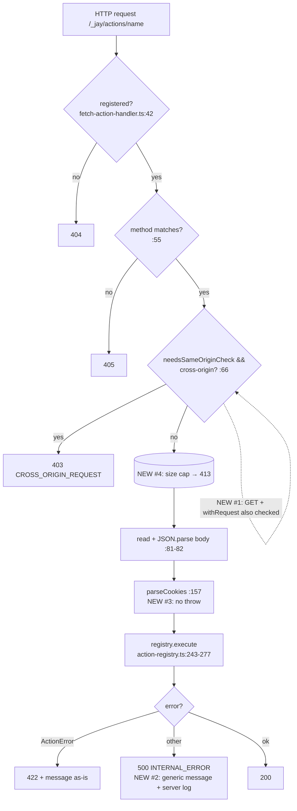

# 234 — Action runtime security hardening

**Status:** Implemented
**Related:** DL#230 (request cookies for server actions, `.withRequest()`), DL#129 (streaming actions), DL#131 (file uploads), DL#134 (production build), DL#143 (fetch handler), DL#179 (validate-plugin)

## Decisions for the Implementer (TL;DR)

1. **GET + `.withRequest()`** — two layers:
   - **Validation (Phase 5):** a `jay-stack validate` / `validate-plugin` **warning** `get-action-reads-cookies` for any `makeJayQuery(...)` chain (or `.withMethod('GET')` chain) that calls `.withRequest()`. **Suppress rule:** `// jay-action: allow-get-request` either as a trailing comment on the line containing `makeJayQuery(` / `makeJayAction(`, or alone on the line directly above it. Anywhere else (e.g. inside the chain, or two lines above) does not suppress.
   - **Runtime (Phase 4):** `needsSameOriginCheck` drops its GET exemption — every `needsRequest` action is rejected cross-origin (403 `CROSS_ORIGIN_REQUEST`), using the existing `isCrossOriginRequest`. No new API.
2. **Internal errors** — the **registry is unchanged** (still returns the raw message). The **production dispatcher** (`fetch-action-handler.ts`, used only by `production-server` and `jay-fetch-handler`) replaces an `INTERNAL_ERROR` message with `'Internal server error'` and logs the real message + stack server-side. "Production" = which dispatcher ran, **not** `NODE_ENV`. The dev router and `jay-stack action` keep full detail. `ActionError` (`isActionError: true`) and framework-authored codes pass through untouched. The streaming error frame gets the same treatment; a streaming `ActionError` keeps `{ error: err.message }`.
3. **Malformed `Cookie` header** — `parseCookies` wraps each `decodeURIComponent` in a try and keeps the **raw** value on failure. No caller changes (5 callers, listed in §3).
4. **Body size cap** — default **1 MiB** (`1_048_576` bytes) for JSON action bodies, in both the production handler and the dev body parser. Over the cap → **413** `PAYLOAD_TOO_LARGE`. Checked from `Content-Length` first (no read), then enforced while streaming the body. Configured via (precedence, highest wins): optional programmatic `actionBodyLimitBytes` on `MainServerOptions`, `JayFetchHandlerOptions`, `DevServerOptions` / `ActionBodyParserOptions`; else `server.actionBodyLimitBytes` in the project **`.jay`** YAML (`stack-cli/lib/config.ts`, read by `jay-stack dev` and `jay-stack serve`); else the default constant. Multipart (`withFiles`) is out of scope (follow-up DL — see Resolved decisions).

Non-obvious constraints:

- The cross-origin and size checks run **before** the body is read (same rule as DL#230 Q5).
- Per jay `CLAUDE.md` rule 4, no backward-compatibility shims. The new optional `options` parameter on `fetchActionRequest` is clean API, not a shim. Intentional behaviour changes:
  - Cross-site and same-site (different origin) browser GET callers of `.withRequest()` actions get **403** `CROSS_ORIGIN_REQUEST`.
  - Production callers that relied on raw internal error messages get `'Internal server error'` (HTTP and stream frames).
  - JSON bodies over the cap (default 1 MiB) get **413** `PAYLOAD_TOO_LARGE`.
  - Existing tests whose expectations change on purpose: GET + `withRequest` tests in `fetch-action-handler.test.ts` / `action-router.test.ts` that send a cross-origin header (now 403), and production `fetch-action-handler.test.ts` assertions on a raw `INTERNAL_ERROR` message (now generic). Same-origin jay-client calls under the cap are unaffected.

## Background

DL#230 added `.withRequest()`: a handler receives `(input, request, ...services)` and can read cookies and set them. It added a same-origin check, but only for non-GET actions (DL#230 Q5). Cookies jay sets default to `SameSite=Lax` (`cookies.ts:34`).

Action request path today (production; dev mirrors it in `action-router.ts`):



## Problem

1. **GET actions that read cookies skip the origin check.** `needsSameOriginCheck` returns `!!action.needsRequest && action.method !== 'GET'` (`action-registry.ts:380-382`). A cross-site top-level navigation (link, `window.open`, form `method=get`) to `/_jay/actions/<query>` carries `SameSite=Lax` cookies. If a query handler has side effects, or calls `request.setCookie` (allowed for queries; DL#230), it runs with the victim's session. Page reads are unaffected — the attacker cannot read the response.
2. **Raw internal error messages reach callers.** Any non-`ActionError` throw becomes `{ code: 'INTERNAL_ERROR', message: error.message }` (`action-registry.ts:268-277`), sent verbatim by the production handler (`fetch-action-handler.ts:138-141`). A handler error whose message contains an upstream URL, a token fragment, a SQL fragment or a file path leaks it. Streaming actions do the same: `{ error: err.message }` (`fetch-action-handler.ts:110-113`, dev `action-router.ts:177`).
3. **A malformed `Cookie` header throws.** `parseCookies` calls `decodeURIComponent` per cookie with no try (`cookies.ts:10-13`). A single `a=%E0%A4%A` cookie (any cookie, set by anything on the domain) throws `URIError`. Callers:
   - `fetch-action-handler.ts:157` (production actions, only for `needsRequest`)
   - `production-server/lib/serve/main-server.ts:168` (every production page) → caught at `:179`, renders a 5xx page
   - `jay-fetch-handler/lib/index.ts:107` (every page in fetch runtimes) → unhandled rejection to the host runtime
   - `dev-server/lib/action-router.ts:235` and `dev-server/lib/dev-server.ts:595` (dev actions, dev pages)
     One bad cookie makes every page on the site fail for that browser.
4. **No action body size cap.** Production reads `await request.text()` unbounded (`fetch-action-handler.ts:81`). Dev concatenates `req.on('data')` chunks unbounded (`action-router.ts:483-491`). An unauthenticated client can POST an arbitrarily large body to any registered action name and the server buffers it all before `JSON.parse`.

## Prior Art / Adjacent Mechanisms

| Mechanism                                                      | Where                                                                                  | Reused for                                        |
| -------------------------------------------------------------- | -------------------------------------------------------------------------------------- | ------------------------------------------------- |
| `isCrossOriginRequest` (Sec-Fetch-Site, Origin fallback)       | `action-registry.ts:389-399`                                                           | #1 runtime — unchanged, only the predicate widens |
| `crossOriginErrorResponse`                                     | `action-registry.ts:402-419`                                                           | #1 — same 403 body                                |
| Dev rejects cross-origin before body parse                     | `action-router.ts:432-437` (`isRejectedCrossOrigin`, :222-231)                         | #1, #4 ordering                                   |
| `.withRequest()` + `.withCaching()` → build-time throw         | `jay-action-builder.ts:277-281`                                                        | Considered for #1; rejected (Q1)                  |
| Line-scan source warning with suppress comment                 | `stack-cli/lib/validate.ts:621-655` (`checkDirectDocumentAccess`, `// jay-dom: allow`) | #1 validation shape                               |
| Plugin action export check (static, no import)                 | `plugin-validator/lib/validate-plugin.ts:449-476`, `:825`                              | #1 plugin side — static scan, so no import needed |
| Project actions directory `src/actions`                        | `dev-server/lib/service-lifecycle.ts:152`                                              | #1 project-side scan root                         |
| Server logger `getLogger()`                                    | `fetch-action-handler.ts:16`, `main-server.ts:179-181`                                 | #2 server-side log                                |
| Express `json()` default limit (100 kB), Node/undici have none | external                                                                               | #4 default choice                                 |

Null hypothesis per item: #1 — "document it in agent-kit" is too weak; the hole is runtime and the fix is one predicate. #2 — handlers could wrap everything in `ActionError`; they don't, and third-party SDK errors escape. #3/#4 — no existing primitive; these are plain bugs.

## Questions and Answers

**Q1. Is a runtime check for GET + `withRequest` warranted on top of the validation warning?**
A. Yes. The validation only covers code `validate` sees; plugins installed from npm are not re-validated in the consuming project. The runtime fix reuses `isCrossOriginRequest` unchanged; the jay client runtime always calls same-origin. A cross-site navigation sends `Sec-Fetch-Site: cross-site`, so it is rejected. A build-time throw (like `withCaching`) is rejected: GET + cookies is a legitimate read pattern (e.g. "current user's cart").

**Q2. Then why keep the warning?**
A. The runtime check blocks cross-site callers, but a GET handler that changes state is still wrong: GETs can be prefetched, retried and logged. The warning tells the author to make state-changing calls `makeJayAction` (POST) and to keep GET + cookies read-only. It is a warning, not an error, because read-only GET + cookies is fine.

**Q3. Who is newly rejected by Q1?** A browser on a _same-site but different origin_ (e.g. a sibling subdomain) calling a GET `withRequest` action — `Sec-Fetch-Site: same-site` is already rejected for non-GET (`action-registry.ts:394`). Non-browser clients (no `Sec-Fetch-Site`, no `Origin`) are unaffected (`:396`). GET navigations from old browsers send no `Origin`, so they pass — same residual as DL#230.

**Q4. How is "production" detected for #2?**
A. By dispatcher. `fetchActionRequest` is used only by `production-server/lib/serve/main-server.ts:118-120` and `jay-fetch-handler/lib/index.ts:76-77`; dev uses `createActionRouter`. No `NODE_ENV` read — it is unset in many fetch runtimes and would make behavior depend on deployment env. The registry keeps raw messages because `jay-stack action` (`stack-cli/lib/run-action.ts`) and dev need them.

**Q5. Do `ActionError` messages stay untouched?** Yes. Redaction applies only when `isActionError === false && code === 'INTERNAL_ERROR'`. Framework-authored codes (`ACTION_NOT_FOUND`, `METHOD_NOT_ALLOWED`, `INVALID_INPUT`, `CROSS_ORIGIN_REQUEST`, `PAYLOAD_TOO_LARGE`) carry framework-written messages and pass through.

**Q6. Should the redacted response carry a correlation id?** Not in this log. The server log line includes action name and timestamp; an id is a follow-up if operators ask.

**Q7. `parseCookies` on failure: drop the cookie or keep the raw value?** Keep raw. Dropping silently changes behavior for handlers that read a cookie written by a non-jay system with a literal `%`. Raw is what the browser sent.

**Q8. Default cap and where configured?** 1 MiB (approved default — not Express 100 kB). Action inputs are JSON form/query payloads; 1 MiB is 10× Express's default and leaves room for rich-text inputs. Files go through multipart (`withFiles`, DL#131), not this path. **`.jay`:** optional `server.actionBodyLimitBytes` (positive integer). **Programmatic:** `actionBodyLimitBytes` on server/handler/dev option objects; explicit option overrides `.jay`. Custom `createJayFetchHandler` bootstraps should `loadConfig()` and pass the resolved value (agent-kit). Invalid non-positive values in `.jay`: `jay-stack validate` **warning** `invalid-action-body-limit` (file `.jay`, does not fail `valid`).

**Q9. GET inputs?** `_input` query param length is bounded by the HTTP server's header/URL limits; no cap added.

## Design

### 1. GET + `withRequest`

**Runtime** (`stack-server-runtime/lib/action-registry.ts:380-382`):

```ts
/** Whether a dispatcher must reject cross-origin calls to this action before reading the body (DL#230, DL#234). */
export function needsSameOriginCheck(action: RegisteredActionEntry): boolean {
  return !!action.needsRequest;
}
```

Both dispatchers already call it before input parsing (`fetch-action-handler.ts:66`; dev `action-router.ts:224`). The dev body parser skips GET before its own check (`action-router.ts:427`), which is fine: GET has no body; the router at `:224` still rejects.

**Validation** — new pure function in `plugin-validator` (exported so `stack-cli` reuses it):

```ts
export interface SourceWarning {
  file: string;
  line: number;
  code: 'get-action-reads-cookies';
  message: string;
}

/** Finds GET action builder chains that call .withRequest() (DL#234). */
export function checkGetActionsReadingCookies(source: string, file: string): SourceWarning[];
```

Algorithm: strip comments except the suppress marker; for each `makeJayQuery(` or `makeJayAction(` occurrence take the text up to the next `.withHandler(` / `.withStreamHandler(`; warn when it contains `.withRequest(` and is GET (`makeJayQuery` without `.withMethod(` to a non-GET, or any chain with `.withMethod('GET')`). Line = line of the builder call. Suppress: `// jay-action: allow-get-request` as a trailing comment on the builder-call line, or alone on the line directly above it (same rule as the TL;DR); no other position suppresses.

Message: `` `<file>:<line> — GET action '<name>' reads cookies (.withRequest()). It must not change state; use makeJayAction (POST) for writes. Cross-origin calls are rejected. Suppress with // jay-action: allow-get-request` ``.

Run sites:

- `validate-plugin`: over the plugin's `lib/**/*.ts` when `manifest.actions` is non-empty (`validate-plugin.ts:450`) → `result.warnings`.
- `jay-stack validate`: over `src/actions/**/*.ts` → `ValidationResult.warnings` (`validate.ts:151`).

### 2. Redact internal errors (production dispatcher only)

In `production-server/lib/serve/fetch-action-handler.ts`:

```ts
const GENERIC_INTERNAL_MESSAGE = 'Internal server error';

/** Replaces an INTERNAL_ERROR message with a generic one and logs the original (DL#234). */
function redactInternalError(actionName: string, error: ActionErrorResponse): ActionErrorResponse;
```

Applied at `:138-141` before building the response. Logs `[Action] <name> failed: <message>` via `getLogger().error`. For the stack, `registry.execute` must hand it over: add an optional, non-serialized `cause?: unknown` to the `{ success: false }` result in `action-registry.ts:268-277` (the dev router sends `result.error` only, `action-router.ts:209-212`, so `cause` never reaches the wire). Streaming (`:110-113`): log `err`, enqueue `{ error: GENERIC_INTERNAL_MESSAGE }` unless `err.name === 'ActionError'`, in which case the frame stays `{ error: err.message }` (unchanged from today; stream frames carry no code).

### 3. `parseCookies` tolerant decode (`cookies.ts:7-15`)

```ts
function decodeCookieValue(raw: string): string {
  try {
    return decodeURIComponent(raw);
  } catch {
    return raw;
  }
}
```

Signature of `parseCookies` unchanged. All five callers benefit with no edits.

### 4. Action body size cap

```ts
// stack-server-runtime/lib/action-registry.ts (shared by both dispatchers)
export const DEFAULT_ACTION_BODY_LIMIT_BYTES = 1_048_576;
export function payloadTooLargeResponse(limitBytes: number): {
  success: false;
  error: ActionErrorResponse;
};
// → { code: 'PAYLOAD_TOO_LARGE', message: `Action request body exceeds ${limitBytes} bytes`, isActionError: false }

// production-server/lib/serve/fetch-action-handler.ts
export interface FetchActionOptions {
  actionBodyLimitBytes?: number;
}
export async function fetchActionRequest(
  request: Request,
  registry?: ActionRegistry,
  options?: FetchActionOptions,
): Promise<Response>;
```

- Production: if `Content-Length` parses as a non-negative integer and exceeds the limit → 413 without reading. A missing, non-numeric or negative `Content-Length` is ignored and falls through to the streaming counter. `request.body === null` (empty POST) → input `{}`, as today. Otherwise read `request.body` with a byte counter (`Uint8Array.byteLength`); on overflow cancel the reader and return 413; decode with `TextDecoder` after the read. Replaces `request.text()` at `:81`.
- Dev (`action-router.ts:483-491`): same `Content-Length` pre-check; remove `req.setEncoding('utf8')` (`:484`) and collect `Buffer` chunks, counting `chunk.length` bytes; on overflow respond 413 once, stop accumulating, and `req.resume()` to drain; `Buffer.concat(...).toString('utf8')` on `end`. Both dispatchers therefore count UTF-8 bytes and agree at the boundary. `ActionBodyParserOptions` gains `actionBodyLimitBytes?: number`; wired at `dev-server.ts:1755`.
- Options plumbing: `MainServerOptions` (`main-server.ts:19`) and `JayFetchHandlerOptions` (`jay-fetch-handler/lib/index.ts:22`) gain `actionBodyLimitBytes?: number`, passed to `fetchActionRequest`.
- **`.jay` plumbing** (`stack-cli/lib/config.ts`):
  - Extend `JayConfig` with `server?: { actionBodyLimitBytes?: number }` (new top-level section — applies to dev and production CLI, not dev-only `devServer`).
  - `loadConfig` merges `server` from YAML like `site` / `validations`.
  - Export `resolveActionBodyLimitBytes(config: JayConfig, override?: number): number` — returns `override` if `override` is a positive integer, else `config.server?.actionBodyLimitBytes` if positive, else `DEFAULT_ACTION_BODY_LIMIT_BYTES`.
  - `stack-cli/lib/server.ts` (`startDevServer`): `resolveActionBodyLimitBytes(resolvedConfig, …)` → `mkDevServer({ …, actionBodyLimitBytes })` (`DevServerOptions` gains the field).
  - `stack-cli/lib/run-production.ts` (`startMainServer` path): same resolver from `loadConfig(projectPath)` → `startMainServer({ …, actionBodyLimitBytes })`.
  - `jay-stack validate`: if `.jay` has `server.actionBodyLimitBytes` present and not a positive integer → warning `invalid-action-body-limit`.
- Status mapping: add `PAYLOAD_TOO_LARGE → 413` to dev `getStatusCodeForError` (`action-router.ts:243`); production returns 413 directly.

## Implementation Plan

Each phase: write the tests first, see them red, then implement.

**Phase 1 — `parseCookies` (#3)** · `stack-server-runtime/test/cookies.test.ts`

- `should keep the raw value when a cookie is not valid percent-encoding` — `parseCookies('a=%E0%A4%A; b=ok')` → `{ a: '%E0%A4%A', b: 'ok' }`.
- `should not throw on a malformed cookie for a page request` — production page handler test with that header returns 200.

**Phase 2 — body cap (#4)** · `production-server/test/fetch-action-handler.test.ts`, `dev-server/test/action-router.test.ts`

- `should return 413 when Content-Length exceeds the limit` (body never read — assert handler not called).
- `should return 413 when a chunked body exceeds the limit without Content-Length`.
- `should accept a body exactly at the limit`.
- `should accept a multi-byte body exactly at the limit in bytes and reject it one byte over` (e.g. `'é'` padding; limit counted in UTF-8 bytes, not characters).
- `should honour a configured actionBodyLimitBytes` (programmatic override).
- Config: `stack-cli/test/config.test.ts` — `resolveActionBodyLimitBytes` default, from `.jay`, override wins; invalid `.jay` value surfaced by validate warning test.
- Integration: dev server started via `startDevServer` with `.jay` `server.actionBodyLimitBytes: 2097152` accepts 1.5 MiB body, rejects 2.5 MiB (same pattern for `runProduction` / `startMainServer` if covered by existing serve tests or a focused CLI test).
- Production only: `should treat a null request.body as {}` (empty POST); `should ignore an invalid Content-Length and enforce the cap while streaming` (`abc` and `-1`).
- Dev: the same Content-Length, chunked, exact-limit, multi-byte and configured-limit tests for `actionBodyParser`.

**Phase 3 — error redaction (#2)** · `production-server/test/fetch-action-handler.test.ts`

- `should return a generic message for a non-ActionError throw in production` → `{ code: 'INTERNAL_ERROR', message: 'Internal server error', isActionError: false }`, and logger received the original message.
- `should return ActionError code and message unchanged`.
- `should return a generic error frame for a streaming action throw`.
- `should keep the ActionError message in a streaming error frame` → `{ error: 'This item is sold out' }`.
- Update on purpose: existing production assertions on a raw `INTERNAL_ERROR` message.
- Dev router test: `should keep the original message in dev` (guards against over-applying).

**Phase 4 — GET runtime check (#1)** · `stack-server-runtime/test/action-registry.test.ts`, both dispatcher tests

- `needsSameOriginCheck should be true for a GET withRequest action`.
- `should reject a GET withRequest action on a cross-site navigation` (`Sec-Fetch-Site: cross-site`, `Sec-Fetch-Mode: navigate`) → 403 `CROSS_ORIGIN_REQUEST`, handler not called.
- `should allow a GET withRequest action from same-origin` and `from a client without Sec-Fetch-Site/Origin`.
- `should still allow a GET action without withRequest cross-origin`.
- Update on purpose: existing GET + `withRequest` tests that send a cross-origin header now expect 403.

**Phase 5 — validation (#1)** · `plugin-validator/test/check-get-actions-reading-cookies.test.ts`, `stack-cli/test/validate.test.ts`

- Warns for `makeJayQuery('x').withRequest().withHandler(...)` (single- and multi-line chains).
- Warns for `makeJayAction('x').withMethod('GET').withRequest()`.
- No warning for `makeJayAction('x').withRequest()` (POST), `makeJayQuery('x').withHandler()`, or `makeJayQuery('x').withMethod('POST').withRequest()`.
- No warning with the suppress comment as a trailing comment on the builder-call line.
- No warning with the suppress comment alone on the line directly above the builder call.
- Still warns when the suppress comment is two lines above, or inside the chain (e.g. on the `.withRequest()` line of a multi-line chain).
- `validate-plugin` and `jay-stack validate` surface it as a warning; `valid` stays `true`.

**Phase 6 — agent-kit + DL#230 cross-note** — update the DL#230 agent-kit guide (DL#230 §5): GET + `withRequest` is read-only and same-origin only; internal errors are generic in production — use `ActionError` for user-facing messages; body cap — default 1 MiB, raise via `.jay` `server.actionBodyLimitBytes` or programmatic options; fetch-handler guide shows `loadConfig` + `resolveActionBodyLimitBytes` for BaaS bootstraps.

Gate: `yarn confirm`.

## Examples

```ts
// ✅ read-only GET with cookies — warns once; suppress after review
// (suppress comment on the line directly above the builder call, or trailing on that line)
// jay-action: allow-get-request
export const currentCart = makeJayQuery('cart.current')
  .withRequest()
  .withHandler(async (_input, request) => loadCart(request.cookies.session));

// ✅ state change with cookies — POST, same-origin checked
export const logout = makeJayAction('auth.logout')
  .withRequest()
  .withHandler(async (_input, request) => {
    request.clearCookie('session');
    return {};
  });

// ❌ state change on GET — validation warning; cross-site navigation now gets 403
export const subscribe = makeJayQuery('news.subscribe')
  .withRequest()
  .withHandler(async (input, request) => addSubscriber(request.cookies.session, input));

// ✅ user-facing message survives in production
throw new ActionError('OUT_OF_STOCK', 'This item is sold out');
// ❌ relying on a raw Error message for the UI — production shows 'Internal server error'
throw new Error('This item is sold out');
```

```yaml
# ✅ raising the cap for jay-stack dev / serve (no custom server code)
server:
  actionBodyLimitBytes: 5242880 # 5 MiB
```

```ts
// ✅ override in code (wins over .jay — custom startMainServer / fetch handler)
await startMainServer({ ...options, actionBodyLimitBytes: 5 * 1_048_576 });
```

## Trade-offs

- **Runtime GET check rejects same-site sibling origins** for GET `withRequest` actions — consistent with non-GET since DL#230; a cross-subdomain read must become a server-to-server call.
- **Redaction makes production debugging log-dependent.** Accepted; dev and `jay-stack action` keep detail. Rejected alternative: `NODE_ENV`-based switch in the registry (env-dependent, affects CLI).
- **Static regex scan can miss** builders split across helper functions or renamed imports. Accepted: it is a warning, and the runtime check (Phase 4) is the real guard.
- **1 MiB default could break** an existing action posting larger JSON. Mitigated by the clear 413 message naming the limit and the option. No such framework example exists.
- **Multipart has no total cap** in this log (dev busboy is configured without `limits`, `action-router.ts:318`; production handler has no multipart path). **Follow-up DL** approved (see Resolved decisions).

## Verification Criteria

- A request with `Cookie: a=%E0%A4%A` renders pages and runs actions in dev, production server and fetch handler.
- A 2 MiB POST to any action returns 413 `PAYLOAD_TOO_LARGE` in dev and production without invoking the handler; a configured 5 MiB limit accepts it.
- A handler `throw new Error('secret https://internal.example/x')` returns `'Internal server error'` from the production server and the fetch handler, the original appears in the server log, and dev returns the original.
- An `ActionError` message is identical in dev and production.
- `curl -H 'Sec-Fetch-Site: cross-site' -H 'Sec-Fetch-Mode: navigate'` to a GET `withRequest` action → 403; same request to a GET action without `withRequest` → 200.
- `jay-stack validate` on a project with a GET `withRequest` action prints the warning and exits 0.
- `yarn confirm` green.

## Scope pre-mortem

- _"Fetch handler still crashes"_ — covered: `parseCookies` fix is inside the shared function, not per caller.
- _"Dev and production diverge again"_ — cap constant and 413 body are shared from `stack-server-runtime`; tests exist for both dispatchers.
- _"Redaction hides `ActionError` thrown from a nested library copy"_ — detection stays the existing `name === 'ActionError'` duck check (`action-registry.ts:254-256`), unchanged.
- _"`cause` leaks to the wire"_ — test asserts the JSON response body has no `cause` key in both dispatchers.
- Out of scope: multipart limits, rate limiting, correlation ids, CORS headers.

## jay-feedback

- **Validation:** `get-action-reads-cookies` warning (Phase 5) — deterministic, suppressible.
- **Agent-kit:** extend the DL#230 cookies guide (Phase 6): GET + cookies is read-only; use `ActionError` for user-facing text; body cap.
- **Framework:** #1 runtime predicate, #2 redaction, #3 tolerant decode, #4 cap — these are runtime safety properties a validation cannot provide.

## Resolved decisions (product — 2026-11-10)

1. **`.jay` config:** Yes. `server.actionBodyLimitBytes` in the project `.jay` file; wired through `jay-stack dev` and `jay-stack serve`. Programmatic options still supported and override `.jay`. BaaS / custom fetch handler: document reading config at bootstrap (Phase 6).
2. **Default cap:** **1 MiB** (`DEFAULT_ACTION_BODY_LIMIT_BYTES = 1_048_576`). Do not match Express 100 kB.
3. **Multipart / `withFiles`:** Out of scope for #234. **Schedule a follow-up design log** for dev busboy limits + production parity (not blocked on #234).

## Open Questions

None — implementation may proceed on body-limit configuration per Resolved decisions above.

## Implementation Results (2026-11-10)

All six phases implemented in plan order, each red-first (tests written with the correct expectation, run red, then implemented).

**Cross-reference:** #234 narrows DL#230's GET exemption (DL#230 Q5) to "GET without `withRequest`" — every `withRequest` action is now same-origin checked.

### Red → green notes

- Phase 1: `parseCookies('a=%E0%A4%A; b=ok')` threw `URIError` (red) → `decodeCookieValue` keeps the raw value.
- Phase 2: production and dev cap tests failed (no cap, no option) → `readBodyWithinLimit` (production, `reader.cancel()` on overflow) and `parseJsonBody` (dev, `Buffer` byte counter). Config tests failed (`resolveActionBodyLimitBytes` missing) → added.
- Phase 3: production returned the raw message and stream frame → `redactInternalError` / `streamErrorMessage`.
- Phase 4: `needsSameOriginCheck` predicate test red → `return !!action.needsRequest`. The dispatcher GET tests went green as soon as the shared predicate changed (same build).
- Phase 5: checker module missing (red) → `checkGetActionsReadingCookies`; `validate-plugin` and `jay-stack validate` run-site tests red → wired.

### Review notes applied

1. **Changed existing test:** the only existing test whose expectation changed is `stack-server-runtime/test/action-registry.test.ts:698` (`[false, true, false]` → `[true, true, false]`, renamed to "…for every withRequest action, GET included"). The TL;DR's list was wrong: no existing `fetch-action-handler.test.ts` / `action-router.test.ts` test sent a GET + `withRequest` cross-origin request, and no existing production test asserted a raw `INTERNAL_ERROR` message.
2. **Dev 413 handling:** after a 413, the `data` handler stops accumulating, the `end` handler returns without parsing or calling `next()`, and the response is sent with `Connection: close` and the request is **destroyed** on `finish` (no `req.resume()` — the rest of the body is not read). Unit test `should not parse or call next after a 413, and should close the request` (mock request whose `resume()` throws).
3. **`SourceWarning` mapping per run site:** `validate-plugin` → `{ type: 'get-action-reads-cookies', code, location: '<file>:<line>', message }`; `jay-stack validate` → `{ file, message }`.
4. **GET detection in any quote style:** `/\.withMethod\s*\(\s*(['"`])GET\1/`; tests for single, double and backtick quotes.
5. **`redactInternalError` logs the `cause` stack** when `cause` is an `Error` (`[Action] <name> failed: <message>\n<stack>`); same for stream throws.
6. **No dispatcher serializes `cause`:** production builds the error body from `error` only; dev sends `result.error` only. Tests in both dispatchers assert the exact JSON body (keys `success`, `error`).
7. **Dev status map:** `PAYLOAD_TOO_LARGE → 413` in `getStatusCodeForError` (now exported for the test).
8. Cross-reference to DL#230 above (DL#230 not edited).

### Deviations

- **Phase 1 page-handler test:** no production page-handler harness takes a raw `Cookie` header cheaply (`main-server` page path needs a full build; `jay-fetch-handler` has no tests). The malformed-cookie case is covered by the shared `parseCookies` unit test plus action-dispatcher tests in production and dev (`should not throw on a malformed cookie`). All five callers use the same function.
- **Phase 2 integration through `startDevServer` / `runServe`:** not added (would start Vite / a full production build). Covered instead by `resolveActionBodyLimitBytes` unit tests (default, from `.jay`, override wins, invalid values) plus dispatcher tests of the programmatic option; `startDevServer` and `runServe` each pass `resolveActionBodyLimitBytes(config)`.
- `resolveActionBodyLimitBytes` also falls back on an invalid override (non-positive / non-integer), as specified; `isPositiveInteger` is exported from `config.ts` and reused by the validate warning.
- `invalid-action-body-limit` message: `invalid-action-body-limit: server.actionBodyLimitBytes must be a positive integer (got <value>); the default of 1048576 bytes is used` (file `.jay`).
- Dev JSON parser: `next()` now runs outside the `try`, so an exception downstream is no longer misreported as `INVALID_JSON`.
- `mkDevServer`'s `defaults()` rebuilds the options object, so `actionBodyLimitBytes` had to be added there as well as to `DevServerOptions`.
- Phase 6: `plugin/actions-guide.md` (GET + cookies read-only + suppress marker; same-origin for every `withRequest`; `ActionError` for user-facing text; body cap + `.jay`) and `devops/fetch-handler.md` (`actionBodyLimitBytes` option; `loadConfig` + `resolveActionBodyLimitBytes` bootstrap; production redaction).

### Test results

| Package              | Result  |
| -------------------- | ------- |
| stack-server-runtime | 182/182 |
| production-server    | 120/120 |
| dev-server           | 787/787 |
| stack-cli            | 211/211 |
| plugin-validator     | 76/76   |

`yarn confirm` (rebuild, type check, all tests, format): green.

### Follow-up

- Multipart / `withFiles` total-size limits (dev busboy + production parity) — own DL, per Resolved decision 3.
