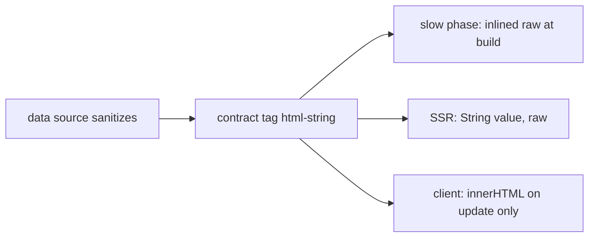

# 237 - html-string XSS sanitization

**Status:** [Implemented] — approved at design review; implemented on the `ai-web-mistakes/09-xss-sanitization` branch (see Implementation Results).
**Context:** "Top 10 things AI gets wrong in web dev", point #9 — DOM XSS & HTML sanitization.

## Decisions for the Implementer (TL;DR)

1. **Validators first** (solution priority, not build order — see Implementation Plan). Add four `jay-stack validate` rules plus one `generate-schema` CLI warning, all **warning** or **error** (validate has no `info` level). Every message names the guide `developer/html-safety.md`.
2. **No sanitizer anywhere, explicit trust.** `html-string` stays "trusted markup". Jay does not sanitize it on the server, in the slow phase, or on the client. A project that renders untrusted HTML sanitizes it **at the source, on the server**, before it enters ViewState (§Design 3).
3. **The client `sanitizeHtml` hook is dead end-to-end and stays untouched (deferred).** Wiring it would protect only client-side updates and needs new app-facing API (Q5). It is documented as not a defense.
4. **Fix the slow-phase escape bug (confirmed).** Slow resolution splices raw values into pre-rendered jay-html text. Escape every slow text value except `html-string`, and escape `&` and `"` in slow attribute values, using a `dataType` added to `PhaseInfo`. `resolveTextBindings` gets an escape mode so nothing is escaped twice (§4).
5. **Out of scope:** CSP, Trusted Types enforcement, `setHTML()` — covered in the guide only.

## Background

- Contract type `html-string` → `JayHtmlString` (`packages/compiler/compiler-shared/lib/jay-type.ts:29,38,230`). Docs: "rendered via innerHTML" (`docs/core/contract-files.md:541`).
- Plain `string` bindings are always text (escaped). DL#133 settled entity handling; its Phase 5 decided html-string is emitted raw on the server.
- Suppression today is **jay-html scoped only** (DL#200): `jay-validations="RULE"` on a headless import (parsed `jay-html-parser.ts:676`, checked `validate.ts:1364-1368`), or keys in the page's `<script type="application/jay-validations">` (YAML, parsed `jay-html-parser.ts:1088-1108`; e.g. `jay-stack: { allow-unused-tags: [...] }`, `validate.ts:2369-2383`). Nothing suppresses per contract tag or per `.ts` line. Plugins can add project validators (DL#232).

## Problem — verified code paths

| #   | Where                                                                                                                                                                                           | What happens                                                                                                                                                                                                                                                                                                                                                                                                                                                                                                                                                                  |
| --- | ----------------------------------------------------------------------------------------------------------------------------------------------------------------------------------------------- | ----------------------------------------------------------------------------------------------------------------------------------------------------------------------------------------------------------------------------------------------------------------------------------------------------------------------------------------------------------------------------------------------------------------------------------------------------------------------------------------------------------------------------------------------------------------------------- |
| 1   | `compiler-jay-html/lib/jay-target/jay-html-compiler.ts:158-183`; hydrate `jay-html-compiler-hydrate.ts:1055-1070,1270-1285`                                                                     | An html-string sole-child binding compiles to `dh(accessor)`                                                                                                                                                                                                                                                                                                                                                                                                                                                                                                                  |
| 2   | `runtime/runtime/lib/element.ts:644-662`                                                                                                                                                        | `applyHtmlContent` → `parentElement.innerHTML = sanitize ? sanitize(content) : content`                                                                                                                                                                                                                                                                                                                                                                                                                                                                                       |
| 3   | `runtime/runtime/lib/element-types.ts:67-70`, `context.ts:338-351`                                                                                                                              | `sanitizeHtml` hook exists on options and `withRootContext(..., sanitizeHtml)`                                                                                                                                                                                                                                                                                                                                                                                                                                                                                                |
| 4   | `runtime/component/lib/component.ts:149`; `jay-stack/stack-client-runtime/lib/hydrate-composite-component.ts:144-145`; `jay-html-compiler.ts:1075-1083`, `jay-html-compiler-hydrate.ts:862-870` | **Corrected finding: the hook is dead end-to-end.** `makeJayComponent` calls `preRender({ eventWrapper })` only — no caller ever supplies `sanitizeHtml`; the jay-stack hydrate wrapper only passes `options` through. The compiled `render` functions (incl. `createRenderFnCode` for headless instances) call `withRootContext(viewState, refManager, cb)` without it, and each child component / headless instance builds its own fresh root context, so nothing would inherit it either. Making it reachable needs a new app-facing API plus inheritance — deferred (Q5). |
| 5   | `jay-html-compiler-server.ts:872-889`                                                                                                                                                           | SSR emits `String(value)` for html-string, no escaping, no sanitizing                                                                                                                                                                                                                                                                                                                                                                                                                                                                                                         |
| 6   | `compiler-jay-html/lib/slow-render/slow-render-transform.ts:277, 414`                                                                                                                           | `resolveTextBindings` returns `String(value)` (`:277`); text nodes get `_rawText = resolved` (`:414`) — raw HTML for **any** slow binding                                                                                                                                                                                                                                                                                                                                                                                                                                     |
| 6b  | same file `:350-352`; node-html-parser 6.1.x `HTMLElement.setAttribute` / `quoteAttribute`                                                                                                      | the same `resolveTextBindings` result goes to `element.setAttribute`, which stores it as the **raw** attribute text and serializes with `quoteAttribute`: `"` → `&quot;`, nothing else escaped (and backslashes removed). So `"` cannot break out today ✅, but `&` is not escaped: a value `a&lt;b` is emitted as-is and decoded to `a<b` when the output jay-html is compiled — the value changes (corrected finding: data corruption, not attribute breakout)                                                                                                              |
| 6c  | same file `:79-85, :92-130`                                                                                                                                                                     | `PhaseInfo` has no `dataType`; `buildPhaseMap` reads `tag.dataType` only for enums (`:111-112`) and drops it (`:115`)                                                                                                                                                                                                                                                                                                                                                                                                                                                         |
| 7   | `plugins/data-files/lib/generate-schema.ts:10, :56, :79`                                                                                                                                        | Any data value starting with `<` is inferred as `html-string` (`:10`) once, in the generate-schema CLI (`:56`), and written to the contract as `dataType: html-string` (`:79`). Validate later sees only an explicit `html-string` — it cannot tell inferred from declared                                                                                                                                                                                                                                                                                                    |
| 6d  | `slow-render-transform.ts:350-352` vs `:410-414`                                                                                                                                                | text uses raw `child.rawText` (entities still encoded); attributes use `getAttribute`, which returns the **decoded** value. A literal `&amp;` in an attribute becomes a bare `&` in the output today                                                                                                                                                                                                                                                                                                                                                                          |
| 8   | `agent-kit-template/contracts/syntax.md:35`, `contracts/examples/product-page.md:15,90,98`, `plugin/contracts-guide.md:40`                                                                      | html-string described only as a type; no trust warning                                                                                                                                                                                                                                                                                                                                                                                                                                                                                                                        |

No sanitizer exists in compiler/runtime/server/plugins (the only one, `sanitizeAddMenuHtmlFragment` in plugin-validator's add-menu catalog lint, is unrelated).

**Agent mistakes this enables:** marking user/CMS input as `html-string` "so formatting shows"; writing `el.innerHTML = x` in `page.ts`; binding `href="{url}"` where `url` can be `javascript:`; adding `onclick="..."` attributes in jay-html.

## Prior Art / Adjacent Mechanisms

- **React** `dangerouslySetInnerHTML` — the name is the warning; no sanitizer. **Vue** `v-html`, **Svelte** `{@html}` — same: raw, documented as unsafe. **Angular** sanitizes by default (DomSanitizer, `bypassSecurityTrustHtml`).
- **Browser:** Sanitizer API / `Element.setHTML()` (not yet universal), Trusted Types (Chromium only).
- **In-repo:** DL#213 fixed a raw-vs-escaped bug in `<script>` children — same class of "which phase escapes" bug. DL#200 suppression pattern; DL#232 project validators.

Jay follows React/Vue/Svelte (raw, explicit type) — the gap is that the _type name_ carries no warning, so validators and the guide must.

## Q&A (open questions for the user)

1. **Where does `HTML-STRING-TRUST` fire, and how is it silenced?** _Default:_ at the **jay-html binding site** (the element binding an html-string value), silenced with the existing jay-html suppression (§1). Why: suppression only exists in jay-html; the binding site is where the trust decision is made (one contract can be bound by trusted and untrusted pages). _Consequence:_ every consumer page carries the warning until it acknowledges it once. _Alternative (rejected for now):_ fire on the contract tag with a new contract-level marker (e.g. `trusted: true`) — new syntax, and it would let a plugin silence the warning for all consumers. (Adding an `info` level to validate was rejected: validate routes only `error`/`warning`, `validate.ts:1891, 2574, 2738`.)
2. **Default sanitizer?** Ship none (proposed), ship a small allowlist sanitizer, or depend on DOMPurify? Shipping one creates a security-maintenance burden and SSR needs a DOM-less implementation.
3. **Severity of `RAW-HTML-SINK` in `.ts`:** _Default:_ warning (line scan has false positives). Alternative: error.
4. **Pages relying on raw slow strings start showing escaped text — acceptable?** _Default:_ yes, treated as a bug fix (nothing is known to rely on it); noted in the CHANGELOG under `## Unreleased`.
5. **Client `sanitizeHtml` hook (dead end-to-end, Problem row 4)?** _Decided:_ defer, leave untouched and documented as not wired. Follow-up options: (a) wire it via a jay-stack client option with inheritance through components and headless instances (framework feature — last in priority order, no second use case yet, covers client updates only); (b) remove the dead option. Default until a use case appears: neither.

6. **Inferred html-string in data files — warn or stop inferring?** _Decided:_ warn in the `generate-schema` CLI (§1). _Alternative (rejected):_ infer `string` instead — safer, but silently changes existing generated contracts (rich text starts showing as escaped markup) and removes a feature users rely on.
7. **CHANGELOG:** entries under `## Unreleased` in `compiler-jay-html` (slow escaping) and `stack-cli` (validate rules), plus `data-files` (CLI warning). No version change.

## Design

### 1. Validators (`jay-stack validate`)

| Rule id                | Severity | Catches                                                                                                                                                                                                                                                                                                                              | Full message                                                                                                                                                                                                                                                                                                                                                                                                                |
| ---------------------- | -------- | ------------------------------------------------------------------------------------------------------------------------------------------------------------------------------------------------------------------------------------------------------------------------------------------------------------------------------------ | --------------------------------------------------------------------------------------------------------------------------------------------------------------------------------------------------------------------------------------------------------------------------------------------------------------------------------------------------------------------------------------------------------------------------- |
| `HTML-STRING-TRUST`    | warning  | jay-html element whose binding resolves to an `html-string` tag; located at that element. Binding → tag path reuses the coverage analyzer's `collectUsedTags` / `usedTagsMap` (`validate.ts:369-377`), so reported paths match the suppression format                                                                                | "`{<key.tag>}` is html-string and is rendered as raw HTML. Jay does not sanitize html-string anywhere (server, slow phase, client). Bind only trusted markup, or sanitize it at the source on the server, then add it to `jay-stack: { allow-html-string: [...] }` in this page's application/jay-validations script, or add `jay-validations=\"HTML-STRING-TRUST\"` on the headless import. See developer/html-safety.md." |
| `RAW-HTML-SINK`        | warning  | line scan of the component `.ts` that validate already reads beside each `.jay-html` (`<name>.ts` or `page.ts`, same lookup as `checkDirectDocumentAccess`, `validate.ts:623-628`); so only `src/` pages/components, never `node_modules`, `dist` or tests: `.innerHTML =`, `.outerHTML =`, `insertAdjacentHTML(`, `document.write(` | "Raw HTML sink `<sink>` at <file>:<line>. Use a text binding, or an html-string tag with data sanitized at the source. See developer/html-safety.md."                                                                                                                                                                                                                                                                       |
| `INLINE-EVENT-HANDLER` | error    | jay-html attribute matching `on[a-z]+` on any element in a page/component `.jay-html`, including inline SVG and headless/plugin `.jay-html` templates the project validates                                                                                                                                                          | "Inline event handler `<attr>` on `<element>`. Add a ref and handle the event in the component. See developer/html-safety.md."                                                                                                                                                                                                                                                                                              |
| `JAVASCRIPT-URL`       | error    | **static** `href`/`src`/`action`/`formaction`/`xlink:href` (attribute names matched case-insensitively) value starting (case-insensitive, after trimming and removing tabs/newlines) with `javascript:` or `vbscript:`, or `data:text/html` (default; other `data:` e.g. images allowed)                                             | "`<attr>` uses a `<scheme>` URL (`javascript:`, `vbscript:` or `data:text/html`, the one matched), which runs script. Use a ref + event handler. See developer/html-safety.md."                                                                                                                                                                                                                                             |

**Not a validate rule — `generate-schema` CLI warning:** when the data-files `generate-schema` CLI infers `html-string` (`generate-schema.ts:10`), it prints a located warning: "`<file>`: field `<path>` was inferred as html-string (raw HTML) because its value starts with `<`. Declare it `string` if it is text. See developer/html-safety.md." No rule id; to silence, declare the type explicitly or ignore it. Reason: inference happens only in that CLI; validate sees an already-written `dataType: html-string`.

**Suppression** (no new mechanism for jay-html; one new comment form for `.ts`):

| Rule                   | How to suppress                                                                                                                                                                                                                                                                                                                                                                                                                                                                                                                                                                                                                                                                                                                                                                                                                                                                                                                                                                                                                                                                                                                                                                                                                                                                                                                                                                                               | New?           |
| ---------------------- | ------------------------------------------------------------------------------------------------------------------------------------------------------------------------------------------------------------------------------------------------------------------------------------------------------------------------------------------------------------------------------------------------------------------------------------------------------------------------------------------------------------------------------------------------------------------------------------------------------------------------------------------------------------------------------------------------------------------------------------------------------------------------------------------------------------------------------------------------------------------------------------------------------------------------------------------------------------------------------------------------------------------------------------------------------------------------------------------------------------------------------------------------------------------------------------------------------------------------------------------------------------------------------------------------------------------------------------------------------------------------------------------------------------- | -------------- |
| `HTML-STRING-TRUST`    | page script `jay-stack: { allow-html-string: ["<key>.<tag path>"] }` — mirrors `allow-unused-tags`, including its matching (`validate.ts:2375`): an entry matches either the key-qualified path or the bare tag path, e.g. `article.body` or `body` (bare matches that path in every import). Paths are dotted contract tag paths as built by `flattenContractTags` (`validate.ts:186-195`); nested/repeated sub-contract tags use the path with no index, e.g. `article.sections.body` (one entry covers every repeated item); page-own contract tags have no key prefix. **Linked sub-contracts (`link:`):** `flattenContractTags` only walks inline `tag.tags`, and the coverage path calls it on the unresolved `imp.contract` (`validate.ts:376`), so linked tags are invisible there. The new rule instead runs on a contract resolved with `resolveContractLinks` (`validate.ts:1745`, `resolveLinkedTags` `:1729-1742`, as the plugin-validator context already does at `:1835, :1853`), so a linked tag is addressed through the linking tag, e.g. `article.author.bio` where `author` has `link: ./author`. Limitation: recursive `$/` links are not expanded (a tag reached only through one is unaddressable; suppress via `jay-validations` on the import). A YAML `#` comment holds the reason, or `jay-validations="HTML-STRING-TRUST"` on the headless import to cover all that plugin's tags | new key only   |
| `INLINE-EVENT-HANDLER` | page script `jay-stack: { allow-inline-handler: ["<element>@<attr>"] }`, e.g. `"svg@onload"`                                                                                                                                                                                                                                                                                                                                                                                                                                                                                                                                                                                                                                                                                                                                                                                                                                                                                                                                                                                                                                                                                                                                                                                                                                                                                                                  | new key only   |
| `JAVASCRIPT-URL`       | page script `jay-stack: { allow-javascript-url: ["<exact attribute value>"] }`, e.g. `"javascript:void(0)"` — a list, not a page-wide switch                                                                                                                                                                                                                                                                                                                                                                                                                                                                                                                                                                                                                                                                                                                                                                                                                                                                                                                                                                                                                                                                                                                                                                                                                                                                  | new key only   |
| `RAW-HTML-SINK`        | same-line or preceding-line comment `// jay-validations: RAW-HTML-SINK <reason>`                                                                                                                                                                                                                                                                                                                                                                                                                                                                                                                                                                                                                                                                                                                                                                                                                                                                                                                                                                                                                                                                                                                                                                                                                                                                                                                              | **new syntax** |

Null hypothesis for the `.ts` comment: existing suppression lives in jay-html, which a `.ts` file cannot reach; a page-script list of `file:line` breaks whenever lines move. A line comment is the smallest mechanism that stays attached to the code (same idea as `eslint-disable-next-line`). The reason is required; without it the comment is ignored.

`RAW-HTML-SINK` is a plain line scan: it does not skip comments or string literals, so it can report false positives; those are suppressed with the comment.

**Dropped (noise):** a warning on bound `{expr}` URL attributes — it would fire on nearly every `href="{url}"`. Bound-URL scheme checking is covered by the guide only. Also dropped: a rule flagging every `{expr}` in attributes (Jay escapes attribute values on client and SSR).

### 2. Client `sanitizeHtml` hook — deferred, left as is

No change. Reasons (Q5): SSR and slow render emit html-string raw, and hydrate skips initial content (`applyHtmlContent(..., skipInitial = true)`, `runtime/lib/hydrate.ts:273`, `element.ts:648-654`), so a client-only hook would protect only later client updates; reaching it needs a new app-facing option plus inheritance through child components and headless instances (Problem row 4). The guide states the hook is not wired.

### 3. SSR parity

A client-only sanitizer is useless: SSR already sent the raw markup. Rule: **sanitize at the data source** (in the slow/fast render function, server-side), which covers SSR, slow pre-render and client updates at once. Jay sanitizes nothing; the dead client hook is not a defense (§2, Q5). No sanitize option in this log (see Q2).

### 4. Slow-phase escaping (confirmed bug)

| Step                                                            | Where                                                                                             | Change                                                                                                                                                                                                                                                                                                                                                                                                                                                          |
| --------------------------------------------------------------- | ------------------------------------------------------------------------------------------------- | --------------------------------------------------------------------------------------------------------------------------------------------------------------------------------------------------------------------------------------------------------------------------------------------------------------------------------------------------------------------------------------------------------------------------------------------------------------- |
| Carry the type                                                  | `PhaseInfo` (`slow-render-transform.ts:79-85`), filled in `buildPhaseMap` `phaseMap.set` (`:115`) | add `dataType?: JayType` from `tag.dataType`                                                                                                                                                                                                                                                                                                                                                                                                                    |
| Escape mode                                                     | `resolveTextBindings` (`:277`)                                                                    | new param `mode: 'text' \| 'attribute'`                                                                                                                                                                                                                                                                                                                                                                                                                         |
| Text binding (`:410-414`, input is raw `rawText`)               | mode `text`                                                                                       | escape each resolved non-html-string expression; html-string and literal text untouched                                                                                                                                                                                                                                                                                                                                                                         |
| Attribute binding (`:350-352`, input is decoded `getAttribute`) | mode `attribute`                                                                                  | resolver returns the unescaped string; the caller escapes the **whole** string once, `&` → `&amp;` then `"` → `&quot;`, before `setAttribute`, for every type incl. html-string. This also fixes literal `&amp;` → bare `&` (row 6d). `quoteAttribute` then finds no `"` and does not touch `&`, so nothing is escaped twice: value `x" onerror="alert(1)` → `alt="x&quot; onerror=&quot;alert(1)"` ✅ (traced against node-html-parser 6.1.x `quoteAttribute`) |
| Mixed text (`"Hi {name}"`)                                      | mode `text`                                                                                       | escape each resolved expression, not the literal text (already encoded)                                                                                                                                                                                                                                                                                                                                                                                         |

`html-string` slow text stays **inlined raw** — same as SSR (row 5). That is source-trust: the value must already be trusted or sanitized; the build does not sanitize it.

### 5. Agent-kit

New `agent-kit-template/developer/html-safety.md` (~1 page): html-string = trusted only; **jay does not sanitize html-string anywhere (server, slow, client)** — sanitize at the source on the server; do not rely on `RenderElementOptions.sanitizeHtml` (not wired); no DOM sinks in `.ts`; URL scheme check; CSP / Trusted Types as optional hardening. One-line trust warning added at `contracts/syntax.md:35` and `plugin/contracts-guide.md:40` linking to it.

## Implementation Plan (red tests first)

Order: slow-phase fix (bug) first, then validators, then guide. "Validators first" in the TL;DR is the solution priority, not the build order.

**Phase 0 — red tests** (fixture-based where the repo uses fixtures: `test/fixtures/<feature>/`)

- Slow render, new fixture dirs under `test/fixtures/slow-render/` (same shape as `attribute-slow-bindings/`: `contract.yaml`, `input.jay-html`, `slow-view-state.json`, `expected-output.jay-html`), driven from `test/slow-render/slow-render-transform.test.ts`:
  - `it("escapes a plain string slow value containing markup")` — `title: string` = ``; expected text `&lt;img src=x onerror=alert(1)&gt;`.
  - `it("escapes a quote in a slow attribute value")` — `alt="{title}"`, value `x" onerror="alert(1)`; expected `alt="x&quot; onerror=&quot;alert(1)"`.
  - `it("does not double-escape an attribute with a literal entity and a slow binding")` — `title="A &amp; {name}"`, `name` = `x<y`; expected exactly `title="A &amp; x<y"` (attribute values escape only `&` and `"`; literal `&amp;` kept, no `&amp;amp;`).
  - `it("keeps html-string slow value raw")` — `bio: html-string` = `<b>hi</b>`; expected `<b>hi</b>`.
  - `it("compiles escaped slow text without double-escape or re-decode")` — feed the first fixture's `expected-output.jay-html` (`&lt;img …&gt;`) to the jay-html compiler (element + server targets); expected: the literal text `` shown once, no `&amp;lt;`, no `` element.
- Validate, one per rule: `it("warns HTML-STRING-TRUST at the jay-html element binding an html-string tag")`, `it("suppresses HTML-STRING-TRUST via allow-html-string in the page script")`, `it("suppresses HTML-STRING-TRUST via jay-validations on the headless import")`, `it("warns RAW-HTML-SINK for innerHTML assignment in page.ts")`, `it("suppresses RAW-HTML-SINK via a preceding-line comment with a reason")`, `it("suppresses RAW-HTML-SINK via a same-line comment with a reason")`, `it("ignores a RAW-HTML-SINK comment without a reason")`, `it("errors INLINE-EVENT-HANDLER for onload on inline svg")`, `it("errors JAVASCRIPT-URL for vbscript: and data:text/html")`, `it("errors INLINE-EVENT-HANDLER for onclick in jay-html")`, `it("errors JAVASCRIPT-URL for static javascript: href")` (message contains `javascript:`), `it("suppresses HTML-STRING-TRUST for a nested tag via allow-html-string [\"article.sections.body\"]")`, `it("suppresses HTML-STRING-TRUST via a bare tag path [\"body\"]")`, `it("suppresses HTML-STRING-TRUST for a linked sub-contract tag via [\"article.author.bio\"]")`, `it("suppresses INLINE-EVENT-HANDLER via allow-inline-handler [\"svg@onload\"] only for that element/attr")`, `it("still errors INLINE-EVENT-HANDLER for img@onerror when only svg@onload is allowed")`, `it("errors JAVASCRIPT-URL for uppercase HREF and xlink:href")`, `it("suppresses JAVASCRIPT-URL via allow-javascript-url only for the listed value")`, `it("does not report JAVASCRIPT-URL for href=\"{url}\"")`; data-files CLI: `it("generate-schema warns with file and field when it infers html-string")`, `it("generate-schema does not warn for a plain string")`.

**Phase 1** slow-phase escaping for text and attributes (§4); rerun the DL#133 entity fixtures and all `test/fixtures/slow-render/*` unchanged. **Phase 2** validators and the generate-schema warning (§1). **Phase 3** agent-kit guide (§5). Each phase: `yarn confirm`.

## Demo plan (`demo-feature`)

Example page with a contract `bio: html-string` and `title: string`, both given ``:

1. Before (build of the branch-base commit, pre-fix): `title` (slow) renders as an image and sets document.title.
2. After: `title` (escaped slow string) shows literal text; `document.title` unchanged; `jay-stack validate` warns `HTML-STRING-TRUST` on `bio` (still raw — by design, the guide says sanitize at the source) and shows the other new rules. Video at the workspace root.

## Verification Criteria

- All Phase 0 tests go red → green; `yarn confirm` passes.
- Each validator fires on its fixture, is silent on a clean fixture, and is suppressible.
- Guide exists and every rule message names it.

## Trade-offs

- Client hook left dead: an app cannot get client-side defense in depth today; accepted because it would not cover SSR/slow output anyway (Q5).
- No default sanitizer: less safe-by-default than Angular, but no false sense of security and no sanitizer to maintain; consistent with React/Vue/Svelte.
- Line-scan rule is heuristic (false positives in comments) — accepted, suppressible, warning-level.
- Escaping slow strings could change output of pages that (unintentionally) relied on raw slow strings.

## Scope pre-mortem

- _"It grew into a sanitizer project"_ → guarded by Q2; core ships none.
- _"Rules are noisy and get suppressed everywhere"_ → `HTML-STRING-TRUST` fires per binding site, so consumers of plugin html-string tags see it until they acknowledge it once per page (accepted cost: that is the trust decision); no bound-URL rule.
- _"The `.ts` comment becomes a blanket off-switch"_ → it covers one line, requires a reason, and has no file-level form.
- _"Inferred html-string slips past validate"_ → caught where it happens, in the generate-schema CLI; an already-generated contract shows only `HTML-STRING-TRUST`.
- _"Slow bug fix broke DL#133 entity behaviour"_ → run DL#133 fixtures; escape `&`/`"` in all slow attribute values and all non-html-string text values.

## jay-feedback decision

- **Validation:** yes — four core validate rules (§1), plus a `generate-schema` CLI warning in data-files (inference is not visible to validate).
- **Agent-kit:** yes — `developer/html-safety.md` + trust warnings in contract guides.
- **Framework:** bug fix only (slow text + attribute escaping); no new feature. Client hook wiring deferred (Q5).

## Implementation Results

**Approved decisions applied:** `sanitizeHtml` hook kept and documented as unwired, not a defence; `RAW-HTML-SINK` is a warning; slow-phase escaping shipped as a security bug fix with CHANGELOG entries under `## Unreleased` (no version change); `// jay-validations: RAW-HTML-SINK <reason>` with the reason required; no default sanitizer; `INLINE-EVENT-HANDLER` (error) is owned here — the INP log (#244) drops its duplicate rule and its guide points to `developer/html-safety.md`.

### What shipped

| Area                     | Files                                                                                                                                                                                                                                                                                |
| ------------------------ | ------------------------------------------------------------------------------------------------------------------------------------------------------------------------------------------------------------------------------------------------------------------------------------ |
| Slow-phase escaping (§4) | `compiler-jay-html/lib/slow-render/slow-render-transform.ts` — `PhaseInfo.dataType`, `SlowValueEscapeMode` (`text` / `attribute`), `escapeTextValue`, `escapeAttributeValue`, `formatSlowValue`                                                                                      |
| Validate rules (§1)      | new module `stack-cli/lib/validate-html-safety.ts` (`checkHtmlStringTrust`, `checkRawHtmlSinks`, `checkInlineEventHandlers`, `checkJavascriptUrls`, aggregator `checkHtmlSafety`); `validate.ts` only gains one import, one 7-line call block and `export` on `resolveContractLinks` |
| generate-schema warning  | `data-files/lib/generate-schema.ts` — `generateSchemaWithWarnings()` returns `{ yaml, warnings }`; the CLI prints each warning; `generateSchema()` unchanged                                                                                                                         |
| Agent-kit (§5)           | new `developer/html-safety.md`; trust notes in `contracts/syntax.md` and `plugin/contracts-guide.md`; rows in `developer/INSTRUCTIONS.md` and `designer/validation-guide.md`                                                                                                         |
| CHANGELOG                | `## Unreleased` in `compiler-jay-html`, `stack-cli`, `data-files`                                                                                                                                                                                                                    |

**Final rule ids and suppression keys** (stable — downstream plugins may reference them):

| Rule                   | Severity | Suppression                                                                                                                               |
| ---------------------- | -------- | ----------------------------------------------------------------------------------------------------------------------------------------- |
| `HTML-STRING-TRUST`    | warning  | `jay-stack: { allow-html-string: ["<key>.<tag path>" \| "<tag path>"] }`, or `jay-validations="HTML-STRING-TRUST"` on the headless import |
| `RAW-HTML-SINK`        | warning  | `// jay-validations: RAW-HTML-SINK <reason>` on the same or preceding line (reason required)                                              |
| `INLINE-EVENT-HANDLER` | error    | `jay-stack: { allow-inline-handler: ["<element>@<attr>"] }`                                                                               |
| `JAVASCRIPT-URL`       | error    | `jay-stack: { allow-javascript-url: ["<exact trimmed value>"] }`                                                                          |

### Tests

- New: 22 tests — slow render 5 (`Slow value escaping (DL#237)`), validate 15 (`test/validate-html-safety.test.ts`, fixtures `test/fixtures/validate/html-safety/`), data-files 2. Red first: the two slow-render bug tests and 9 validator tests failed before the fix (the quote-in-attribute, html-string-raw and compile tests are regression guards that already held, as Problem row 6b predicted). **22/22 green.**
- Package suites: compiler-jay-html 774/774 (incl. all existing `slow-render/*` and DL#133 entity fixtures, unchanged); stack-cli 228/228; data-files 25/25.
- `yarn confirm`: rebuild and type check passed; tests passed in 60 packages. `dev-server` ran 811/811 assertions green but `hydration.test.ts` failed on `afterAll` hook timeouts (10 s browser/server close); a different set of hooks timed out on an isolated rerun, with machine load average 57–84 from parallel work — teardown flakiness under load, not an assertion failure. The 11 packages confirm then skipped were run one by one: all green (stack-cli 228, a11y 75, agent-skills 10, data-files 25, design-system 160, editing-policy 79, markdown 35, seo 66, design-system-demo 9, fake-shop 9, smoke-test 80). Format: prettier run on the changed files.

### Deviations

1. **Messages start with the rule id** (`HTML-STRING-TRUST: …`) and each adds its suppression hint, so the id and key are discoverable from the output. `HTML-STRING-TRUST` names the element (`{article.body} on 
`) and shows the key-qualified path even when the template writes a scoped `{body}`, because that is the path the allow list takes.
2. **`INLINE-EVENT-HANDLER` skips `<jay:…>` instance elements:** their attributes are component props (a prop such as `ongoing` would match `on[a-z]+`), not DOM attributes.
3. **Test grouping:** some planned `it`s were merged (svg `onload` + `img` `onerror` + `onclick` in one; `javascript:` / uppercase `HREF` / `vbscript:` / `data:text/html` / `xlink:href` / bound `{url}` / `data:image` in one; "allow `svg@onload`" + "still errors `img@onerror`" in one). Every case in the plan is asserted with its exact expected message.
4. **CHANGELOG files were created:** no package in this repo had one; each new file holds only `## Unreleased`.
5. **Demo finding — Problem row 6 is narrower in the running app than assumed.** Pre-fix, the payload did **not** execute in served pages: in both the dev server and the production build/serve, the SSR server element keeps `{title}` as a binding and escapes the slow value at request time (verified in the cached `page.server-element.ts` and in the browser: `document.title` unchanged). The raw splice lands in the **pre-rendered jay-html** (`build/dev/pre-rendered/<route>/page.jay-html`), which is compiled to the client element target — live when SSR is disabled (`DevServerOptions.disableSSR`) and the source for hydrate code. The fix is still required (that artifact must be a faithful, escaped template), but the Demo plan's step 1 ("title renders as an image") does not happen in the served page. The demo therefore shows the pre-rendered artifact from the base commit vs the branch rendered in sandboxed frames (onerror runs before, not after), then the live page on the branch, then `jay-stack validate` reporting `HTML-STRING-TRUST`. The `bio` html-string got benign markup so the live page stays readable.
6. **RAW-HTML-SINK** adds `document.writeln(` to `document.write(` (same sink) and ignores `innerHTML ===` comparisons. The existing `// jay-dom: allow` comment of the direct-DOM check is untouched (separate rule).

### Reviewer notes (round 6)

The notes reached the implementation after the first pass; each was checked and closed in follow-up commits.

1. **`collectUsedTags` records no locations and skips the page's own tags.** Confirmed. `HTML-STRING-TRUST` does not reuse it: `validate-html-safety.ts` has its own walker with the same scoping (keyed paths, `forEach`, `<jay:x>`, `with-data`). It reports the binding element and also resolves the page's own contract (`jayHtml.contract`, with linked sub-contracts resolved from `contractRef`). New tests cover page-own tags. _Deviation from §1:_ this is a sibling walker, not a reuse of `collectUsedTags`. Changing `collectUsedTags` would have touched coverage behaviour that other streams depend on.
2. **Kebab-case vs camelCase suppression paths.** This was a real gap: a kebab-case tag (`rich-text`) bound as `{richText}` was not resolved, so it never warned. Fixed. **Rule:** a binding segment matches a contract tag by exact name or by its camelCase. The warning prints the contract spelling (`rich-text`, consistent with `allow-unused-tags`). An `allow-html-string` entry matches in either spelling, because both sides are camelCased per segment before comparing. Tests cover both spellings, and html-safety.md documents the rule.
3. **Exact escape sets.** Text mode escapes `&`→`&amp;`, `<`→`&lt;`, `>`→`&gt;`, and leaves `"`, `'` and `\` as-is. Attribute mode escapes `&`→`&amp;` and `"`→`&quot;`, and leaves `<`, `>`, `'` and `\` as-is. There is one `it.each` test per character per mode, and html-safety.md documents both sets.
4. **Backslashes in slow attributes.** This was in scope, and is a real bug that goes further than the note said. node-html-parser `setAttribute`/`removeAttribute` re-serialize **every** attribute of the element through `quoteAttribute`, which strips all `\`. So a slow binding (or a slow boolean attribute) also corrupted literal siblings: `pattern="\d+"` became `d+`. A red test came first (fixture `slow-attribute-backslash`). The fix is `serializeRawAttributes()`, which rebuilds `rawAttrs` from the stored raw values after each mutation. CHANGELOG entry added.
5. **Demo route.** Handled by the sandboxed-frame demo; see Deviation 5.

Follow-up tests: validate 18/18 (+3), slow render +13 (6 text, 6 attribute, 1 backslash); compiler-jay-html 787/787, stack-cli 231/231.

### dev-server 14a timeouts reported after the review commits

One `yarn confirm` run on the branch tip (`ca5e2f01`) failed 10/811 dev-server tests: all of `hydration.test.ts` "14a. Instance with nested slow+fast sub-contract" in all three modes (15 s timeouts), plus `dev-server.test.ts` "simple-page hydration" with `ENOTEMPTY: rmdir …/dev-server/node_modules/.vite/deps`. Investigated on the same tip with a quiet machine (load average 5–15):

- 14a alone: passes. `hydration.test.ts` alone: 735/735. dev-server package: 811/811, with a warm, a cold, and the stale Vite cache restored (it held a leftover `deps_temp_*` directory).
- Full `yarn confirm`: **exit 0**, 72/72 packages (dev-server 811/811, compiler-jay-html 787/787, stack-cli 231/231).
- 14a passes through the changed code (slow `src`/`alt` attributes on an `` inside a headless instance). In the passing runs the DOM checks pass, so `serializeRawAttributes` emits the expected attributes.

**Conclusion:** not reproducible, so there was nothing to bisect and no code change was made. The failing run's `ENOTEMPTY` on `.vite/deps` points to the Vite dependency optimizer racing between the two dev-server test files, which share `node_modules/.vite`. In that state page loads hang, and the hang shows up as timeouts with correct DOM. This needs a separate test-infrastructure fix (for example a per-file Vite `cacheDir`) if it recurs.

### Agent feedback loop (jay-feedback)

- **Validation:** four core rules + the generate-schema warning, as designed.
- **Agent-kit:** `developer/html-safety.md` is the target of every message; contract guides carry the trust note.
- **Not added:** a rule for bound URL attributes (noise, as designed).
