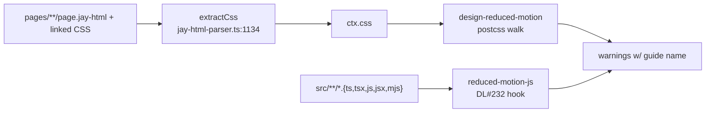

# Design Log #238 — Reduced-motion validation (stop teaching the blanket reset)

Status: **[Implemented]**. Builds on DL#145 (plugin validators), DL#151 (design-system validator), DL#188 (viewport-height validator — same shape), DL#232 (project-level validators).

## Decisions for the Implementer (TL;DR)

1. **Our own advice is wrong.** `design-tokens.ts:244` and `design-system.md:212` tell agents to add `* { transition-duration: 0s !important; animation-duration: 0s !important }`. Replace it everywhere with **per-element reduce/replace** and the **`no-preference` opt-in**.
2. **Owner: `@jay-framework/design-system-validator`** (decided, see Q1). New page validator `design-reduced-motion` plus project validator `reduced-motion-js`. Neither needs a `DESIGN.md`. Projects without the plugin get **no** reduced-motion checks (same as every other design-system check today).
3. **Six CSS rules + one JS rule**, all **warnings**, suppressible under the existing `design-system:` key in `<script type="application/jay-validations">`.
4. **Pages only.** Like `design-viewport-height`, the CSS rules skip files outside `pages/` (a component's `ctx.css` has only its own CSS, so a gate in page/global CSS would be missed → false positive).
5. **Only movement counts.** Opacity/colour fades never trigger a rule. For `missing`, movement = transitions/animations of `transform`/`translate`/`scale`/`rotate`/`all` and `@keyframes` that move. Smooth scroll and scroll-driven animation are owned by their own rules and never also trigger `missing` (no double-reporting). Declarations inside a `reduce` block are never movement.
6. **"Gated"** = the declaration is inside `@media (prefers-reduced-motion: no-preference)`, **or** the same selector is overridden inside `@media (prefers-reduced-motion: reduce)`.
7. **The old "missing override" check moves** out of `validateTokens` into the new validator. Key `allow-no-reduced-motion` is kept.
8. **JS rule** scans `src/**/*.{ts,tsx,js,jsx,mjs}` for `behavior: 'smooth'` / `.animate(`; a file that mentions `prefers-reduced-motion` passes.
9. **Fix framework-shipped wrong patterns**: `component-refs.md:192,258` and `ui-kit/lib/scroll-carousel.ts:20,26`.
10. **No runtime helper.** `matchMedia('(prefers-reduced-motion: reduce)')` is one line. Reduced motion maps to `behavior: 'instant'`, never `'auto'` (`'auto'` defers to CSS `scroll-behavior`, which may still be `smooth`).
11. **Demo project = fake-shop**, which gains `@jay-framework/design-system-validator` as a devDependency. Exact before/after warnings are listed in _Verification_.

## Background

Source: Chrome DevRel, "Top 10 things AI gets wrong in web dev", point 2. Motion can cause dizziness or nausea for people with vestibular disorders. Models usually remember `prefers-reduced-motion` for plain transitions, but get it wrong for:

| #   | Article mistake                                                                                                                                 |
| --- | ----------------------------------------------------------------------------------------------------------------------------------------------- |
| A   | `scroll-behavior: smooth` set globally and unconditionally on the root                                                                          |
| B   | Scroll-driven animations (`animation-timeline: scroll()/view()`) with no reduced-motion check                                                   |
| C   | Carousel: transition removed under `reduce`, but `transform` kept → items jump in size                                                          |
| D   | Blanket `0.01ms`/`0s` reset on `*, *::before, *::after` → also kills useful fades (opacity, colour) and can break JS waiting on `transitionend` |
| E   | `@view-transition { navigation: auto }` enabled unconditionally                                                                                 |

Also in scope: JS motion — `scrollIntoView/scrollTo/scrollBy({ behavior: 'smooth' })` and `element.animate()`.

## Problem

1. **Jay teaches mistake D.** ✅ verified:
   - `packages/plugins/design-system-validator/lib/validators/design-tokens.ts:238-247` — suggestion text is the blanket `*` reset.
   - `packages/plugins/design-system-validator/agent-kit/designer/design-system.md:208-212` — same text in the guide.
   - `packages/plugins/design-system-validator/test/validators/design-tokens.test.ts:254-270` — test locks the wrong text in.
2. **The check is narrow and too eager.** ✅ verified:
   - Runs only with a `DESIGN.md` that has animation tokens (`design-tokens.ts:150`, `:198`).
   - Passes if _any_ `@media` mentions `prefers-reduced-motion` (`:232`).
   - Fires on a pure fade: the test at `design-tokens.test.ts:254` expects a warning for `.fade { transition: opacity 300ms }` — the opposite of the guide's "keep fades".
   - Ignores A, B, C, E.
3. **Jay ships mistake A in JS/CSS.** ✅ verified:
   - `packages/jay-stack/stack-cli/agent-kit-template/developer/component-refs.md:192,258` — ungated `behavior: 'smooth'`; copied into `examples/jay-stack/design-system-demo/agent-kit/developer/component-refs.md`.
   - `packages/plugins/ui-kit/lib/scroll-carousel.ts:20,26` — ungated `scrollBy({ behavior: 'smooth' })`.
   - `packages/plugins/ui-kit/agent-kit/designer/scroll-carousel.md:50`, `examples/jay-stack/fake-shop/agent-kit/designer/scroll-carousel.md:60`, `examples/jay-stack/fake-shop/src/pages/ui-demo/page.jay-html:45` — ungated `scroll-behavior: smooth`.

## Prior Art / Adjacent Mechanisms

| Mechanism                                  | Where                                                                                                  | Use                                                                                                                                                                                                                                                                                   |
| ------------------------------------------ | ------------------------------------------------------------------------------------------------------ | ------------------------------------------------------------------------------------------------------------------------------------------------------------------------------------------------------------------------------------------------------------------------------------- |
| `checkReducedMotion`                       | `design-tokens.ts:218-248`                                                                             | **Moved and replaced.**                                                                                                                                                                                                                                                               |
| `design-viewport-height`                   | `design-viewport-height.ts:41-48` (DL#188)                                                             | Template: pages-only gate (`/pages/` path check), `design-system` override key, guide-named message.                                                                                                                                                                                  |
| `ctx.css`                                  | `compiler-jay-html/lib/jay-target/jay-html-parser.ts:1134-1189`                                        | ✅ Merges linked CSS (with `@import`) and `<style>` blocks. One parse covers the page.                                                                                                                                                                                                |
| `ctx.validationOverrides['design-system']` | `packages/compiler/compiler-shared/lib/plugin-validators.ts:32`; keys in `validation-guide.md:134-136` | Suppression to reuse.                                                                                                                                                                                                                                                                 |
| `projectValidators` hook                   | DL#232; runner `stack-cli/lib/validate.ts:1929-1975`                                                   | ✅ Loads the handler from the plugin's **tools** entry via `loadPluginToolsHandler`; context is only `{ projectRoot }` (`:1953`), so the validator globs files itself (as `seo-project-validator.ts:12` reads its own files). Finding has `file`, no line → line goes in the message. |
| `scanPlugins({ includeDevDeps: true })`    | `validate.ts:1808,1934`                                                                                | ✅ A devDependency is enough to load the plugin in the demo project.                                                                                                                                                                                                                  |
| Good examples in ui-kit                    | `spring-button-hover.md:52-60`, `sticky-header-scroll.md:102-108`                                      | Linked from the new guide.                                                                                                                                                                                                                                                            |

## Questions and Answers

**Q1. Which plugin owns this?**
A (decided): **design-system-validator.** It already owns the check, the `allow-no-reduced-motion` key, postcss and the cascade helper, and the guide `design-system.md` that must change. a11y-validator has no CSS-parsing code and no evidence of wider install (in examples only fake-shop depends on it). Without the plugin a project gets no reduced-motion warnings; the framework guide fixes (`component-refs.md`, `validation-guide.md`) still teach the right pattern.

**Q2. Error or warning?** Warning. Some projects knowingly accept a reset; they suppress it.

**Q3. How do we know a selector is overridden under `reduce`?** Exact selector-string match after whitespace normalisation. No specificity math. A different selector that matches the same element → false positive → suppress.

**Q4. Does `scroll-behavior: smooth` inside `reduce` count as a fix?** No. Only `scroll-behavior: auto` for the same selector in `reduce`, or `smooth` inside `no-preference`.

**Q5. JS rule — regex or AST?** Regex line scan. File-level pass (mentions `prefers-reduced-motion`) makes the fix and the escape hatch the same thing.

**Q6. Framework helper `prefersReducedMotion()`?** No — one standard line, works inside `exec$`.

**Q7. Rule for mistake C?** Yes, id **`reduced-motion/transform-kept`**, Phase 3. Keep criterion: it must stay silent on every should-not-warn fixture and on fake-shop after the fix; if not, drop it and record that in Implementation Results.

**Q8. Component files?** Skipped (pages only, TL;DR 4). Cost: motion defined only in a component file and never used on a page is not checked. Accepted. Only CSS the page itself links or inlines is in `ctx.css`; a component's own CSS that the page does not link is not checked from the page either.

**Q9. Why does `missing` keep a coarse pass ("any reduced-motion block exists")?** On purpose. `missing` only answers "did the author think about motion at all?". Per-selector correctness is the job of the targeted rules (`smooth-scroll`, `scroll-timeline`, `view-transition`, `transform-kept`, `blanket-reset`). Making `missing` per-selector would duplicate them and flood pages with one warning per moving selector.

**Q10. Example agent-kit copies — regenerate or hand-edit?** Regenerate. They are committed output of `jay-stack-cli agent-kit` (`fake-shop/package.json:9`, `design-system-demo/package.json:11`). After fixing the template/plugin guides and building, run `yarn agent-kit` in both examples and commit the result. Hand edits would drift from the source.

## Design

### Movement detection (shared)

A declaration is **movement** when:

| Property                                                                               | Movement if                                                                                                                                                                                                                                                                                                                                                             |
| -------------------------------------------------------------------------------------- | ----------------------------------------------------------------------------------------------------------------------------------------------------------------------------------------------------------------------------------------------------------------------------------------------------------------------------------------------------------------------- |
| `transition`, `transition-property`                                                    | lists `transform`, `translate`, `scale`, `rotate`, `all`, or names no property (shorthand default = `all`)                                                                                                                                                                                                                                                              |
| `transition-duration` alone                                                            | value is not all-zero (`0s`/`0ms`), and the rule has no `transition-property` limiting it to non-movement                                                                                                                                                                                                                                                               |
| `animation`, `animation-name` (not `none`), in a rule **without** `animation-timeline` | keyframes name = `animation-name`, or for the shorthand the first token that is not a time, easing (`ease*`, `linear`, `step*`, `cubic-bezier(`), number/`infinite`, direction, fill-mode, play-state or `none`; the referenced `@keyframes` in `ctx.css` sets `transform`/`translate`/`scale`/`rotate`, **or** the keyframes are not found (unknown → assume movement) |

| `scroll-behavior: smooth` | **not** movement for `missing` — owned by `smooth-scroll` |
| `animation-timeline` (and the `animation*` in the same rule) | **not** movement for `missing` — owned by `scroll-timeline` |
| any declaration inside `@media (prefers-reduced-motion: reduce)` (or bare `(prefers-reduced-motion)`) | **never** movement — a reset's `0.01ms` is not motion |

Never movement: opacity/colour/background/box-shadow transitions; `transition: none`; `transition-duration: 0s`; `animation: none`.

**Rule:** each declaration is reported by at most one rule. `missing` = transition/animation movement only.

**Finding order:** rule-table order (`missing`, `blanket-reset`, `smooth-scroll`, `scroll-timeline`, `view-transition`, `transform-kept`), then source order within a rule.

### Rule set

Validator `design-system-validator/design-reduced-motion`, severity **warning**, **pages only**. One finding per (rule, selector), deduped like `flaggedBreakpoints` in `design-tokens.ts:163`.

| Rule id                                   | Catches                                                                                                                                                                                                                                   | Pass when                                                                                                                                                                                                                                                                             | Suppress key                         |
| ----------------------------------------- | ----------------------------------------------------------------------------------------------------------------------------------------------------------------------------------------------------------------------------------------- | ------------------------------------------------------------------------------------------------------------------------------------------------------------------------------------------------------------------------------------------------------------------------------------- | ------------------------------------ |
| `reduced-motion/missing`                  | Page has a movement declaration and **no** `prefers-reduced-motion` media block at all                                                                                                                                                    | any such block exists (Q9)                                                                                                                                                                                                                                                            | `allow-no-reduced-motion` (existing) |
| `reduced-motion/blanket-reset`            | Inside `reduce`, a rule whose selector list contains `*` (alone or `*::before`/`*::after`, even mixed with named selectors) setting `transition*`/`animation*`                                                                            | reset targets named selectors only                                                                                                                                                                                                                                                    | `allow-blanket-motion-reset`         |
| `reduced-motion/smooth-scroll`            | `scroll-behavior: smooth` not gated                                                                                                                                                                                                       | inside `no-preference`, or same selector has `scroll-behavior: auto` in `reduce`                                                                                                                                                                                                      | `allow-smooth-scroll`                |
| `reduced-motion/scroll-timeline`          | `animation-timeline` = `scroll(`/`view(`/named timeline, not gated                                                                                                                                                                        | inside `no-preference`, or same selector sets `animation: none`/`animation-name: none` in `reduce`                                                                                                                                                                                    | `allow-scroll-animation`             |
| `reduced-motion/view-transition`          | `@view-transition { navigation: auto }` not inside `no-preference`                                                                                                                                                                        | wrapped in `no-preference`                                                                                                                                                                                                                                                            | `allow-view-transition`              |
| `reduced-motion/transform-kept` (Phase 3) | Inside `reduce`, selector S sets transition `none`/`0s`, and an ungated rule T outside `reduce` sets `transform` where T = S after stripping trailing `:hover`/`:focus`/`:focus-visible`/`:active` (Q3 normalisation). One finding per T. | `reduce` has a rule with **exactly T** (e.g. `.slide:hover`, not `.slide`) setting `transform: none`, or T's `transform` is inside `no-preference`. Reason: `.slide:hover` is more specific than `.slide`, so `reduce { .slide { transform: none } }` loses and the item still jumps. | `allow-transform-under-reduce`       |

`@supports` wrappers are transparent: a declaration inside `@supports (...)` or `@supports not (...)` is judged by its `@media` ancestors only. A rule inside `@supports not (animation-timeline: scroll())` is a fallback for browsers without scroll timelines, so `scroll-timeline` never fires there (it has no `animation-timeline` declaration anyway).

`@media (prefers-reduced-motion)` (no value) matches `reduce` per spec → treat as `reduce`.

### JS rule (project validator)

|          |                                                                                                                                   |
| -------- | --------------------------------------------------------------------------------------------------------------------------------- |
| Id       | `reduced-motion/js-motion`, validator `design-system-validator/reduced-motion-js`                                                 |
| Files    | `src/**/*.{ts,tsx,js,jsx,mjs}` under `projectRoot`, walked with `fs.readdirSync(dir, { recursive: true })` (Node ≥20, no new dep) |
| Excluded | `**/*.d.ts`, `**/*.test.*`, `**/*.spec.*`, `**/test/**`, `**/__tests__/**`, `**/node_modules/**`, `**/dist/**`                    |
| Triggers | `/behavior:\s*['"]smooth['"]/` or `/\.animate\(/`                                                                                 |
| Pass     | file text contains `prefers-reduced-motion`                                                                                       |
| Finding  | one per file, first matching line in the message                                                                                  |

Only project `src/` is scanned — ui-kit's own `lib/` is covered by its unit test (Phase 1).

### Exact messages

```
reduced-motion/missing
  message:    [reduced-motion/missing] Page moves elements (transform/scroll/animation) but has no @media (prefers-reduced-motion) rules
  suggestion: Put movement inside @media (prefers-reduced-motion: no-preference) { ... }, or override each moving selector inside @media (prefers-reduced-motion: reduce). Keep opacity/color fades. Do not use a "*" reset. See design-system-validator agent-kit/designer/reduced-motion.md. If intentional, suppress with design-system: { allow-no-reduced-motion: true } in <script type="application/jay-validations">.

reduced-motion/blanket-reset
  message:    [reduced-motion/blanket-reset] "*" reset inside @media (prefers-reduced-motion: reduce) removes all transitions, including fades that show state changes
  suggestion: Reduce motion per element instead: keep opacity/color transitions, remove or replace only movement (transform, scroll, parallax). See design-system-validator agent-kit/designer/reduced-motion.md. If intentional, suppress with design-system: { allow-blanket-motion-reset: true } in <script type="application/jay-validations">.

reduced-motion/smooth-scroll
  message:    [reduced-motion/smooth-scroll] "<selector>" sets scroll-behavior: smooth for every user
  suggestion: Wrap it: @media (prefers-reduced-motion: no-preference) { <selector> { scroll-behavior: smooth; } }. See design-system-validator agent-kit/designer/reduced-motion.md. If intentional, suppress with design-system: { allow-smooth-scroll: true } in <script type="application/jay-validations">.

reduced-motion/scroll-timeline
  message:    [reduced-motion/scroll-timeline] "<selector>" runs a scroll-driven animation (animation-timeline: <value>) for every user
  suggestion: Move the animation-timeline rule inside @media (prefers-reduced-motion: no-preference), or set animation: none for "<selector>" inside @media (prefers-reduced-motion: reduce). See design-system-validator agent-kit/designer/reduced-motion.md. If intentional, suppress with design-system: { allow-scroll-animation: true } in <script type="application/jay-validations">.

reduced-motion/view-transition
  message:    [reduced-motion/view-transition] @view-transition { navigation: auto } is enabled for every user
  suggestion: Wrap it: @media (prefers-reduced-motion: no-preference) { @view-transition { navigation: auto; } }. See design-system-validator agent-kit/designer/reduced-motion.md. If intentional, suppress with design-system: { allow-view-transition: true } in <script type="application/jay-validations">.

reduced-motion/transform-kept
  message:    [reduced-motion/transform-kept] "<T>" still changes transform under reduce after "<S>" turned off its transition, so it jumps instead of moving
  suggestion: Set transform: none for "<T>" (the selector that sets the transform) inside @media (prefers-reduced-motion: reduce), or move "<T>" inside @media (prefers-reduced-motion: no-preference). See design-system-validator agent-kit/designer/reduced-motion.md. If intentional, suppress with design-system: { allow-transform-under-reduce: true } in <script type="application/jay-validations">.

reduced-motion/js-motion   (file = src/.../x.ts)
  message:    [reduced-motion/js-motion] line <n>: <"behavior: 'smooth'" | ".animate("> runs motion without checking prefers-reduced-motion
  suggestion: Check window.matchMedia('(prefers-reduced-motion: reduce)').matches and use behavior: 'instant' / skip the animation when it is true. See design-system-validator agent-kit/designer/reduced-motion.md.
```

### "Gated" check (shared helper)

```
isGated(declaration, offValue):
  if any ancestor @media matches /prefers-reduced-motion:\s*no-preference/
     or /not\s*\(\s*prefers-reduced-motion:\s*reduce\s*\)/             → gated
  if a @media reduce rule in ctx.css has the same normalised selector
     and sets offValue for that property                                    → gated
  otherwise                                                                  → not gated
```

### Registration

| File                                            | Change                                                                                                                                                                                                                                                                                                                                                                 |
| ----------------------------------------------- | ---------------------------------------------------------------------------------------------------------------------------------------------------------------------------------------------------------------------------------------------------------------------------------------------------------------------------------------------------------------------- |
| `lib/validators/design-reduced-motion.ts` (new) | `export const validateReducedMotion: JayHtmlValidatorFn`                                                                                                                                                                                                                                                                                                               |
| `lib/validators/reduced-motion-js.ts` (new)     | `export const validateReducedMotionJs: ProjectValidatorFn`                                                                                                                                                                                                                                                                                                             |
| `lib/tools.ts`                                  | export both (project handlers are loaded from the tools entry by `loadPluginToolsHandler`)                                                                                                                                                                                                                                                                             |
| `plugin.yaml`                                   | `validators:` → `design-reduced-motion` / `validateReducedMotion`; new `projectValidators:` → `reduced-motion-js` / `validateReducedMotionJs`                                                                                                                                                                                                                          |
| `lib/validators/design-tokens.ts`               | delete `checkReducedMotion` + `ANIMATION_PROPERTIES` and the call at `:198-200`. Side effect: `validateTokens` appends its `GUIDE_SUGGESTION` finding (`:202-204`) only when it has findings, so a page whose only issue was missing reduced-motion no longer gets the `design-system.md` guide line. Intended — the new messages name `reduced-motion.md` themselves. |

### Flow



### Guide — `packages/plugins/design-system-validator/agent-kit/designer/reduced-motion.md` (new)

1. Why: vestibular disorders; motion ≠ all animation.
2. Rule of thumb: **movement** (transform, scroll, parallax, zoom, view transitions) → remove or replace with a fade; **fades** (opacity, colour) → keep.
3. Two patterns: `no-preference` opt-in (default), or per-selector `reduce` override. Link `spring-button-hover.md`.
4. ❌ The `*` reset and why (kills state fades; `transitionend` listeners may never fire).
5. Smooth scroll, scroll-driven animation, view transitions — one ❌/✅ snippet each.
6. Carousel: when you remove the transition, also reset `transform: none` on the **selector that sets it** (e.g. `.slide:hover`, not `.slide`) — or keep the transform inside `no-preference`.
7. JS: `matchMedia` gate inside `exec$`, `behavior: reduce ? 'instant' : 'smooth'`.
8. Suppression keys table.

### Other file changes

| File                                                                  | Change                                                                                                                                                                                                                  |
| --------------------------------------------------------------------- | ----------------------------------------------------------------------------------------------------------------------------------------------------------------------------------------------------------------------- |
| `design-system-validator/agent-kit/designer/design-system.md:208-212` | replace the blanket suggestion; point to `reduced-motion.md`                                                                                                                                                            |
| `stack-cli/agent-kit-template/designer/validation-guide.md:134-136`   | add the five new keys                                                                                                                                                                                                   |
| `stack-cli/agent-kit-template/developer/component-refs.md:192,258`    | gate `behavior` with `matchMedia` (`'instant'` under reduce)                                                                                                                                                            |
| `ui-kit/agent-kit/designer/scroll-carousel.md:50`                     | wrap `scroll-behavior: smooth` in `no-preference`                                                                                                                                                                       |
| `ui-kit/lib/scroll-carousel.ts:20,26`                                 | extract `scrollCarouselBy(el, direction)` (exported for the test; reads `matchMedia` and scrolls); `behavior: reduce ? 'instant' : 'smooth'`; reads `globalThis.matchMedia` (works in the browser and in the node test) |
| `examples/jay-stack/fake-shop/package.json`                           | add devDependency `"@jay-framework/design-system-validator": "workspace:^"`                                                                                                                                             |
| `examples/jay-stack/fake-shop/src/pages/ui-demo/page.jay-html`        | move `scroll-behavior: smooth` (`:45`) and the transform transitions (`:84`, `:95-96`) into `no-preference`, keep the colour/background fades                                                                           |
| `examples/jay-stack/*/agent-kit/**`                                   | regenerate with `yarn agent-kit` (Q10), no hand edits                                                                                                                                                                   |

## Scope pre-mortem — what this will not handle

| Gap                                                                          | Decision                                                                                                                                                 |
| ---------------------------------------------------------------------------- | -------------------------------------------------------------------------------------------------------------------------------------------------------- |
| Third-party CSS from `node_modules`                                          | Out — `ctx.css` only has project CSS.                                                                                                                    |
| Inline `style="..."`                                                         | Defer — cannot be gated inline; guide says don't.                                                                                                        |
| Component files checked on their own                                         | Out — pages only (Q8).                                                                                                                                   |
| Non-scroll `@keyframes` animations (spin, pulse, parallax via transform)     | Covered **only** by `missing` (coarse). A page with an unrelated reduced-motion block and an ungated spinner passes. Accepted; the guide shows the gate. |
| A gated and an ungated JS call in one file                                   | Passes (file-level rule).                                                                                                                                |
| `transitionend` listeners                                                    | Guide only.                                                                                                                                              |
| JS animation libraries (GSAP etc.)                                           | Defer.                                                                                                                                                   |
| `/\.animate\(/` also matches jQuery `.animate(` and other libraries' methods | Accepted false positive; mentioning `prefers-reduced-motion` in the file (the fix) silences it.                                                          |
| Equivalent but different selectors                                           | False positive; suppress.                                                                                                                                |
| Auto-fix                                                                     | No.                                                                                                                                                      |

## Implementation Plan

**Phase 1 — RED tests (write first, all fail).**

`packages/plugins/design-system-validator/test/validators/design-reduced-motion.test.ts` — each "should warn" expects exactly the message above; each "should not warn" expects `[]`. Contexts use a `src/pages/x/page.jay-html` path. Fixture CSS lives in `test/fixtures/reduced-motion/<rule>-<case>.css` (repo rule: fixtures as files); assertions use `toEqual` on the full findings array, never `toContain`.

Expected arrays below list findings in order, by rule id and selector; each entry is the exact message/suggestion from _Exact messages_ with that selector. "Should not warn" = `[]`.

| Rule                       | Should warn → expected findings                                                                                                                                                                                                                                                                                  | Should not warn                                                                                                                                                                                                                                                                                                           |
| -------------------------- | ---------------------------------------------------------------------------------------------------------------------------------------------------------------------------------------------------------------------------------------------------------------------------------------------------------------- | ------------------------------------------------------------------------------------------------------------------------------------------------------------------------------------------------------------------------------------------------------------------------------------------------------------------------- |
| missing                    | `.lift { transition: transform 200ms }`, no `DESIGN.md` (bug repro: today `[]`, `design-tokens.ts:150`) → `[missing]`; `.spin { animation: 2s linear infinite spin }` + `@keyframes spin` rotating (name not first token) → `[missing]`                                                                          | `.fade { transition: opacity 300ms }` (bug repro: today warns, `design-tokens.test.ts:254`); `.x { transition-duration: 0s }`; same `.lift` in `src/components/x.jay-html`                                                                                                                                                |
| blanket-reset              | `.card { transition: opacity 200ms }` + `reduce { *, *::before, *::after { transition-duration: 0.01ms !important } }` → `[blanket-reset]` (reduce exists → no `missing`; reset is not movement)                                                                                                                 | `.card, .menu { transition: none }` in `reduce`                                                                                                                                                                                                                                                                           |
| blanket-reset (mixed list) | `reduce { .card, * { animation: none } }` → `[blanket-reset]`                                                                                                                                                                                                                                                    | —                                                                                                                                                                                                                                                                                                                         |
| smooth-scroll              | `html { scroll-behavior: smooth }` → `[smooth-scroll "html"]` (no `missing`: smooth scroll is not `missing` movement)                                                                                                                                                                                            | inside `no-preference`; or `html { scroll-behavior: auto }` in `reduce`                                                                                                                                                                                                                                                   |
| smooth-scroll + missing    | `html { scroll-behavior: smooth } .lift { transition: transform 200ms }` → `[missing, smooth-scroll "html"]` (in that order)                                                                                                                                                                                     | —                                                                                                                                                                                                                                                                                                                         |
| scroll-timeline            | `.bar { animation: grow linear; animation-timeline: scroll() }` → `[scroll-timeline ".bar" (scroll())]` (no `missing`)                                                                                                                                                                                           | `.bar { animation: none }` in `reduce` (CSS from `sticky-header-scroll.md`); fallback inside `@supports not (animation-timeline: scroll())`; ungated rule inside `@media not (prefers-reduced-motion: reduce)`                                                                                                            |
| view-transition            | `@view-transition { navigation: auto }` → `[view-transition]`                                                                                                                                                                                                                                                    | wrapped in `no-preference`                                                                                                                                                                                                                                                                                                |
| bare media query           | —                                                                                                                                                                                                                                                                                                                | `.lift { transition: transform 200ms }` + `@media (prefers-reduced-motion) { .lift { transition: none } }` → `[]` (bare query treated as `reduce`: block exists, its declarations are not movement); and `html { scroll-behavior: smooth }` + `@media (prefers-reduced-motion) { html { scroll-behavior: auto } }` → `[]` |
| transform-kept (Phase 3)   | base `.slide { transition: transform 300ms } .slide:hover { transform: scale(1.1) }` plus: (a) `reduce { .slide { transition: none } }` → `[transform-kept T=".slide:hover" S=".slide"]`; (b) `reduce { .slide { transition: none; transform: none } }` → same single finding (`.slide` loses to `.slide:hover`) | base + `reduce { .slide { transition: none } .slide:hover { transform: none } }`; `.slide:hover { transform }` inside `no-preference` + `reduce { .slide { transition: none } }`; `.slide { transition: none }` under reduce with no transform anywhere                                                                   |
| suppression                | table-driven: each key silences its rule                                                                                                                                                                                                                                                                         | —                                                                                                                                                                                                                                                                                                                         |

`test/validators/design-tokens.test.ts:254-270` — **change** to expect `validateTokens` returns `[]` for that fixture (the check moved, and a fade is not movement).

`test/validators/reduced-motion-js.test.ts` (temp dir as `projectRoot`):

- `should warn with line number on behavior: 'smooth' without matchMedia` (`.ts`)
- `should warn on element.animate( in a .tsx file`
- `should not warn when the file mentions prefers-reduced-motion`
- `should skip .d.ts, *.test.ts and test/ files`

`packages/plugins/ui-kit/test/scroll-carousel.test.ts` (node env: `ui-kit/vite.config.ts` sets no test environment, so there is no `window`):

- The helper reads `globalThis.matchMedia` (decided; no `window` stub). Test: `vi.stubGlobal('matchMedia', vi.fn((query) => ({ matches: true, media: query })))`; fake `el = { clientWidth: 300, scrollBy: vi.fn() }`.
- `should scroll with behavior 'instant' when reduced motion is preferred` → `scrollCarouselBy(el, 1)` calls `el.scrollBy({ left: 300, behavior: 'instant' })`; `-1` → `{ left: -300, behavior: 'instant' }`; matchMedia called with `'(prefers-reduced-motion: reduce)'`.
- `should scroll smoothly when no reduced-motion preference` → `matches: false` → `{ left: 300, behavior: 'smooth' }`.

**Phase 2 — implement** the two validators and registration (table above), delete `checkReducedMotion`, write `reduced-motion.md`, fix guides and ui-kit, regenerate example agent-kits.

**Phase 3 — `transform-kept`**, keep/drop per Q7.

**Phase 4 — demo** (`demo-feature`) on fake-shop `ui-demo`; see Verification 2 and 4. Record to the workspace root.

Run `yarn confirm` at the end. Never bump versions; CHANGELOG entries under `## Unreleased`.

## Examples

❌ Blanket reset (`blanket-reset`)

```css
@media (prefers-reduced-motion: reduce) {
  *,
  *::before,
  *::after {
    transition-duration: 0.01ms !important;
    animation-duration: 0.01ms !important;
  }
}
```

✅ Opt-in movement, keep the fade

```css
.card {
  transition: opacity 200ms ease;
}
@media (prefers-reduced-motion: no-preference) {
  .card {
    transition:
      opacity 200ms ease,
      transform 300ms ease;
  }
  .card:hover {
    transform: translateY(-4px);
  }
}
```

✅ Fade alone — no warning, no gate needed

```css
.dropdown {
  opacity: 0;
  transition: opacity 0.15s;
}
```

❌ / ✅ Smooth scroll

```css
html {
  scroll-behavior: smooth;
} /* ❌ */
@media (prefers-reduced-motion: no-preference) {
  html {
    scroll-behavior: smooth;
  }
} /* ✅ */
```

✅ JS

```ts
export function scrollCarouselBy(el: HTMLElement, direction: 1 | -1) {
  const reduce = globalThis.matchMedia('(prefers-reduced-motion: reduce)').matches;
  el.scrollBy({ left: direction * el.clientWidth, behavior: reduce ? 'instant' : 'smooth' });
}
```

## Trade-offs

| Choice               | Benefit                              | Cost                                      |
| -------------------- | ------------------------------------ | ----------------------------------------- |
| Warnings, not errors | No broken builds                     | Can be ignored                            |
| Movement only        | No noise on fades; matches the guide | Must parse transition lists and keyframes |
| Pages only           | No false positives from split CSS    | Unlinked component CSS unchecked          |
| Exact selector match | Simple, predictable                  | False positives on equivalent selectors   |
| File-level JS pass   | No new suppression syntax            | Mixed files pass                          |
| Separate validator   | Runs without `DESIGN.md`             | One existing test rewritten               |
| No runtime helper    | No new API                           | Agents write one `matchMedia` line        |

## Verification Criteria

1. All Phase 1 tests red → green. `git grep "transition-duration: 0s !important"` returns nothing outside this log.
2. **fake-shop `jay-stack validate`** (plugin added as devDependency, before the page fix) reports exactly these reduced-motion warnings, for `src/pages/ui-demo/page.jay-html`:
   - `[reduced-motion/missing] Page moves elements (transform/scroll/animation) but has no @media (prefers-reduced-motion) rules` — the finding has no location; its causes are the transform transitions at `:84` (`.slider::before`) and `:95` (`.letter-demo .letter`), not part of the message.
   - `[reduced-motion/smooth-scroll] ".carousel-track" sets scroll-behavior: smooth for every user` (`:45`)
   - Order: `missing`, then `smooth-scroll`. Not movement: `.carousel-btn` / `.has-tooltip::after` static `transform` (no transform transition).
   - No warning for `.dropdown { transition: opacity 0.15s }` (`:38`) or `.slider { transition: background 0.2s }` (`:83`).
   - No `js-motion` warning (fake-shop `src/` has no `behavior: 'smooth'` / `.animate(`).
     After the fix (lines `:45`, `:84`, `:95` become as below; everything else unchanged) → zero `reduced-motion/*` warnings:
   ```css
   .carousel-track {
     display: flex;
     overflow-x: auto;
     scroll-snap-type: x mandatory;
     gap: 12px;
     padding: 8px 0;
     scrollbar-width: none;
   }
   .slider::before {
     content: '';
     position: absolute;
     width: 18px;
     height: 18px;
     left: 3px;
     bottom: 3px;
     background: white;
     border-radius: 50%;
   }
   .letter-demo .letter {
     display: inline-block;
     transition: color 0.2s;
   }
   @media (prefers-reduced-motion: no-preference) {
     .carousel-track {
       scroll-behavior: smooth;
     }
     .slider::before {
       transition: transform 0.2s;
     }
     .letter-demo .letter {
       transition:
         transform 0.2s,
         color 0.2s;
     }
   }
   ```
   Colour/opacity fades (`.dropdown`, `.slider` background, `.has-tooltip::after`, `.letter` colour) stay ungated. Under reduce the hover transforms still apply instantly (no transition) — no `transform-kept`, since no `reduce` block turns a transition off. Adding the plugin also brings its devOnly `/design-system/settings` route and its `agentkit` generator (`plugin.yaml:3,24`), so the regenerated fake-shop agent-kit gains design-system files — expected, not drift. Other new design-system warnings that adding the plugin may surface (contrast, font fallbacks, undefined vars) are out of scope; list them in Implementation Results, do not fix here.
   design-system-demo: has no motion CSS and does not install the plugin; it only gets the regenerated agent-kit.
3. A page with no `DESIGN.md` and `.lift { transition: transform 200ms }` gets `reduced-motion/missing`; `.fade { transition: opacity 300ms }` gets nothing.
4. **Browser demo** (Playwright, fake-shop `/ui-demo`). The track snaps (`scroll-snap-type: x mandatory`, slides `calc(33.33% - 8px)` + `gap: 12px`, `page.jay-html:45,47`), so the resting `scrollLeft` is a snap point, not `clientWidth`. Measure: click "next", read `scrollLeft` right after the click (`first`), then after ~800 ms (`final`).

   | Run                                                | Expected                                                   |
   | -------------------------------------------------- | ---------------------------------------------------------- |
   | Pre-fix baseline, `reduce` (record as the red run) | `first < final` — JS smooth scroll animates despite reduce |
   | Post-fix, `reduce`                                 | `first === final` (> 0)                                    |
   | Post-fix, `no-preference`                          | `first < final`; reaches `final` within ~500 ms            |

   This proves the **JS** fix (`scrollBy({ behavior })` overrides CSS `scroll-behavior`, so the CSS move alone cannot change it); the CSS move into `no-preference` is checked by the validator (Verification 2). The ~500 ms bound is informational, not pass/fail.

   Video saved at the workspace root.

5. Feedback loop (jay-feedback): validation = the rules above; guide = `reduced-motion.md`; framework feature = none (Q6).

## Open questions

None blocking. Product may later want reduced-motion checks for projects without design-system-validator (e.g. moving them into core validate); out of scope here.

## Implementation Results

Status after implementation: **[Implemented]**.

### What landed

| Area                                                                                         | Files                                                                                                                                                                                                              |
| -------------------------------------------------------------------------------------------- | ------------------------------------------------------------------------------------------------------------------------------------------------------------------------------------------------------------------ |
| Page validator `design-reduced-motion` (6 rules incl. Phase 3 `transform-kept`, kept per Q7) | `design-system-validator/lib/validators/design-reduced-motion.ts`                                                                                                                                                  |
| Project validator `reduced-motion-js`                                                        | `design-system-validator/lib/validators/reduced-motion-js.ts`                                                                                                                                                      |
| Registration                                                                                 | `lib/tools.ts`, `plugin.yaml` (`validators:` + new `projectValidators:`)                                                                                                                                           |
| Old check removed                                                                            | `checkReducedMotion` + `ANIMATION_PROPERTIES` (and the now-unused `postcss` import) deleted from `design-tokens.ts`                                                                                                |
| Guides                                                                                       | new `agent-kit/designer/reduced-motion.md`; `design-system.md` (blanket reset removed); `validation-guide.md` (five new keys); `component-refs.md` (both snippets gated, `'instant'`); ui-kit `scroll-carousel.md` |
| ui-kit                                                                                       | `scrollCarouselBy(el, direction)` exported from `lib/scroll-carousel.ts`, reads `globalThis.matchMedia`                                                                                                            |
| fake-shop                                                                                    | devDependency `@jay-framework/design-system-validator`; `ui-demo/page.jay-html` movement moved into `no-preference`                                                                                                |
| Example agent-kits                                                                           | regenerated with `yarn agent-kit` in fake-shop and design-system-demo (no hand edits)                                                                                                                              |

### Reviewer notes folded in (final review round)

1. Demo waits for `scrollLeft > 0` before the first read.
2. One `isReduceMedia(params)` helper; it excludes `not (prefers-reduced-motion: reduce)`, which `isNoPreferenceMedia` treats as an opt-in.
3. "scroll" removed from the `missing` message: it is now `Page moves elements (transform/animation) but has no @media (prefers-reduced-motion) rules` (smooth scroll is never `missing` movement, so the old wording was misleading).
4. `transform-kept` takes source order into account: the exact `T { transform: none }` override in `reduce` passes only when it comes **after** T (new fixture `transform-kept-override-before.css` → finding).
5. The scroll-timeline override fixture is labelled "adapted from" `sticky-header-scroll.md`.
6. The demo page's remaining hover transform (`.letter-demo .letter:hover`, old `:96`) is gated too; its colour change stays ungated.
7. `reduced-motion.md` states that `js-motion` has no suppression key.
8. `allow-no-reduced-motion` is documented with its new meaning (only `missing`: movement and no reduced-motion block at all) in `validation-guide.md` and `reduced-motion.md`.

### Deviations

- **`transform-kept` needs a state pseudo-class.** T must end in `:hover`/`:focus`/`:focus-visible`/`:active` (T ≠ S). The literal rule (T = S after stripping) would also match a static `transform` on the reset selector itself (e.g. `.carousel-btn { transform: translateY(-50%) }`), which never jumps. All should-not-warn fixtures and fake-shop stay silent, so the rule is kept (Q7).
- **`transition-duration` alone** is also not movement when the rule has a `transition` shorthand (the shorthand decides the property), not only a `transition-property`.
- **`blanket-reset`** dedupes per selector list of the reset rule (the message has no selector).
- **Vitest config** of design-system-validator now excludes `test/fixtures/**`: the `reduced-motion-js` fixture project contains a `*.test.ts` file (needed to test the exclusion) that vitest would otherwise run.
- **Regenerated example agent-kits carry older drift.** The committed copies were behind the templates; `yarn agent-kit` also refreshed unrelated guides and added files (fake-shop gains the design-system and a11y guides, `INSTRUCTIONS.md`, `contracts/`, `aiditor/`). This is generator output, committed as is. The generated `fake-shop/public/aiditor-add-menu-thumbnails/` is not committed (no example commits it).
- No CHANGELOG entries: the touched packages have no CHANGELOG file.

### Verification

1. `git grep "transition-duration: 0s !important"` → only this log.
2. fake-shop `jay-stack validate`, before the page fix: exactly `[reduced-motion/missing]` then `[reduced-motion/smooth-scroll] ".carousel-track" …` for `src/pages/ui-demo/page.jay-html`; no `js-motion`; no other new design-system warnings. After the fix: zero `reduced-motion/*` warnings (the only remaining warning is the pre-existing seo-site "no error pages").
3. Covered by the `missing` tests (no `DESIGN.md`: `.lift` warns, `.fade` does not).
4. Browser demo (Playwright, fake-shop `/ui-demo`, `emulateMedia({ reducedMotion })`):

   | Run                       | first | final | Result                    |
   | ------------------------- | ----- | ----- | ------------------------- |
   | Pre-fix, `reduce` (red)   | 2     | 527   | animated — bug reproduced |
   | Post-fix, `reduce`        | 527   | 527   | jumped, no movement ✅    |
   | Post-fix, `no-preference` | 2     | 527   | animated ✅               |

   Videos at the workspace root: `02-reduced-motion-baseline-20261123.webm` (red), `02-reduced-motion-20261123.webm` (fixed).

5. Feedback loop: validation = the seven rules; guide = `reduced-motion.md`; framework feature = none.

### Tests

- Red first: 35 design-system-validator tests and 2 ui-kit tests failed before the implementation (validators missing; the old fade test still warned).
- design-system-validator: **194/194** (incl. 33 `design-reduced-motion`, 2 `reduced-motion-js`, the rewritten fade test in `design-tokens`).
- ui-kit: **7/7** (incl. 2 `scroll-carousel`).
- `yarn confirm`: green (rebuild, type check, 3837 tests across the workspace, format).
