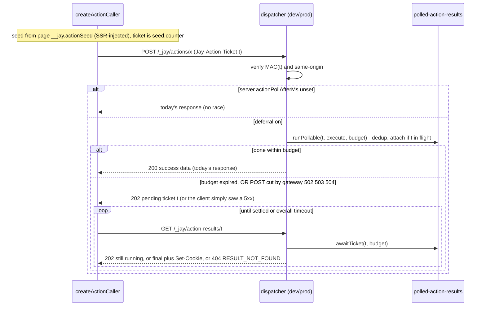

# 239 — Deferred action results for gateway timeouts

## Status

**[Design]** — 2026-11-25. Raised by the live AIditor online environment: the sandbox gateway cuts every request at **55 s** and answers `504`. Long AIditor actions fail even though the server finishes them.

> **Terminology (renamed after review):** this feature is "long-request polling", not "deferral" — a long request is broken into an initial response plus follow-up poll requests. The config key is `server.actionPollAfterMs`, the module is `polled-action-results.ts`, the helper is `runPollable`. Older prose below may still say "defer/deferral"; read it as "poll". The DL title and the `/_jay/action-results/` route are unchanged.

## Decisions for the Implementer (TL;DR)

1. **Fix it in the transport, not per action.** When deferral is enabled, both dispatchers (dev `action-router.ts`, prod `fetch-action-handler.ts`) race `registry.execute(...)` against a **deferral budget**. If the handler finishes first, the response is exactly as today. If the budget expires, they answer **`202 { pending: { ticket } }`** and keep the promise server-side.
2. **The client caller hides it.** `createActionCaller` derives a **ticket** up front (see 6) and sends it on the POST as `Jay-Action-Ticket`. If it gets a `202` — or the POST is cut by a gateway `502/503/504` or a network error — it long-polls **`GET /_jay/action-results/<ticket>`**, a route of its own outside `/_jay/actions/`, each poll held up to the budget. The call site still gets one `Promise<Output>`. Handlers, `.jay-action` files and call sites do not change. The client does not read the config.
3. **The handler runs exactly once, even across client retries.** The ticket is the idempotency key, known from `t=0`. A POST whose ticket is already running **attaches** to the in-flight promise; one whose ticket already settled returns the stored result. So a client that re-POSTs after a cut never double-runs the handler.
4. **One shared server module**: `stack-server-runtime/lib/polled-action-results.ts` holds the ticket store, the seed helpers (`issueSeed` / `verifyTicket`) and `runPollable` / `awaitTicket`. Both dispatchers call it, so the dev and prod behaviour cannot drift.
5. **Opt-in, one key**: `.jay` `server.actionPollAfterMs` (a positive integer in ms). If it is absent, deferral is **off** on both dev and serve. It sits beside `server.actionBodyLimitBytes` (DL#234) and is resolved the same way (`resolveActionDeferAfterMs`, then passed as a dispatcher option, not a registry setting). Recommended value is **25000**. It must be well under the gateway limit, because a poll also waits up to the budget. Default-off because in-memory tickets break on fetch-handler platforms and multi-instance deployments (Q2).
6. **Tickets are client-derived from a server seed** (Q10/Q11). The SSR'd page carries `seed = base64(nonce).base64(HMAC(procSecret, nonce))` — a signed 128-bit nonce — injected into the existing `__jay` bootstrap object (prod `fetch-page-handler.ts:153`, dev `dev-server.ts:1822`), so it costs no extra round-trip. Each deferred call's ticket is `seed.<counter>`. The server **verifies the MAC** on every POST and poll (so it controls entropy and authenticity even though the client assembles the string), then applies the same-origin check, then uses the whole string as the store key. The **per-page-load nonce** means a page can only address its own actions. Held in memory, **re-deliverable until the TTL** (not single-consume), TTL **5 min after the promise settles**. Unknown / expired / bad-MAC tickets return `404 RESULT_NOT_FOUND`; the client reports "the result is no longer available (server restarted or result expired)". `procSecret` is an ephemeral per-process random (shares Q2's multi-instance fate).
7. **Request-bound actions (DL#230/#234)**: `setCookies` from a deferred result go on **every poll response that delivers it** (resending them is harmless). The poll applies the same same-origin check the original action had. Every 202 and every poll response is `Cache-Control: private, no-store`.
8. **Client `timeout` keeps its meaning, an overall deadline for the call** (AIditor sets 120 s, `aiditor/page.ts:129`). It now covers the first request plus all polls. Each individual fetch is bounded by the server budget, never by the gateway.
9. **Late rejection must not crash.** `runPollable` attaches its rejection handler to `run` immediately, so a handler that fails after the 202 is stored as the result, never as an unhandled rejection.
10. **Streams (`makeJayStream`, DL#129) are segmented and resumable**, controlled by the same key. When the key is set, the generator is decoupled from the HTTP response: a server-side pump drains it into the ticket's chunk buffer, under the client-derived ticket sent on the POST (TL;DR 6). Each HTTP response is one **segment** lasting at most the budget. A segment ends with `{"done":true}`, `{"error":…}` or, when the budget elapses, `{"resume":true}`. The client then opens `GET /_jay/action-results/<ticket>?from=<chunks received>` with the ticket it already holds, and keeps feeding the same iterator. The call site still sees one `AsyncIterable<Chunk>`. This works against total-duration caps and idle caps alike: silence inside a segment is at most the budget. **No heartbeat**, so Q1 no longer blocks anything (Q9).
11. **Stream buffer is acknowledged by the cursor.** A poll with `from=N` drops buffered chunks `< N`. Chunks `≥ N` stay until delivered _and_ acknowledged by a later `from`, or until the TTL, so a lost segment is re-fetched from the client's own count (same reasoning as Q8). The ticket meta keeps the same-origin check. Streams still never set cookies (DL#230).
12. **Abandoned streams are cancelled**, which is new compared with today. If no segment is open on a stream ticket for **2× budget**, the server calls `generator.return()` and drops the ticket. Otherwise a never-ending generator with no reader would grow its buffer without bound. The client iterator gains `return()` (a `break` in `for await`), which aborts the current segment fetch and stops polling.
13. **The client treats an unexpected end as an error, always** (independent of the key). Today a reader end without `done`/`error` resolves as a normal finish (✅ `action-caller.ts:412-416`), so a gateway cut silently truncates the stream. New behaviour: if a ticket is known, resume from the count, with at most 2 consecutive retries that bring no progress. Otherwise throw `STREAM_ERROR` "stream ended unexpectedly".

## Background

- The AIditor runs long agent and tooling actions. It already raises the client abort to 120 s (`setActionCallerOptions({ timeout: 120_000 })`, aiditor `page.ts:129`) because 30 s, the default at `action-caller.ts:230`, was too short.
- In the sandbox (`*.pub.wix-code.com`), the gateway returns `504` after 55 s regardless of the client timeout. The handler keeps running and its result is lost.
- Fixing it per action (turning each into a stream, or a hand-made start/poll pair) does not scale and is easy to forget.

## Problem

Any request/response action that may run longer than an upstream gateway's limit must still deliver its result. This has to work without changing any action, and the same on the dev-server and the production server.

## Prior Art / Adjacent Mechanisms (traced)

| Mechanism                | Where                                                                                                                                                                 | Solves / constrains                                                                                                                                                                                                                  |
| ------------------------ | --------------------------------------------------------------------------------------------------------------------------------------------------------------------- | ------------------------------------------------------------------------------------------------------------------------------------------------------------------------------------------------------------------------------------ |
| Dev action dispatcher    | `dev-server/lib/action-router.ts:66` → `registry.execute` at `:188`, cookies at `:200`, NDJSON streams at `:167-184`                                                  | ✅ verified: the single choke point in dev. Action name is `req.path.slice(1)` (`:73`)                                                                                                                                               |
| Prod action dispatcher   | `production-server/lib/serve/fetch-action-handler.ts:145` (fetch `Response`), streams at `:119-141`                                                                   | ✅ verified: the single choke point in prod. Uses `redactInternalError` (DL#234), which must also apply to deferred errors                                                                                                           |
| Client caller            | `stack-client-runtime/lib/action-caller.ts:203` `createActionCaller`, a single `fetch` + `AbortController` (`:229-264`)                                               | ✅ verified: the single choke point on the client                                                                                                                                                                                    |
| Stream reader            | `action-caller.ts:340-440` `createStreamCaller`, envelopes `{chunk}` / `{done}` / `{error}` (server `action-router.ts:174-178`)                                       | ✅ verified: unknown lines are skipped (`:394-409`). **Bug:** reader end with no `done` line counts as success (`:412-416`), so a gateway cut truncates silently. The iterator has no `return()`, so `break` does not stop the fetch |
| Stream pumping today     | dev `action-router.ts:172-175` (`res.write`, no drain await), prod `fetch-action-handler.ts:121-131` (`ReadableStream.start` loop)                                    | ✅ verified: both already drain the generator eagerly, with no backpressure. Moving the drain into a server-side pump does not change the generator's pacing                                                                         |
| Streaming actions        | DL#129, `createStreamCaller` (NDJSON)                                                                                                                                 | Long work can be written as a stream, but that is a per-action rewrite and does not help existing actions                                                                                                                            |
| Request access           | DL#230 `withRequest` (`setCookie` only on success, not streams), DL#234 same-origin check + generic prod errors                                                       | Constrains: cookies must follow the result, the poll must keep the origin check, errors stay redacted                                                                                                                                |
| `.jay` `server` section  | `stack-cli/lib/config.ts:41-44` `server.actionBodyLimitBytes`, `resolveActionBodyLimitBytes` (`:123`), validated by `checkActionBodyLimitConfig` (`validate.ts:3040`) | ✅ verified: the pattern for the new key. `loadConfig` copies only known sections (`:84-90`), so a new top-level `actions:` would be dropped                                                                                         |
| Fetch-handler platforms  | `devops/fetch-handler.md:5`: "BaaS platforms (Wix, Cloudflare Workers)"                                                                                               | Constrains: work after the response may be killed and polls may hit another isolate. This is why deferral is opt-in                                                                                                                  |
| Server-side action calls | DL#82 (in-process) and `stack-cli/lib/run-action.ts:92`                                                                                                               | Not HTTP, so unaffected                                                                                                                                                                                                              |
| Error pages              | DL#218 (`504` page): "no 504/timeout runtime"                                                                                                                         | Complementary: that is for pages, this is for actions                                                                                                                                                                                |

**Prevention order (CLAUDE.md §4):** validation cannot see run time, and an agent-kit guide ("keep actions under 55 s or write a stream") is exactly the per-action discipline that already failed. A framework feature is justified, but it stays inside the three choke points above. Validation still covers the config value (step 7), and the devops agent-kit covers when to enable it.

**Null hypothesis tried: whitespace heartbeat on JSON responses.** Commit `200` immediately and write `' '` every 20 s (JSON allows leading whitespace), then the body. Rejected as the primary mechanism: (a) it only helps against an _idle_ limit, (b) buffering proxies swallow it, (c) it forces status `200` before the outcome is known, which breaks DL#234's status mapping and cookie headers. Tickets work against idle limits and total-duration caps alike.

## Questions and Answers

**Q1: Is the 55 s a total-duration cap or an idle cap?** **A: no longer blocking.** Segmented streams (TL;DR 10, Q9) keep every response under the budget, so both kinds of cap are covered. The probe (a route writing one byte every 10 s for 70 s, curled through the sandbox URL) is still useful for the devops guide, but nothing waits on it.

**Q2: Multi-instance production?** **A:** the in-memory store assumes the poll hits the same process. That holds for the sandbox (one dev-server) and for a single-process `serve`. It does **not** hold on fetch-handler platforms (Workers-style isolates: work after the response may be killed, and polls may land elsewhere) or for multi-instance deployments. Those need sticky routing or a pluggable store (cf. DL#143 `ArtifactStore`), which is deferred. **Revised:** because of this, deferral is opt-in (`server.actionPollAfterMs`), not default-on. The devops agent-kit says when to enable it.

**Q3: What if the client gives up (tab closed, overall timeout)?** **A:** for request/response actions, same as today: the handler runs to completion and the settled result expires after the TTL. For streams, an abandoned ticket (no open segment for 2× budget, or the iterator's `return()`) calls `generator.return()` (TL;DR 12). This is the one cancellation this DL adds. It is needed because the decoupled pump would otherwise buffer an unread stream without bound.

**Q4: GET actions with `withCaching`?** **A:** a deferred GET is not cached: the 202 and the poll are `no-store`. A cacheable GET that takes over the budget is a smell, but it stays correct.

**Q5: Reserved path `_result`.** **A (revised after review):** the poll gets its own route, `GET /_jay/action-results/<ticket>`, instead of `/_jay/actions/_result/<ticket>`. Reasons: nothing is reserved in the action namespace, so no `_`-prefix registry guard is needed. Both dispatchers take the action name straight from the path, so a `_result` branch would have had to come before `registry.get`. A poll is not an action call, so it must not go through the method check, body limit or action lookup. It only needs the same-origin check and `no-store`. Cost: prod adds an `isActionResultRequest` prefix check beside `isActionRequest`, and dev mounts one more middleware.

**Q6: Why recommend 25 s and not ~50 s?** **A:** other proxies (CDNs, corporate) commonly cut at 30 s. 25 s clears both, and each extra poll costs one cheap round-trip.

**Q7: Should the feature be controlled from `.jay`, both to turn it on and to set the cutoff?** **A:** yes, with one key, `server.actionPollAfterMs`: absent means off, a positive integer turns it on and sets the budget. Server-only. The client always handles a 202. AIditor online sets it in the sandbox's `.jay`, as documented in the devops agent-kit.

**Q8: Single-consume vs. re-deliverable tickets?** **A:** re-deliverable until the TTL. With single-consume, if the delivering poll response is lost (a gateway `502`, a network blip), the result is gone and the handler cannot run again. The ticket is a 128-bit bearer secret either way, and resending `Set-Cookie` is harmless.

**Q9: Streams: heartbeat or segmented resume?** **A: segmented resume** (raised in review: "we should also solve `makeJayStream`"). A heartbeat only beats an idle limit, buffering proxies can swallow it, and if Q1 turned out to be a total cap, streams would still be cut. Segments reuse the same ticket store, poll route and config key as request/response deferral. The only stream-specific parts are the chunk buffer with a cursor and the abandonment rule. The cursor is the client's count of chunks received, so it needs no server-issued IDs, and chunk order is already preserved by the single pump. The ticket is client-derived (Q10/Q11), so it exists before the first byte — a cut _before_ the budget (an unexpected 30 s proxy, a network blip) is still resumable, which the earlier "ticket on the first body line" idea could not guarantee.

**Q10: Resume an action cut by the gateway (`504`), not only a deferred one?** **A: yes, and this is why the ticket is client-minted, not server-minted in the 202.** Resume needs the client to already hold the ticket when the cut lands. On the normal deferred path the client gets a `202` at the budget and only makes short polls, so a `504` means the cut landed _before any ticket reached the client_ — e.g. a proxy that cuts shorter than the budget, or a connect-time failure. So `createActionCaller` derives the ticket up front (Q11) and sends it as `Jay-Action-Ticket` on the POST. A `502/503/504` or a network-level failure on the POST — or on any poll — then falls through to polling the ticket the client already holds. A poll is an idempotent GET, so a transient 5xx is simply retried (≤ 2 no-progress retries, then fail). The server never emits `504` for actions itself (DL#218 is pages), so a `504` on an action endpoint is unambiguously the gateway. Non-gateway errors (`400/401/403/404` action-level) are real failures, not resumed. With deferral off there is no ticket, so a `504` stays unrecoverable, as today.

**Q11: Entropy and page-ownership of a client-minted ticket.** **A (user's refinement):** the client does not mint freely; it derives every ticket from a **server-issued seed**, `seed = nonce . HMAC(procSecret, nonce)`, with `ticket = seed . counter`. The server verifies the MAC on every POST and poll, so entropy and authenticity are server-controlled despite the client assembling the string — a client cannot present a low-entropy or forged ticket. The **per-page-load nonce** scopes tickets to the page that received the seed, so a same-origin sibling page cannot address another page's actions, which the DL#234 same-origin check alone does not give. No seed storage is needed (the MAC is self-verifying); only active tickets sit in the in-memory store. **Seed delivery: SSR injection.** Both servers already attach a `__jay` bootstrap object to the serialized view state (prod `fetch-page-handler.ts:153`, dev `dev-server.ts:1822` — ✅ verified, today it carries `params`/`url`); the seed rides there as `__jay.actionSeed`, so the client reads it synchronously with **no extra round-trip** and the shared client-script generator already produces it for both dev and prod. (Alternative considered and rejected: a lazy `GET /_jay/action-seed` — decoupled from the renderer, but one round-trip on the first deferred call for no benefit, since the injection point already exists.) `procSecret` is an **ephemeral per-process random** — no config, no key file. A restart invalidates old seeds, but old tickets are gone from the in-memory store anyway, so it is consistent. Seed verification is therefore stateless and multi-instance-safe on its own; only the result store stays single-process. For multi-instance (Q2) the secret becomes shared config alongside the pluggable store — same deferral.

## Design



```ts
// stack-server-runtime/lib/polled-action-results.ts
export type BudgetOutcome<R> = { kind: 'done'; result: R } | { kind: 'pending' }; // ticket is the client's input

export interface DeferredTicketMeta {
  actionName: string;
  needsSameOriginCheck: boolean;
}

// --- seed / ticket authenticity (Q11) ---
/** Fresh signed seed: base64(nonce).base64(HMAC(procSecret, nonce)). procSecret is per-process. */
export function issueSeed(): string;
/** True iff the ticket's seed carries a valid MAC. The dispatcher calls this before any store access. */
export function verifyTicket(ticket: string): boolean;

/**
 * Registers `ticket` and races `run()` against the budget. Dedup: if `ticket` is already in flight,
 * attaches to the existing promise instead of calling `run` again (idempotent client retries, TL;DR 3).
 * Attaches a rejection handler immediately, so a late failure becomes the stored result, never an
 * unhandled rejection (TL;DR 9).
 */
export function runPollable<R>(
  ticket: string,
  run: () => Promise<R>,
  budgetMs: number,
  meta: DeferredTicketMeta,
): Promise<BudgetOutcome<R>>;

/** Waits up to budgetMs. A settled result stays deliverable until its TTL. */
export function awaitTicket<R>(
  ticket: string,
  budgetMs: number,
): Promise<
  { kind: 'done'; result: R; meta: DeferredTicketMeta } | { kind: 'pending' } | { kind: 'unknown' }
>;
```

Streams (deferral on):

```mermaid
sequenceDiagram
  participant C as createStreamCaller
  participant D as dispatcher (dev/prod)
  participant S as polled-action-results
  C->>D: POST /_jay/actions/x (stream, Jay-Action-Ticket t)
  D->>S: openStreamTicket(t, generator) - pump drains into buffer
  D-->>C: chunk lines then resume (within budget; client holds ticket)
  loop until done or error
    C->>D: GET /_jay/action-results/t?from=N
    D->>S: readStreamSegment(t, N, budget) - drops chunks below N
    D-->>C: chunk lines, then resume or done or error
  end
  Note over S: no open segment for 2x budget, generator.return()
```

```ts
// stack-server-runtime/lib/polled-action-results.ts (stream part)
export type StreamSegmentEvent<C> =
  | { kind: 'chunk'; chunk: C }
  | { kind: 'done' }
  | { kind: 'error'; error: unknown } // the dispatcher serializes it (prod: streamErrorMessage, DL#234)
  | { kind: 'resume' };

/** Starts the pump under the client's `ticket` (verified first). Shares the store, TTL and meta. */
export function openStreamTicket<C>(
  ticket: string,
  generator: AsyncGenerator<C>,
  meta: DeferredTicketMeta,
): void;

/** One segment from chunk index `from`, ending by `budgetMs`. undefined = unknown ticket. */
export function readStreamSegment<C>(
  ticket: string,
  from: number,
  budgetMs: number,
): AsyncIterable<StreamSegmentEvent<C>> | undefined;
```

The poll route checks the ticket's kind. A value ticket answers with JSON (`awaitTicket`), a stream ticket answers with NDJSON (`readStreamSegment`). Each dispatcher keeps its own line serialization, as today.

```ts
// stack-cli/lib/config.ts
server?: {
  actionBodyLimitBytes?: number;
  /** Defer action results past this many ms (202 + ticket poll). Absent = off (DL#239). */
  actionPollAfterMs?: number;
};

export function resolveActionDeferAfterMs(config: JayConfig): number | undefined;
```

```yaml
# .jay (sandbox behind a 55 s gateway)
server:
  actionPollAfterMs: 25000
```

Wire shape (no backward compatibility, per CLAUDE.md):

```ts
// Jay-Action-Ticket request header carries the client-derived ticket on every POST.
// 202 body (initial response and still-running poll). The ticket is already known to the
// client, so it is echoed only for clarity/debugging, not required by the caller.
interface PendingActionResponse {
  pending: { ticket: string };
}
```

The seed is injected into the page's `__jay` bootstrap object (where `params`/`url` already live), one field:

```ts
// prod fetch-page-handler.ts:153 / dev dev-server.ts:1822 — add when a budget is configured
(fullViewState as any).__jay = { params, url, actionSeed: issueSeed() };
```

Each dispatcher keeps its own response writing (status mapping, `redactInternalError`, cookies). Per request the changes are: verify the `Jay-Action-Ticket` MAC + same-origin, then the `await registry.execute(...)` line becomes `runPollable(ticket, …)` when a budget is configured; plus the `/_jay/action-results/<ticket>` handler. The page handler injects `actionSeed`; no seed endpoint.

## Scope pre-mortem

| Not handled                                                                              | Decision                                                                                                                                           |
| ---------------------------------------------------------------------------------------- | -------------------------------------------------------------------------------------------------------------------------------------------------- |
| Streams under a total-duration or idle cap                                               | **Handled here** by segmented resume (TL;DR 10–13, Q9)                                                                                             |
| Action cut by a gateway `502/503/504` (even shorter than the budget, or at connect time) | **Handled** (Q10): the client holds the ticket from `t=0`, so a cut at any point falls through to a poll; a re-POST attaches instead of re-running |
| Low-entropy or cross-page ticket from a client                                           | **Prevented** (Q11): the ticket must embed a server-signed seed; the per-page nonce scopes it to its own page                                      |
| Shared seed secret across instances                                                      | Deferred with Q2 (ephemeral per-process secret until a pluggable store exists)                                                                     |
| Abandoned streams                                                                        | Cancelled after 2× budget with no open segment (TL;DR 12)                                                                                          |
| Stream input replay                                                                      | Not needed. The POST runs once and later segments are GETs on the ticket                                                                           |
| Fetch-handler platforms / multi-instance prod                                            | Deferred (Q2). Opt-in config plus a devops guide note saying "do not enable"                                                                       |
| Cancelling server work when the client leaves                                            | Out of scope (Q3, unchanged behaviour)                                                                                                             |
| Tickets lost on dev-server restart                                                       | Accepted. `404 RESULT_NOT_FOUND` with a clear client message (TL;DR 6)                                                                             |
| Page/SSR requests over 55 s                                                              | Out of scope. Pages must not do this. DL#218 covers 504 pages                                                                                      |
| File-upload temp-dir cleanup (DL#131)                                                    | Cleanup moves to when the promise settles, not to when the response is sent                                                                        |

## Implementation Plan

1. **Tests first**, `stack-server-runtime/test/polled-action-results.test.ts` (fake timers): done-within-budget, pending → done on poll, pending → still pending → done, re-delivery of a settled result until TTL, TTL expiry → unknown, rejection after the budget expired is carried as the result with no unhandled rejection. **Seed/ticket:** `verifyTicket` accepts a ticket from `issueSeed` and rejects a forged or tampered MAC; `runPollable` with a ticket already in flight **attaches** (one `run` call for two POSTs, counter test); a ticket already settled returns the stored result without re-running.
2. Implement `polled-action-results.ts`, including `issueSeed` / `verifyTicket` (HMAC over a per-process ephemeral secret) and `runPollable`'s attach-or-return dedup.
3. Config: `server.actionPollAfterMs` in `JayConfig`, `resolveActionDeferAfterMs`, and a validation rule beside `checkActionBodyLimitConfig`: `invalid-action-defer-after` if the value is not a positive integer, and a warning if it is ≥ 45000 (a poll also waits the budget, so this risks a 55 s gateway). Pass the value to both dispatchers as an option, like `actionBodyLimitBytes`.
4. Wire the dev `action-router.ts`: verify the `Jay-Action-Ticket` MAC + same-origin, then `runPollable(ticket, …)` at `:188` when a budget is set; mount the `/_jay/action-results/<ticket>` handler (same-origin check, `no-store`, cookies on delivery), temp-dir cleanup on settle. Inject `actionSeed` into `__jay` at `dev-server.ts:1822` when a budget is set. Router tests pass `actionPollAfterMs: 50` directly as a router option and use an action that sleeps 120 ms. Also test "no option → no race, response unchanged" and "bad MAC → 404".
5. Wire the prod `fetch-action-handler.ts` the same way (redacted errors on the deferred path too, `isActionResultRequest` prefix), and inject `actionSeed` at `fetch-page-handler.ts:153`. Add the same test matrix.
6. Client `action-caller.ts`: read `__jay.actionSeed`, derive `seed.<counter>` per call, send `Jay-Action-Ticket` on the POST; handle 202, **and a `502/503/504`/network error on the POST or a poll by falling through to polling the held ticket** (≤ 2 no-progress retries); the poll loop, the overall `timeout` across polls, and the `RESULT_NOT_FOUND` message. Tests with a mocked `fetch` sequence (202 → 202 → 200; **504 on POST → poll → 200**; 202 → 404; 5xx on a poll → retry; overall timeout mid-poll; re-POST after a dropped 202 attaches, handler runs once).
7. Streams:
   - **Tests first**, in `polled-action-results.test.ts`, with fake timers:
     - a segment ends with `resume` at the budget;
     - `from=N` replays from N and drops chunks below N;
     - re-fetching a lost segment;
     - `done`/`error` delivered in a later segment;
     - abandonment calls `generator.return()`;
     - an unknown ticket gives `undefined`.
   - Implement `openStreamTicket(ticket, …)` / `readStreamSegment`, then wire both dispatchers: the initial stream response is segment 0 under the client-held ticket (no `ticket` line needed), and the poll route serves stream tickets as NDJSON.
   - **Dispatcher tests:** a generator yielding every 30 ms for 200 ms with a 50 ms budget gives several segments and every chunk exactly once, in order.
   - **Client:** `createStreamCaller` follows `resume`, adds `return()`, and treats an unexpected end as an error. That last part always applies: today's silent truncation is fixed even with the key unset.
   - **Client tests** with a mocked `fetch`:
     - segments → full sequence;
     - a cut segment → resume from the count;
     - a cut with no ticket → `STREAM_ERROR`;
     - 404 on resume → `RESULT_NOT_FOUND`;
     - `break` → no further polls.
8. Agent-kit: in devops, document `server.actionPollAfterMs` (when to enable: behind a time-limited gateway on a single process; when not to: fetch-handler platforms, multi-instance), and add a short developer note ("long actions survive gateways when the project enables deferral").
9. **Live check in the sandbox** with `server.actionPollAfterMs: 25000`: an AIditor action that sleeps 90 s returns its value with no 504, the network tab shows 202 + polls to `/_jay/action-results/`, and a `withRequest` action sets its cookie on the final poll. A stream that yields once every 10 s for 120 s delivers every chunk in order across segments, with no 504.

## Verification criteria

- With the config set, an action that runs 90 s resolves on the client through the sandbox gateway, with no code change in the action.
- Without the config, dispatcher behaviour is unchanged. With the config, actions under the budget produce byte-identical responses to today (existing router and handler tests unchanged).
- The handler runs once per call (counter in tests), **even when the client re-POSTs after a `504`** — the second POST attaches to the in-flight ticket. A stream's generator is created once per call, and each chunk reaches the iterator exactly once, in order.
- A forged or tampered `Jay-Action-Ticket` is rejected (`404`), and a ticket from one page cannot be polled from another page's seed.
- An action cut by a gateway `504` at any point (including before the budget) still resolves on the client, because it holds the ticket from `t=0`.
- A stream cut by the network before `done` throws (or resumes), and never ends quietly as if it had finished.
- `jay-stack validate` reports an invalid or too-large `actionPollAfterMs`.
- `yarn confirm` is green.

## Implementation Results (2026-11-25)

Implemented on branch `DL239-polled-action-results`. All five touched packages build clean; new and existing tests pass (server-runtime 204, client-runtime 35, dev-server 818, production-server 129, stack-cli config 21).

### What was built

- **`stack-server-runtime/lib/polled-action-results.ts`** — the shared module: `issueSeed` / `verifyTicket` (HMAC-SHA256 over a per-process ephemeral secret), `runPollable` (attach-or-return dedup + immediate rejection capture), `awaitTicket`, `openStreamTicket` / `readStreamSegment` (buffer + cursor + abandon timer), `peekTicketMeta`. 17 unit tests (`polled-action-results.test.ts`).
- **Config** — `.jay` `server.actionPollAfterMs` + `resolveActionDeferAfterMs` (`stack-cli/lib/config.ts`); validation `checkActionDeferConfig` (`validate.ts`): positive-integer rule + `≥ 45000` warning. Threaded from `stack-cli/lib/server.ts` (dev) and `run-production.ts` (serve).
- **Prod dispatcher** (`fetch-action-handler.ts`) — `isActionResultRequest`, `fetchActionResultRequest`, deferral + stream branches; wired in `main-server.ts`. 8 tests (`polled-action-handler.test.ts`).
- **Dev dispatcher** (`action-router.ts`) — `createActionResultRouter` + `ACTION_RESULT_ENDPOINT_BASE`, deferral + stream branches; mounted in `dev-server.ts`. 6 tests (`action-router-polling.test.ts`).
- **Client** (`stack-client-runtime/lib/action-caller.ts`) — ticket derivation from `window.__jay.actionSeed`, `Jay-Action-Ticket` header, `pollForResult`, resume on `502/503/504`/network cut, overall-deadline timeout; `createStreamCaller` rewritten as an async generator with segment resume, `return()`-on-break abort, and unexpected-end-is-an-error. 11 tests (`action-caller-polling.test.ts`).
- **Seed injection** — `window.__jay.actionSeed` inline script in both servers' page HTML, gated on the budget: prod `fetch-page-handler.ts` (`headParts`), dev `dev-server.ts` (`injectActionSeedScript` on the two page-send paths).
- **Agent-kit** — devops `long-request-polling.md` (+ INSTRUCTIONS index), developer `configuration.md` `server.*` keys.

### Deviations from the design

1. **Seed delivery is `window.__jay.actionSeed` (a browser global via an inline `<script>`), not the server-side ViewState `__jay` at `fetch-page-handler.ts:153`.** Those are different objects: the ViewState `__jay` (params/url) is not the browser global the client reads. `window.__jay` is the established client global (`generate-client-script.ts:426`), so the seed rides there. The design's "no extra round-trip / reuses the client-script path" intent holds.
2. **The settled value is a discriminated `Settled<R> = {ok:true;value} | {ok:false;error}`, not a bare `R`.** This keeps the module generic and lets a defensive late rejection (TL;DR 9) be carried without coupling to `ActionExecutionResult`. Dispatchers map `ok:false` to a generic 500.
3. **`runPollable(ticket, run, …)` takes the ticket as input** (client-minted), replacing the design sketch's `raceBudget` that returned a server-minted ticket. `openStreamTicket(ticket, …)` likewise. The 202 body still echoes the ticket for clarity, though the client already holds it.
4. **End-to-end (smoke-test project):** `examples/jay-stack/smoke-test` sets `server.actionPollAfterMs: 400` and adds `src/actions/long.actions.ts` (a ~1.2 s action, a ~1.2 s GET query, and a 6-chunk stream). `test/smoke.test.ts` registers `registerDeferredPollingTests` in **both** dev and production-self-hosted modes: it reads the SSR-injected `window.__jay.actionSeed` off `/actions/`, derives a ticket, and over real HTTP checks the 202 + poll for the action and query, the resumable NDJSON segments for the stream, a `404 RESULT_NOT_FOUND` for a bad-MAC ticket, and that a fast action with a ticket returns 200 within budget. All 92 smoke tests pass. This exercises the seed injection and the server poll/stream path end-to-end; the browser-side resume JS remains unit-covered (a Node smoke test cannot run it). The `/actions/` and `/long-actions/` pages are now interactive demos (headfull: contract + `page.ts`) with buttons wired to the real `counter.*` and `long.*` callers, so a human — or a future headless-browser test — can drive the client deferral/poll and stream-resume paths in a real browser.
5. **Bug found + fixed via the e2e:** the dev server's `defaults()` rebuilt its options object and dropped `actionPollAfterMs`, so dev never enabled polling (seed not injected). Added the field to `defaults()`. Prod was unaffected.

### Review fixes (2026-11-25)

- **Cache only disabled when actually deferred.** The first cut forced `no-store` on every response once deferral was enabled, including a cacheable GET that finished within the budget. Fixed: the within-budget `done` branch delivers today's headers (GET `max-age`/`swr`, `withRequest` `private, no-store`) — only the `202` and the poll delivery are `no-store`, as Q4 intended. Regression test: a cacheable GET within budget keeps `max-age=60, stale-while-revalidate=120`. This restores the "within budget = byte-identical to today" verification criterion.
- **Parameters are never resent on a continuation.** The handler runs once on the POST with the POST's input; polls are bodyless GETs on the ticket. A resume-retry POST may resend the input, but dedup attaches to the in-flight handler, so the resent input is ignored when the handler already started.

### Review fix — stream segment is a wall-clock cap, not an idle timeout (2026-11-25)

Manual browser testing showed a long stream running as **one** ~1.5 s request instead of several polls. Cause: `readStreamSegment` ended a segment only after `budgetMs` passed with _no new chunk_ (an idle timeout). When chunks arrive faster than the budget (the ticker yields every 250 ms under a 400 ms budget), the idle timer never fired and a single segment consumed the whole stream — defeating the point (each HTTP response must stay under the gateway limit). Fixed to a **wall-clock deadline**: a segment lasts at most `budgetMs` from its start regardless of chunk rate, then emits `resume`. Value/query deferral was unaffected (a single settle event, correctly raced by the budget). Added a regression test (`segments a fast stream by wall-clock…`: 100 ms chunks under a 250 ms budget must produce multiple segments) and verified over the wire that the initial POST returns one segment ending in `resume` and the client then polls `/_jay/action-results/<ticket>?from=N`.

### Review fix — action-import detection misclassified pages under an `actions/` route folder (2026-11-25)

Making the demo pages interactive exposed a pre-existing compiler bug (not introduced by DL#239). `isActionImport` (`compiler-jay-stack/lib/transform-action-imports.ts`) matched any import whose path merely _contained_ `/actions/` or `-actions`. So the client-bundle build of a page under a route folder named `actions` (`src/pages/actions/page.ts`) or `*-actions` (`.../long-actions/page.ts`) treated the **page** as an action module, prefixed it with the `\0jay-action:` virtual id, and failed to load it — leaving the route with no client bundle. In the browser the page's `import { init } from '/'` then returned HTML, yielding _"Failed to load module script … MIME type text/html"_. (It passed the smoke tests because those fetch page HTML and action endpoints, not the JS module.) Fixed `isActionImport` to match on the module's own name (`*.actions`, `*-actions`, bare `actions` barrel) or its immediate parent dir being `actions`, and to never treat a reserved `page` module as an action. Regression tests added in `transform-action-imports.test.ts`; all client bundles now build and serve `application/javascript`.
