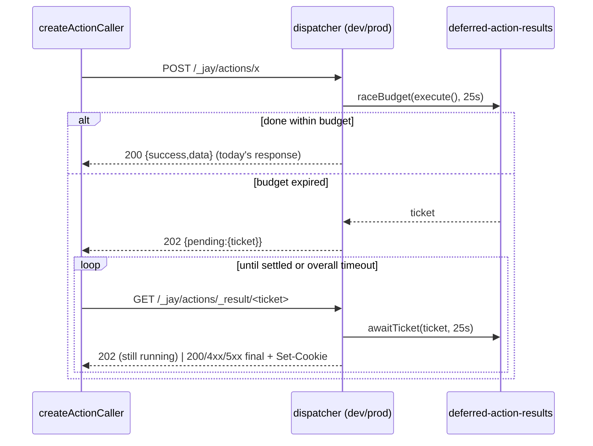

# 239 — Deferred action results for gateway timeouts

## Status

**[Design]** — 2026-11-25. Raised by the live AIditor online environment: the sandbox gateway cuts every request at **55 s** and answers `504`. Long AIditor actions fail even though the server finishes them.

## Decisions for the Implementer (TL;DR)

1. **Fix it in the transport, not per action.** Both dispatchers (dev `action-router.ts`, prod `fetch-action-handler.ts`) race `registry.execute(...)` against a **deferral budget**. If the handler finishes first, the response is exactly as today. If the budget expires, they answer **`202 { pending: { ticket } }`** and keep the promise server-side.
2. **The client caller hides it.** `createActionCaller` sees a 202 and long-polls `GET /_jay/actions/_result/<ticket>`, where each poll is held up to the budget. The call site still gets one `Promise<Output>`. Handlers, `.jay-action` files and call sites do not change.
3. **The handler runs exactly once.** The client never re-sends the original request. The ticket is the idempotency key.
4. **One shared server module**: `stack-server-runtime/lib/deferred-action-results.ts` holds the ticket store and the `raceBudget` / `awaitTicket` helpers. Both dispatchers call it, so the dev and prod behaviour cannot drift.
5. **Budget**: the default is **25 s** and is always on (dev included, so local runs use the same path the sandbox needs). It is configurable via `.jay` `actions.deferAfterMs` (`0` = off). It must be well under the gateway's 55 s, because a poll also waits up to the budget.
6. **Tickets**: 128-bit random, held in memory, **single-consume** (delivered once, then deleted), TTL **5 min after the promise settles**. Unknown or expired tickets return `404 RESULT_NOT_FOUND`.
7. **Request-bound actions (DL#230/#234)**: `setCookies` from a deferred result go on the **poll response** that delivers it. The poll applies the same same-origin check the original action had. Every 202 and every poll response is `Cache-Control: private, no-store`.
8. **Client `timeout` keeps its meaning, an overall deadline for the call** (AIditor sets 120 s, `aiditor/page.ts:129`). It now covers the first request plus all polls. Each individual fetch is bounded by the server budget, never by the gateway.
9. **Streams (`makeJayStream`, DL#129) are not deferred.** They get a **heartbeat line** `{"hb":1}` every 20 s of silence, which the client ignores. This is sufficient **only if** the gateway limit is an idle limit (Q1). If it is a total-duration cap, resumable streams get their own DL.

## Background

- The AIditor runs long agent and tooling actions. It already raises the client abort to 120 s (`setActionCallerOptions({ timeout: 120_000 })`, aiditor `page.ts:129`) because 30 s, the default at `action-caller.ts:230`, was too short.
- In the sandbox (`*.pub.wix-code.com`), the gateway returns `504` after 55 s regardless of the client timeout. The handler keeps running and its result is lost.
- Fixing it per action (turning each into a stream, or a hand-made start/poll pair) does not scale and is easy to forget.

## Problem

Any request/response action that may run longer than an upstream gateway's limit must still deliver its result. This has to work without changing any action, and the same on the dev-server and the production server.

## Prior Art / Adjacent Mechanisms (traced)

| Mechanism                | Where                                                                                                                   | Solves / constrains                                                                                                        |
| ------------------------ | ----------------------------------------------------------------------------------------------------------------------- | -------------------------------------------------------------------------------------------------------------------------- |
| Dev action dispatcher    | `dev-server/lib/action-router.ts:66` → `registry.execute` at `:188`, cookies at `:200`, NDJSON streams at `:167-184`    | ✅ verified: the single choke point in dev                                                                                 |
| Prod action dispatcher   | `production-server/lib/serve/fetch-action-handler.ts:145` (fetch `Response`), streams at `:119-141`                     | ✅ verified: the single choke point in prod. Uses `redactInternalError` (DL#234), which must also apply to deferred errors |
| Client caller            | `stack-client-runtime/lib/action-caller.ts:203` `createActionCaller`, a single `fetch` + `AbortController` (`:229-264`) | ✅ verified: the single choke point on the client                                                                          |
| Streaming actions        | DL#129, `createStreamCaller` (NDJSON)                                                                                   | Long work can be written as a stream, but that is a per-action rewrite and does not help existing actions                  |
| Request access           | DL#230 `withRequest` (`setCookie` only on success, not streams), DL#234 same-origin check + generic prod errors         | Constrains: cookies must follow the result, the poll must keep the origin check, errors stay redacted                      |
| Server-side action calls | DL#82 (in-process) and `stack-cli/lib/run-action.ts:92`                                                                 | Not HTTP, so unaffected                                                                                                    |
| Error pages              | DL#218 (`504` page): "no 504/timeout runtime"                                                                           | Complementary: that is for pages, this is for actions                                                                      |

**Prevention order (CLAUDE.md §4):** validation cannot see run time, and an agent-kit guide ("keep actions under 55 s or write a stream") is exactly the per-action discipline that already failed. A framework feature is justified, but it stays inside the three choke points above.

**Null hypothesis tried: whitespace heartbeat on JSON responses.** Commit `200` immediately and write `' '` every 20 s (JSON allows leading whitespace), then the body. Rejected as the primary mechanism: (a) it only helps against an _idle_ limit, (b) buffering proxies swallow it, (c) it forces status `200` before the outcome is known, which breaks DL#234's status mapping and cookie headers. Tickets work against idle limits and total-duration caps alike.

## Questions and Answers

**Q1: Is the 55 s a total-duration cap or an idle cap?** **A: open, must be measured before implementing step 4.** Probe: a dev route that writes one byte every 10 s for 70 s, curled through the sandbox URL. Tickets (TL;DR 1–8) do not depend on the answer. Only the stream heartbeat (TL;DR 9) does.

**Q2: Multi-instance production?** **A:** the in-memory store assumes the poll hits the same process. That holds for the sandbox (one dev-server) and for a single-process `serve`. A multi-instance deployment needs sticky routing or a pluggable store (cf. DL#143 `ArtifactStore`), which is deferred until someone deploys that way. Until then the default budget is on in prod too, and the constraint is documented in the devops agent-kit guide.

**Q3: What if the client gives up (tab closed, overall timeout)?** **A:** same as today: the handler runs to completion. The settled result expires after the TTL. No cancellation is added here.

**Q4: GET actions with `withCaching`?** **A:** a deferred GET is not cached: the 202 and the poll are `no-store`. A cacheable GET that takes over 25 s is a smell, but it stays correct.

**Q5: Reserved path `_result`.** **A:** action names are `<domain>.<name>`, so `_result` cannot collide. ⚠️ assumed: the registry does not already reject leading `_`. Add a registry guard that rejects names starting with `_`, so it stays reserved.

**Q6: Why a 25 s default and not ~50 s?** **A:** other proxies (CDNs, corporate) commonly cut at 30 s. 25 s clears both, and each extra poll costs one cheap round-trip.

## Design



```ts
// stack-server-runtime/lib/deferred-action-results.ts
export type BudgetOutcome<R> = { kind: 'done'; result: R } | { kind: 'pending'; ticket: string };

export interface DeferredTicketMeta {
  actionName: string;
  needsSameOriginCheck: boolean;
}

export function raceBudget<R>(
  run: Promise<R>,
  budgetMs: number,
  meta: DeferredTicketMeta,
): Promise<BudgetOutcome<R>>;

/** Waits up to budgetMs. 'consumed' deletes the ticket. */
export function awaitTicket<R>(
  ticket: string,
  budgetMs: number,
): Promise<
  { kind: 'done'; result: R; meta: DeferredTicketMeta } | { kind: 'pending' } | { kind: 'unknown' }
>;
```

Wire shape (no backward compatibility, per CLAUDE.md):

```ts
// 202 body, initial response and still-running poll
interface PendingActionResponse {
  pending: { ticket: string };
}
```

Each dispatcher keeps its own response writing (status mapping, `redactInternalError`, cookies). Only the `await registry.execute(...)` line becomes `raceBudget(...)`, plus one new branch for `_result/<ticket>`.

## Scope pre-mortem

| Not handled                                   | Decision                                                                    |
| --------------------------------------------- | --------------------------------------------------------------------------- |
| Streams under a total-duration cap            | Own DL (resumable NDJSON with a chunk cursor) **if** Q1 says "total"        |
| Multi-instance prod                           | Deferred (Q2), documented constraint                                        |
| Cancelling server work when the client leaves | Out of scope (Q3, unchanged behaviour)                                      |
| Page/SSR requests over 55 s                   | Out of scope. Pages must not do this. DL#218 covers 504 pages               |
| File-upload temp-dir cleanup (DL#131)         | Cleanup moves to when the promise settles, not to when the response is sent |

## Implementation Plan

1. **Tests first**, `stack-server-runtime/test/deferred-action-results.test.ts` (fake timers): done-within-budget, pending → done on poll, pending → still pending → done, single-consume, TTL expiry → unknown, rejection is carried as the result.
2. Implement `deferred-action-results.ts`. Add the `_`-prefix name guard in the registry.
3. Wire the dev `action-router.ts`: `raceBudget` at `:188`, the `_result/<ticket>` branch with the same-origin check, cookies on the delivering poll, temp-dir cleanup on settle. Add router tests with a `deferAfterMs: 50` registry and an action that sleeps 120 ms.
4. Wire the prod `fetch-action-handler.ts` the same way (redacted errors on the deferred path too). Add the same test matrix.
5. Client `action-caller.ts`: handle 202, the poll loop, and the overall `timeout` across polls. Tests with a mocked `fetch` sequence (202 → 202 → 200, 202 → 404, overall timeout mid-poll).
6. Stream heartbeat (only after the Q1 probe): server writes `{"hb":1}` after 20 s of silence, client skips it. Tests on both dispatchers and on the stream caller.
7. `.jay` config `actions.deferAfterMs`, plus a docs note in the developer/devops agent-kit ("long actions are fine; the transport defers").
8. **Live check in the sandbox**: an AIditor action that sleeps 90 s returns its value with no 504, the network tab shows 202 + polls, and a `withRequest` action sets its cookie on the final poll.

## Verification criteria

- An action that runs 90 s resolves on the client through the sandbox gateway, with no code change in the action.
- Actions under the budget produce byte-identical responses to today (existing router and handler tests unchanged).
- The handler runs once per call (counter in tests).
- `yarn confirm` is green.
