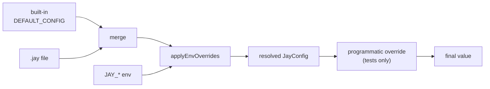

# 240 - Unified `.jay` config with env-variable overrides

## Decisions for the Implementer (TL;DR)

- **One override mechanism: environment variables.** Not CLI flags. The config is consumed in
  layers that have no CLI argv (production-server, `jay-fetch-handler` on platform hosts); env is the
  only channel that reaches all of them, and matches the pod/CI use case that triggered this.
- **`.jay` stays the committed source of truth.** Env only overrides at runtime. Nothing is written
  back to the file. Precedence: **programmatic override (tests) → env var → `.jay` → built-in
  default**.
- **Explicit registry, not a magic path convention.** One table entry per overridable field:
  `{ env, path, parse }`. Gives type coercion, precise invalid-value warnings, and a single
  documented list of what is overridable.
- **Naming scheme: `JAY_<UPPER_SNAKE_PATH>`.** `server.actionBodyLimitBytes` →
  `JAY_SERVER_ACTION_BODY_LIMIT_BYTES`. Reversal is never needed (registry declares both sides).
- **Clean break on the existing env names** (CLAUDE.md: no backward-compat shims unless asked). The
  ad-hoc vars are renamed into the scheme; old names are removed, not aliased:
  - `__VITE_ADDITIONAL_SERVER_ALLOWED_HOSTS` → `JAY_DEV_SERVER_ALLOWED_HOSTS`
  - `JAY_STALE_WAIT_MS` → `JAY_SERVER_STALE_WAIT_MS`
  - `JAY_FRESHNESS_HEADER` → `JAY_SERVER_FRESHNESS_HEADER`
  - `JAY_SLOW_RENDER_CONCURRENCY` → `JAY_SERVER_SLOW_RENDER_CONCURRENCY`
  - `JAY_MISS_TIMEOUT_MS` → `JAY_SERVER_MISS_TIMEOUT_MS`
  - `BASE` → `JAY_DEV_SERVER_BASE`
- **Fold every loose env-only knob into `.jay` as a real field.** The four `JAY_*` production knobs
  and `BASE` become `server.*` / `devServer.base` fields, resolved through the same scheme. After
  this DL, "every switch lives in `.jay`" is literally true.
- **Out of scope / explicitly not a config switch:** `DEBUG_IMPORTS` (compiler debug toggle, not a
  deployment setting — stays a bare env flag). See Scope pre-mortem.
- **Invalid env value = warn + ignore** (fall through to `.jay`/default), never throw. A bad pod env
  must not take the server down.

---

## Background

The `.jay` file (YAML, parsed by `loadConfig` at `packages/jay-stack/stack-cli/lib/config.ts:82` ✅)
is the project config. It currently holds four sections: `devServer`, `site`, `server`,
`validations` (`JayConfig`, `config.ts:7` ✅).

Overrides grew ad-hoc, one per need:

| Setting                       | In `.jay`?    | Override today                                       | Source                           |
| ----------------------------- | ------------- | ---------------------------------------------------- | -------------------------------- |
| `devServer.allowedHosts`      | yes           | env `__VITE_ADDITIONAL_SERVER_ALLOWED_HOSTS` (merge) | DL#220 — `vite-factory.ts:77` ✅ |
| `server.actionBodyLimitBytes` | yes           | programmatic `override` arg only                     | DL#234 — `config.ts:132` ✅      |
| `server.actionPollAfterMs`    | yes           | programmatic `override` arg only                     | DL#239 — `config.ts:147` ✅      |
| stale-wait                    | no (env-only) | `JAY_STALE_WAIT_MS`                                  | `fetch-page-handler.ts:25` ✅    |
| freshness header              | no (env-only) | `JAY_FRESHNESS_HEADER`                               | `fetch-page-handler.ts:32` ✅    |
| slow-render concurrency       | no (env-only) | `JAY_SLOW_RENDER_CONCURRENCY`                        | `instance-renderer.ts:110` ✅    |
| cache-miss timeout            | no (env-only) | `JAY_MISS_TIMEOUT_MS`                                | `instance-renderer.ts:112` ✅    |
| dev public base path          | no (env-only) | `BASE`                                               | `dev-server.ts:351` ✅           |

Three different mechanisms (env-merge, programmatic arg, bare env), two settings with no env path at
all, and four knobs that live nowhere but env. This is the "name the shared cause before the second
workaround" tripwire (CLAUDE.md / DL#195): the shared cause is **`.jay` is git-managed, so
deployment environments cannot set values without editing a source-controlled file.**

## Problem

jay-ci and jay-dev-machine need to set `server.actionBodyLimitBytes` per environment. The only way
today is editing `.jay` — a git-tracked file — on pod startup. That is bad practice (mutating
source-controlled config at runtime) and there is no env path for that field.

Adding one more bespoke env var for this one field would be the second workaround for the shared
cause. Instead: **one systematic env-override layer for the whole config.**

## Prior Art / Adjacent Mechanisms

- **DL#220 `resolveAllowedHosts`** (`vite-factory.ts:43` ✅) already does `.jay` + env _merge_ for one
  field. This DL generalizes the idea but with _replace_ semantics (see Q3) and moves the resolution
  up into `loadConfig` so every field benefits.
- **DL#234 / DL#239 `resolveActionBodyLimitBytes` / `resolveActionPollAfterMs`** (`config.ts:132`,
  `:147` ✅) take a programmatic `override` param (used by tests and reserved for CLI flags that were
  never added). These stay — they become the top of the precedence chain — but they gain env as the
  middle tier automatically once `loadConfig` applies env overrides. ⚠️ assumed: no user-facing CLI
  flag currently feeds these (grep found only `resolve*(config)` with no override at
  `run-production.ts:168` / `server.ts:71` ✅; the `override` arg is test-only).
- **`getConfigWithDefaults`** (`config.ts:108` ✅) centralizes devServer defaulting. The env layer
  slots in _before_ this, inside `loadConfig`, so defaulting and override compose cleanly.
- **Null hypothesis (minimize new surface):** could we skip the registry and just document "set the
  value in `.jay`"? No — that is exactly what the pod cannot do. Could we reuse the existing
  per-field `resolve*` functions and add one env read to each? That reproduces the ad-hoc pattern
  N times and misses the goal of _all_ switches. A single registry-driven layer is the smallest
  surface that covers every field uniformly.

## Questions and Answers

**Q1 — env vars or CLI flags?** _A: env vars._ Architecture decides it: `loadConfig` is in
`stack-cli`, but `actionBodyLimitBytes` and the `JAY_*` knobs are consumed in `production-server` and
`jay-fetch-handler`, which on platform hosts have **no CLI argv**. Env is ambient and readable at one
choke point; a flag must be parsed at an entry point and threaded through every layer, and there is
no entry point on fetch-handler platforms. Also matches pods/CI (they inject env, not argv). (User
decision.)

**Q2 — generic `JAY__A__B` path convention or explicit registry?** _A: explicit registry._ Precise
error messages, real type coercion, and a single authoritative list of overridable fields. Avoids
magic string→path reversal. (User decision.)

**Q3 — merge or replace for array/complex values (e.g. `allowedHosts`)?** _A: replace._ (User
decision, confirmed.) DL#220 merged env into config for `allowedHosts`, but a uniform rule is simpler
and "env overrides config" is the mental model everywhere else. The pod author gets the final value
they set. Deviation from DL#220 behavior — `resolveAllowedHosts` merge logic is retired. ✅ verified
the merge has a single consumer (`vite-factory.ts:77` only), so retiring it is safe.

**Q8 — complete env inventory in production-server (does any env read exist we might miss)?** ✅
_verified:_ `grep process.env packages/jay-stack/production-server/lib` returns **exactly four**, all
already on the migration list — `JAY_STALE_WAIT_MS`, `JAY_FRESHNESS_HEADER`
(`fetch-page-handler.ts:25,32`), and `JAY_SLOW_RENDER_CONCURRENCY`, `JAY_MISS_TIMEOUT_MS` (via
`envNumber`, `instance-renderer.ts:110,112`). No `PORT`/`NODE_ENV`/action-body read: `port` comes from
options (`main-server.ts:219`, `renderer-server.ts:169`) and `actionBodyLimitBytes` is resolved in
`stack-cli` and passed in. So Phase 3's "remove `process.env` from production-server" = remove these
four and read from passed options; the inventory is closed.

**Q4 — scope: just the override layer, or also migrate the loose env-only knobs into `.jay`?**
_A: migrate all._ The stated goal is "all switches in `.jay`." Phased so the urgent field ships
first. (User decision.)

**Q5 — keep old env names as aliases?** _A: no, clean break / rename._ CLAUDE.md: experimental
framework, no backward-compat unless asked. (User decision.) jay-ci/jay-dev-machine setups that set
the old names must update; the rename table is in the TL;DR and must go in the devops agent-kit
guide + migration note.

**Q6 — invalid env value behavior?** _A: warn + ignore, fall through to `.jay`/default._ A malformed
pod env must not crash the server. Reuse the existing `getLogger().warn` pattern (`config.ts:103`).

**Q7 — where does env resolution run so production (no stack-cli) gets it?** _A:_ resolution stays a
pure function in the config module; the production entrypoints already call
`loadConfig`+`resolve*` and pass values down (`run-production.ts:168`, `server.ts:71` ✅). The
migrated `server.*` knobs follow the same pattern: `stack-cli` resolves and passes them into the
production-server / fetch-handler options, replacing the direct `process.env` reads in
`instance-renderer.ts` / `fetch-page-handler.ts`. ⚠️ Open: fetch-handler platform hosts that do not
run `stack-cli` must call `loadConfig` in their adapter, or we move the config module to a package
production can import directly (`jay-fetch-handler/lib/index.ts:39` already references
`resolveActionBodyLimitBytes from @jay-framework/stack-cli` in a doc comment ✅). Decide in Phase 3.

## Design

### Registry

```ts
// config.ts
type ConfigPath = string[]; // e.g. ['server', 'actionBodyLimitBytes']

interface OverrideEntry {
  env: string; // JAY_SERVER_ACTION_BODY_LIMIT_BYTES
  path: ConfigPath; // ['server','actionBodyLimitBytes']
  parse: (raw: string) => unknown | undefined; // undefined => invalid => warn+ignore
}

const ENV_OVERRIDES: OverrideEntry[] = [
  {
    env: 'JAY_SERVER_ACTION_BODY_LIMIT_BYTES',
    path: ['server', 'actionBodyLimitBytes'],
    parse: parsePositiveInt,
  },
  {
    env: 'JAY_SERVER_ACTION_POLL_AFTER_MS',
    path: ['server', 'actionPollAfterMs'],
    parse: parsePositiveInt,
  },
  { env: 'JAY_SERVER_STALE_WAIT_MS', path: ['server', 'staleWaitMs'], parse: parseNonNegInt },
  { env: 'JAY_SERVER_MISS_TIMEOUT_MS', path: ['server', 'missTimeoutMs'], parse: parsePositiveInt },
  {
    env: 'JAY_SERVER_SLOW_RENDER_CONCURRENCY',
    path: ['server', 'slowRenderConcurrency'],
    parse: parsePositiveInt,
  },
  { env: 'JAY_SERVER_FRESHNESS_HEADER', path: ['server', 'freshnessHeader'], parse: parseOnOff },
  {
    env: 'JAY_DEV_SERVER_ALLOWED_HOSTS',
    path: ['devServer', 'allowedHosts'],
    parse: parseHostsOrTrue,
  },
  { env: 'JAY_DEV_SERVER_BASE', path: ['devServer', 'base'], parse: (s) => s || undefined },
  { env: 'JAY_DEV_SERVER_PORT_RANGE', path: ['devServer', 'portRange'], parse: parseIntPair },
  { env: 'JAY_SITE_BASE_URL', path: ['site', 'baseUrl'], parse: (s) => s || undefined },
  // …remaining devServer.*, site.*, validations.* fields, one row each
];
```

### Apply layer

Applied inside `loadConfig`, after defaults+file merge, before returning:

```ts
export function applyEnvOverrides(config: JayConfig, env = process.env): JayConfig {
  for (const { env: name, path, parse } of ENV_OVERRIDES) {
    const raw = env[name];
    if (raw === undefined) continue;
    const value = parse(raw);
    if (value === undefined) {
      getLogger().warn(`Ignoring invalid ${name}=${raw}; using .jay/default`);
      continue;
    }
    setAtPath(config, path, value); // creates nested objects as needed
  }
  return config;
}
```



### Migration of loose knobs (Phase 2–3)

Add to `JayConfig.server`: `staleWaitMs`, `missTimeoutMs`, `slowRenderConcurrency`,
`freshnessHeader` (boolean). Add `devServer.base`. Replace the direct `process.env` reads:

- `fetch-page-handler.ts:25,32` — take values from passed options, not env.
- `instance-renderer.ts:110,112` — take values from passed options (remove `envNumber`).
- `dev-server.ts:351` — `options.publicBaseUrlPath || config.devServer.base || '/'`.
- `vite-factory.ts:43,77` — drop `resolveAllowedHosts` env read; value arrives pre-resolved.

`stack-cli` (`run-production.ts`, `server.ts`) resolves these from `loadConfig()` and passes them
down, exactly like `actionBodyLimitBytes` today.

## Implementation Plan

**Phase 1 — override layer (unblocks jay-ci/jay-dev-machine).**

1. Add `setAtPath`, parsers, `ENV_OVERRIDES` registry, `applyEnvOverrides` to `config.ts`.
2. Call `applyEnvOverrides` at the end of `loadConfig` (both the parsed-ok and the
   defaults-only early-return paths get the overrides — overrides must apply even with no `.jay`).
3. Registry entries for the fields **already in** `JayConfig` (`server.*`, `devServer.*`, `site.*`,
   `validations.*`).
4. Tests: fixture-based `config.test.ts` — env sets/overrides/invalid-ignored, precedence, no-`.jay`
   case. (No `toContain` on code files.)

**Phase 2 — fold loose knobs into `JayConfig`.** 5. Extend `JayConfig.server` + `devServer.base`; registry rows for them. 6. Keep production reads working via options threading (below).

**Phase 3 — route production consumers through config.** 7. `run-production.ts` / `server.ts` resolve the new `server.*` + `devServer.base` and pass to
production-server / dev-server / fetch-handler options. 8. Remove `process.env.JAY_*` / `BASE` / `__VITE_ADDITIONAL_SERVER_ALLOWED_HOSTS` reads from
`fetch-page-handler.ts`, `instance-renderer.ts`, `dev-server.ts`, `vite-factory.ts`. 9. Decide the fetch-handler-platform resolution seam (Q7): adapter calls `loadConfig`, or extract
config module to a package production imports.

**Phase 4 — docs sweep + master config reference.** 10. **New master config reference** — one devops agent-kit guide
(`agent-kit-template/devops/configuration.md`) that is the single source of truth: a table with a
row per setting giving **`.jay` path · env var · type · default · meaning**, plus the
precedence rule and the old→new rename table. Every other guide links here instead of
re-documenting fields. 11. **Sweep every devops agent-kit file that currently names a config field or env var** and update
it to the new scheme (✅ inventory below), removing the now-duplicated per-field tables in favor
of a link to `configuration.md`: - `devops/INSTRUCTIONS.md` — `allowedHosts` + `__VITE_ADDITIONAL_SERVER_ALLOWED_HOSTS` (lines
84–90) → `JAY_DEV_SERVER_ALLOWED_HOSTS`; add `configuration.md` to the guide index (line 152). - `devops/serving-modes.md` — the env table (lines 140–143: `JAY_SLOW_RENDER_CONCURRENCY`,
`JAY_STALE_WAIT_MS`, `JAY_MISS_TIMEOUT_MS`, `JAY_FRESHNESS_HEADER`) → renamed `JAY_SERVER_*`
and shown as `.jay server.*` with env override; update the inline refs at lines 130/136. - `devops/fetch-handler.md` — `actionBodyLimitBytes` bootstrap snippet (lines 53–60) gains the
env note; confirm the resolve-at-bootstrap pattern still holds post Q7. - `devops/long-request-polling.md` — `actionPollAfterMs` (lines 19/37) cross-links the env var. 12. Also update the non-agent-kit `.jay` config docs (wherever `JayConfig` fields are documented) and
the config-field JSDoc in `config.ts` to name each field's env var. 13. Update DL#220 / #234 / #239 index rows to point here (#220 row already annotated).

> **Master section requirement (user ask):** there must be **one** place — `configuration.md` — where
> a devops reader sees, per setting, both the `.jay` file key and its env override side by side.
> Scattered per-topic tables are the thing this DL removes.

## Examples

Pod startup, no file edit:

```bash
JAY_SERVER_ACTION_BODY_LIMIT_BYTES=2097152 \
JAY_DEV_SERVER_ALLOWED_HOSTS=.preview.example.dev \
jay-stack serve
```

`.jay` (committed, unchanged) + env (per-pod) compose; `.jay` wins where env is unset.

## Trade-offs

- **Registry maintenance:** every new `.jay` field needs a registry row to be overridable. Accepted —
  the row is one line and doubles as documentation; a lint/test can assert every leaf `JayConfig`
  field has an entry (verification criterion below).
- **Clean break breaks existing setups:** jay-ci/jay-dev-machine must rename their env vars in the
  same change. Accepted per CLAUDE.md; mitigated by the rename table in the devops guide.
- **Replace (not merge) for `allowedHosts`** changes DL#220 behavior. Accepted for uniformity; the
  pod can list every host it needs.

## Scope pre-mortem (what this does NOT handle)

- **`DEBUG_IMPORTS`** (`compiler-jay-stack/lib/index.ts:94` ✅) — a build-time compiler debug toggle,
  not a deployment config switch. _Decision: leave as a bare env flag, out of `.jay`._
- **Per-field CLI flags** — explicitly rejected (Q1). If an interactive one-off need appears later,
  it is its own DL, and it would feed the existing programmatic `override` tier, not duplicate env.
- **Secrets / service config** (`DATABASE_URL`, etc. in `services.ts` docs) — those are app-level env
  consumed by service factories, not framework config. Out of scope.
- **Fetch-handler-platform resolution seam** (Q7) — flagged as a Phase 3 decision, not deferred to a
  later DL; if it turns into a package extraction it gets a one-line follow-up note here.

## Verification Criteria

1. With no `.jay` present, `JAY_SERVER_ACTION_BODY_LIMIT_BYTES=2097152 jay-stack serve` caps the
   action body at 2 MiB (413 above it) — the original jay-ci/jay-dev-machine need.
2. `.jay` value is used when the env var is unset; env wins when both are set; invalid env value logs
   a warning and falls back to `.jay`/default (no crash).
3. After Phase 3, `grep process.env` in `production-server/lib` and `dev-server/lib` finds no
   framework-config reads (only the registry in `config.ts`).
4. A test asserts every leaf field of `JayConfig` has an `ENV_OVERRIDES` entry (keeps "all switches
   overridable" true as fields are added).
5. `agent-kit-template/devops/configuration.md` exists and lists, per setting, both the `.jay` key and
   its env var; no other devops guide still documents a config field with the **old** env name
   (`grep` for `__VITE_ADDITIONAL`/`JAY_STALE_WAIT_MS`/… across `agent-kit-template/` returns nothing
   outside the rename table).

---

## Implementation Results (2026-11-26)

Implemented in full across all four phases; `yarn confirm` passes (rebuild + type-check + all tests +
format, exit 0).

### Phase 1 — override layer

- `stack-cli/lib/config.ts`: added the `ENV_OVERRIDES` registry (one row per leaf), the parsers
  (`parsePositiveInt`, `parseNonNegativeInt`, `parseOnOff`, `parseNonEmptyString`, `parseCsvList`,
  `parseHostsOrTrue`, `parseIntPair`), `setAtPath`, and `applyEnvOverrides`. `loadConfig` now builds
  the base config (default-only clone, or `.jay` merged onto defaults) and **always** calls
  `applyEnvOverrides` — including the no-`.jay` path. `getConfigWithDefaults` exposes `devServer.base`.
- Precedence as designed: programmatic `override` (tests) → env → `.jay` → default. Invalid env
  values warn + ignore.

### Phase 2 — fields folded into `JayConfig`

- `server.*` gained `staleWaitMs`, `missTimeoutMs`, `slowRenderConcurrency`, `freshnessHeader`;
  `devServer` gained `base`. All carry registry rows and JSDoc naming their env override.

### Phase 3 — production/dev read from options (no env in runtime)

- `production-server`: `instance-renderer.ts` dropped `envNumber` (options default to the `DEFAULT_*`
  constants); `fetch-page-handler.ts` replaced the `staleWaitMs()`/`freshnessHeaderEnabled()` env
  functions with a `FetchPageOptions` arg (+ `DEFAULT_STALE_WAIT_MS`); `main-server.ts`
  `MainServerOptions` gained the four knobs and threads them into `InstanceRenderer` + `fetchPageRequest`.
- `jay-fetch-handler/lib/index.ts`: `JayFetchHandlerOptions` gained the same four; threaded down.
- `dev-server.ts`: dropped `process.env.BASE` (base now from caller). `vite-factory.ts`: **retired**
  `resolveAllowedHosts` (and its env read) — `allowedHosts` arrives pre-resolved (Q3 replace, not merge).
- `stack-cli`: `run-production.ts` loads config once and passes the new `server.*` values;
  `server.ts` passes `devServer.base`.
- ✅ Verification #3 confirmed: `grep process.env` in `production-server/lib` and `dev-server/lib`
  returns nothing (framework-config env reads all removed).

### Phase 4 — docs

- New master reference `agent-kit-template/devops/configuration.md` (per-setting `.jay` key · env ·
  type · default · meaning, precedence, value formats, old→new rename table, examples).
- Swept: `devops/INSTRUCTIONS.md` (allowedHosts + port env notes, guide index), `devops/serving-modes.md`
  (env table → `.jay server.*` + `JAY_SERVER_*`), `devops/fetch-handler.md` (bootstrap snippet + option
  table), `devops/long-request-polling.md`, `devops/source-editing.md`, and both `render-results.md`
  (developer + plugin). JSDoc in `config.ts`, `dev-server-options.ts`, `vite-factory.ts` updated.

### Tests

- `stack-cli/test/config.test.ts`: added an `applyEnvOverrides` suite (env wins, creates absent
  sections, invalid→ignore, on/off, csv, hosts-`true`, int-pair, feeds `resolveActionBodyLimitBytes`)
  and the **registry-coverage** test (Verification #4) asserting the exact set of env names with no
  duplicates.
- Deleted `dev-server/test/vite-factory.test.ts` (tested the retired `resolveAllowedHosts`); its
  parsing is now covered by the config suite.

### Deviations from the design

- None of substance. `FetchPageOptions` replaced the single trailing `actionPollAfterMs?` positional
  arg of `fetchPageRequest` (cleaner than adding three more positionals) — a mechanical refactor, not
  a design change.
- Q7 (fetch-handler-platform seam) resolved the lightweight way: `jay-fetch-handler` keeps taking the
  resolved values as options; the host bootstrap calls `loadConfig` (documented in `fetch-handler.md`).
  No package extraction was needed.
